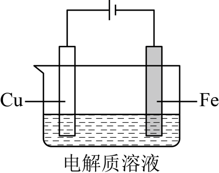

# Chemistry - 题目 79

**ID**: 35a0907127bc48e7a9ebe6e0d57c6560
**年级**: Grade 11
**难度**: Medium-Hard
**题型**: Multiple-choice

## 题目
利用下图装置进行铁上电镀铜的实验探究。​​​​​​​‌装置示意图序号电解质溶液实验现象Ⅰ0.1mol/ ${\rm L}{\rm{C}}{\rm{u}}{\rm{S}}{\rm{O}}{{}_{{{4}}}}{\rm ＋}$ 少量 ${\rm{H}}{{}_{{{2}}}}{\rm{S}}{\rm{O}}{{}_{{{4}}}}$阴极表面有无色气体，一段时间后阴极表面有红色固体，气体减少。经检验电解液中有 ${\rm{F}}{\rm{e}}{^{2+}}$ 。Ⅱ0.1mol/ ${\rm L}{\rm{C}}{\rm{u}}{\rm{S}}{\rm{O}}{{}_{{{4}}}}{\rm ＋}$ 过量氨水阴极表面未观察到气体，一段时间后阴极表面有致密红色固体。经检验电解液中无 ${\rm{F}}{\rm{e}}$ 元素。已知：① ${\rm{C}}{\rm{u}}{^{2+}}$ 在氨水中存在如下平衡： ${\rm{C}}{\rm{u}}{^{2+}}+4{\rm{N}}{\rm{H}}{{}_{3}}\xrightleftharpoons []{}\left [{\rm{C}}{\rm{u}}\left ({{\rm{N}}{\rm{H}}{{}_{3}}}\right ){{}_{4}}\right ]{^{2+}}$②当 ${\rm{C}}{\rm{u}}{^{2+}}$ 放电的速率缓慢且平稳时，有利于得到致密、细腻的镀层。下列说法不正确的是

## 解答

1. Ⅰ中检测到 ${\rm{F}}{\rm{e}}{^{2+}}$ ，推测可能发生反应：铁和稀硫酸反应生成亚铁离子或铁和生成的铜离子反应生成亚铁离子， ${\rm{F}}{\rm{e}}+2{\rm{H}}{^{+}}={\rm{F}}{\rm{e}}{^{2+}}+{\rm{H}}{{}_{2}}↑$ 、 ${\rm{F}}{\rm{e}}+{\rm{C}}{\rm{u}}{^{2+}}={\rm{F}}{\rm{e}}{^{2+}}+{\rm{C}}{\rm{u}}{\rm ，A}$ 正确；铁和稀硫酸反应生成亚铁离子和氢气，随着反应进行生成的铜离子在阴极放电生成铜，溶液中 ${\rm{c}}\left ({{\rm{H}}{^{{{+}}}}}\right )$ 减少，且 ${\rm{C}}{\rm{u}}$ 覆盖铁电极，阻碍 ${\rm{H}}{^{+}}$ 与铁接触，B正确；当 ${\rm{C}}{\rm{u}}{^{2+}}$ 放电的速率缓慢且平稳时，有利于得到致密、细腻的镀层。Ⅱ中生成 ${\rm{C}}{\rm{u}}{^{2+}}$ 与过量的氨水生成 $\left [{\rm{C}}{\rm{u}}\left ({{\rm{N}}{\rm{H}}{{}_{3}}}\right ){{}_{4}}\right ]{^{2+}}$ ，使得 ${\rm{c}}\left ({{\rm{C}}{\rm{u}}{^{{{2}}{{+}}}}}\right )$ 比Ⅰ中溶液的小， ${\rm{C}}{\rm{u}}$ 缓慢析出，镀层更致密，C正确；反应中阳极铜不断溶解，故Ⅱ中溶液 ${\rm{c}}\left ({{\rm{C}}{\rm{u}}{^{{{2}}{{+}}}}}\right )$ 不会减少，，D错误；

## 知识点

**中文**:
  - 电镀

**English**:
  - Electroplating

---
