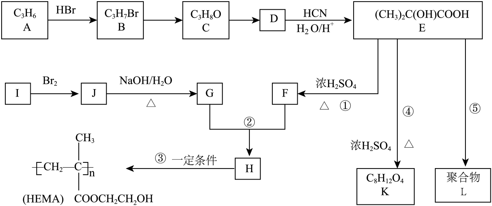
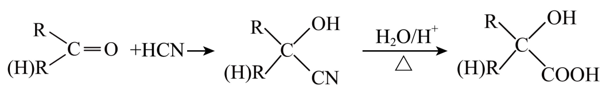
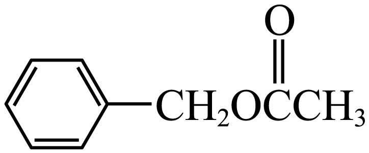

# Chemistry - 题目 237

**ID**: 566c2a1294b643df80bd831f03d7a17f
**年级**: Grade 11
**难度**: Medium-Hard
**题型**: 非选择题

## 题目
用于制造隐形眼镜的功能高分子材料HEMA的合成路线如图所示，其中G可用于生产汽车防冻液，K是六元环状化合物，E在一定条件下可发生缩聚反应生成L。​​​​​​​‌已知：回答下列问题：(1)①的反应类型是，D的官能团名称是。(2)一定条件下B也可以转化为A，反应试剂及条件为。(3)写出下列反应的化学方程式：E→K；J→G。(4)W是F与足量氢气发生加成反应后的产物，则W的一溴取代物同分异构体中符合下列条件的有种(不考虑立体异构)。①能发生银镜反应和水解反应        ②不含环状结构        ③只含有两种官能团(5)请参考以上合成路线中的信息，写出以甲苯和乙酸为原料，设计的合成路线。(用流程图表示，无机试剂任选)

## 解答

1. （1）根据分析可知，反应①是E在浓硫酸、加热条件下发生醇的消去反应生成F的过程，属于消去反应。D的结构简式为(CH_{3})_{2}C＝O，其分子中含有的官能团为羰基。答案为：消去反应；酮羰基(或羰基)；
2. （2）卤代烃可以在NaOH醇溶液、加热条件下发生消去反应生成烯烃，因此一定条件下B也可以转化为A，反应试剂及条件为强碱(如NaOH或KOH)的乙醇溶液、加热；答案为：强碱(如NaOH或KOH)的乙醇溶液、加热；
3. （3）
4. 根据分析，可知E→K为酯化反应，反应方程式为： $2\left ({{\rm{C}}{\rm{H}}{{}_{3}}}\right ){{}_{2}}{\rm{C}}({\rm{O}}{\rm{H}}){\rm{C}}{\rm{O}}{\rm{O}}{\rm{H}}{\mathop {\rightleftharpoons }\limits_{浓{\rm{H}}{{}_{2}}{\rm{S}}{\rm{O}}{{}_{4}}}^{{\rm{Δ}}}}$$+2{\rm{H}}{{}_{2}}{\rm{O}}$ ；J→G为卤代烃水解生成醇的过程，反应方程式为： ${\rm{B}}{\rm{r}}{\rm{C}}{\rm{H}}{{}_{2}}{\rm{C}}{\rm{H}}{{}_{2}}{\rm{B}}{\rm{r}}+2{\rm{N}}{\rm{a}}{\rm{O}}{\rm{H}}\xrightarrow [\mathrm{\Delta }]{\mathrm{{\rm{水}}}}{\rm{H}}{\rm{O}}{\rm{C}}{\rm{H}}{{}_{2}}{\rm{C}}{\rm{H}}{{}_{2}}{\rm{O}}{\rm{H}}+2{\rm{N}}{\rm{a}}{\rm{B}}{\rm{r}}$ 。答案为： $2\left ({{\rm{C}}{\rm{H}}{{}_{3}}}\right ){{}_{2}}{\rm{C}}({\rm{O}}{\rm{H}}){\rm{C}}{\rm{O}}{\rm{O}}{\rm{H}}{\mathop {\rightleftharpoons }\limits_{浓{\rm{H}}{{}_{2}}{\rm{S}}{\rm{O}}{{}_{4}}}^{{\rm{Δ}}}}$$+2{\rm{H}}{{}_{2}}{\rm{O}}$ ； ${\rm{B}}{\rm{r}}{\rm{C}}{\rm{H}}{{}_{2}}{\rm{C}}{\rm{H}}{{}_{2}}{\rm{B}}{\rm{r}}+2{\rm{N}}{\rm{a}}{\rm{O}}{\rm{H}}\xrightarrow [\mathrm{\Delta }]{\mathrm{{\rm{水}}}}{\rm{H}}{\rm{O}}{\rm{C}}{\rm{H}}{{}_{2}}{\rm{C}}{\rm{H}}{{}_{2}}{\rm{O}}{\rm{H}}+2{\rm{N}}{\rm{a}}{\rm{B}}{\rm{r}}$ ；
5. （4）
6. F是，F与H_{2}发生加成反应生成W，则W的结构简式是CH_{3}CH(CH_{3})COOH，其一溴取代物同分异构体符合条件：①能发生银镜反应和水解反应，说明分子中含有溴原子和甲酸酯基或溴原子和醛基、羟基或醚键；②不含环状结构；③只含有两种官能团，说明含有溴原子和HCOO-，符合条件的结构相当于丙烷中的2个氢原子被-Br、HCOO-取代；如果-Br、HCOO-位于同一个碳原子上，有2种位置异构；如果-Br、HCOO-位于两个碳原子上，有3种位置异构，所以符合条件的同分异构体有2+3=5种。答案为：5；
7. （5）
8. 分析目标产物的结构简式，可逆推出其由CH_{3}COOH和发生酯化反应得到，结合原料甲苯和乙酸的结构简式和性质，可通过甲苯在光照条件下与Cl_{2}发生苯环侧链上的取代反应生成，在NaOH水溶液、加热条件下发生卤代烃的水解，生成，故合成路线为：$\xrightarrow [\mathrm{光照}]{\mathrm{{\rm{C}}{\rm{l}}{{}_{{{2}}}}}}$$\xrightarrow [\mathrm{{\rm{Δ}}}]{\mathrm{{\rm{N}}{\rm{a}}{\rm{O}}{\rm{H}}{\rm{/}}{\rm{H}}{{}_{{{2}}}}{\rm{O}}}}$$\xrightarrow [\mathrm{浓硫酸，{\rm{Δ}}}]{\mathrm{{\rm{C}}{\rm{H}}{{}_{{{3}}}}{\rm{C}}{\rm{O}}{\rm{O}}{\rm{H}}}}$；答案为：$\xrightarrow [\mathrm{光照}]{\mathrm{{\rm{C}}{\rm{l}}{{}_{{{2}}}}}}$$\xrightarrow [\mathrm{{\rm{Δ}}}]{\mathrm{{\rm{N}}{\rm{a}}{\rm{O}}{\rm{H}}{\rm{/}}{\rm{H}}{{}_{{{2}}}}{\rm{O}}}}$$\xrightarrow [\mathrm{浓硫酸，{\rm{Δ}}}]{\mathrm{{\rm{C}}{\rm{H}}{{}_{{{3}}}}{\rm{C}}{\rm{O}}{\rm{O}}{\rm{H}}}}$。

## 知识点

**中文**:
  - 卤代烃的消去反应
  - 常见官能团名称、组成及结构
  - 同分异构体的书写和数目判断

**English**:
  - Elimination Reaction
  - Names, Composition and Structure of Functional Groups
  - Writing and Counting Isomers

---
