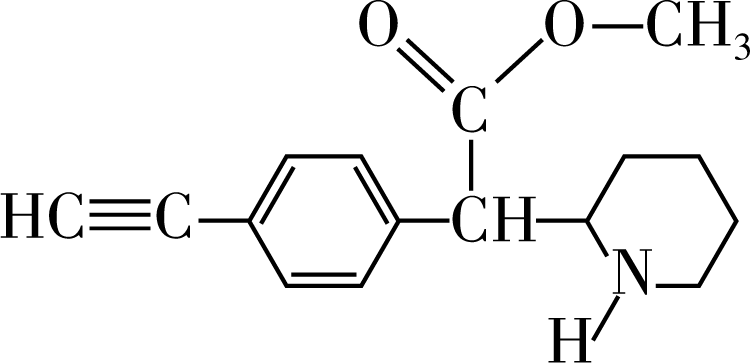

# Chemistry - 题目 346

**ID**: 641edf2efcdd4db9972b75cefe016bbb
**年级**: Grade 11
**难度**: Medium-Hard
**题型**: Multiple-choice

## 题目
关于化合物,下列说法正确的是（      ）​​​​​​​‌

## 解答

1. 该分子中一定共线的碳原子有5个,故其中至少有5个碳原子共直线,A错误; 该分子中有如图所示的2个手性碳原子:(用*标记),B错误;该有机物中含有酯基,与碱反应生成羧酸盐,含有亚氨基,与盐酸反应可生成盐,C正确;该有机物含有碳碳三键,能使酸性高锰酸钾溶液褪色,D错误。

## 知识点

**中文**:
  - 有机物中碳原子的成键特点
  - 炔烃的结构与性质
  - 酯的化学性质

**English**:
  - Bonding Characteristics of Carbon
  - Structure and Properties of Alkynes
  - Chemical Properties of Esters

---
