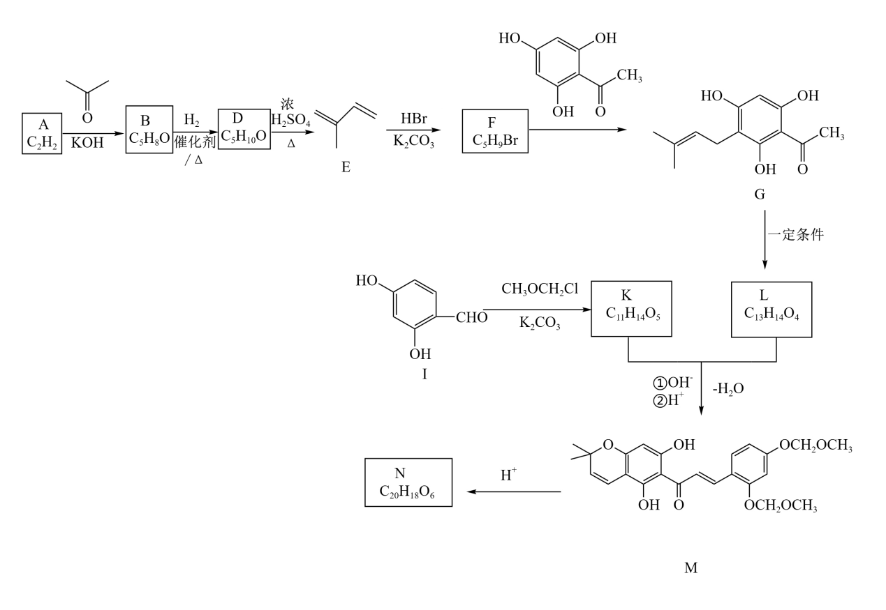
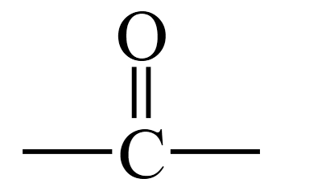
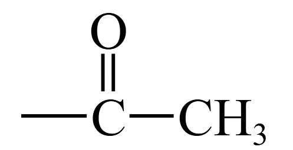
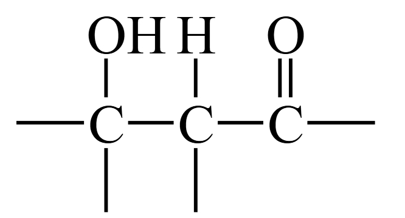
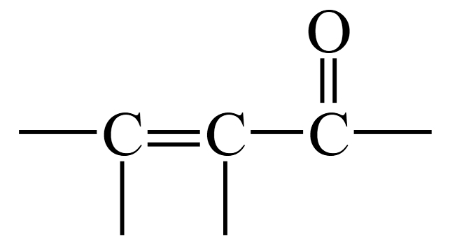

# Chemistry - 题目 219

**ID**: 69e486f3658f4caa9ececae8967e60b4
**年级**: Grade 11
**难度**: Medium-Hard
**题型**: 非选择题

## 题目
黄烷酮类有机物在制药工业中有潜在的应用价值，一种制备黄烷酮类有机物的中间体N的合成路线如下(部分试剂和反应条件略去)。​​​​​​​‌已知：+$\xrightarrow []{\mathrm{{\rm{O}}{\rm{H}}{^{-}}}}$$\xrightarrow [\mathrm{{\rm{Δ}}}]{\mathrm{{\rm{H}}{^{+}}}}$+H_{2}O(1)实验室制取A反应的化学方程式是。(2)B→D的反应类型是。(3)设计实验检验Ⅰ中的酚羟基，实验方案是。(4)D→E的化学方程式是。(5)K的结构简式是。(6)L分子比G分子少2个氢原子，L的结构简式是。(7)I→K的作用是。(8)有机物N在一定条件下可生成黄烷酮类有机物T和W。T、W和N互为同分异构体，T和W分子中各有4个六元环。T、W和N与Na充分反应产生的 ${\rm{H}}{{}_{2}}$ 的物质的量之比为 $3:3:4$ ，写出T和W的结构简式：、。

## 解答

1. （1）A为乙炔，实验室利用电石与水反应制取乙炔，化学方程式是 ${\rm{C}}{\rm{a}}{\rm{C}}{{}_{2}}+2{\rm{H}}{{}_{2}}{\rm{O}}\to {\rm{H}}{\rm{C}}={\rm{C}}{\rm{H}}\uparrow +{\rm{C}}{\rm{a}}\left ({{\rm{O}}{\rm{H}}}\right ){{}_{2}}$ ；
2. （2）分子式为 ${\rm{C}}{{}_{{{5}}}}{\rm{H}}{{}_{{{8}}}}{\rm{O}}$ 的B与 ${\rm{H}}{{}_{{{2}}}}$ 发生加成反应生成分子式为 ${\rm{C}}{{}_{{{5}}}}{\rm{H}}{{}_{10}}{\rm{O}}$ 的D，故B→D的反应类型是加成反应或还原反应；
3. （3）
4. I为，结构中含有酚羟基，能与 ${\rm{F}}{\rm{e}}{\rm{C}}{\rm{l}}{{}_{3}}$ 溶液反应使溶液显紫色，故检验I中含有酚羟基的方法为：取少量Ⅰ的溶液于试管中，滴入几滴 ${\rm{F}}{\rm{e}}{\rm{C}}{\rm{l}}{{}_{3}}$ 溶液，溶液显紫色，说明Ⅰ的分子中有酚羟基；
5. （4）
6. D为在浓硫酸、加热条件下发生消去反应生成E→，反应化学方程式为$\xrightarrow [\mathrm{Δ}]{\mathrm{浓硫酸}}$${{+}}{\rm{H}}{{}_{{{2}}}}{\rm{O}}$ 或$\xrightarrow [\mathrm{Δ}]{\mathrm{浓硫酸}}$${{+}}{\rm{H}}{{}_{{{2}}}}{\rm{O}}$ ；
7. （5）
8. 由上述分析可知K的结构简式为；
9. （6）
10. 由上述分析可知L的结构简式是；
11. （7）
12. I为与 ${\rm{C}}{\rm{H}}{{}_{{{3}}}}{\rm{O}}{\rm{C}}{\rm{H}}{{}_{{{2}}}}{\rm{C}}{\rm{l}}$ 反应的K为，K与L反应生成M，最终生成N为，可看出I转化成K时酚羟基转化为醚，最终在N中又转化为酚羟基，则I→K的作用是保护酚羟基，防止酚羟基在反应中被氧化；
13. （8）
14. N的分子式 ${\rm{C}}{{}_{20}}{\rm{H}}{{}_{18}}{\rm{O}}{{}_{{{6}}}}$ ，不饱和度为12，N的结构简式为，结构中含有4个羟基，转化为互为同分异构体的黄烷酮类有机物T和W时，形成了4个六元环，且酮羰基未发生反应，由T、W和N与Na充分反应产生的 ${\rm{H}}{{}_{2}}$ 的物质的量之比为 $3:3:4$ ，可知T和W结构中含有3个羟基，则说明有1个羟基与碳碳双键发生了加成反应，由此可知T、M的结构可能为、。

## 知识点

**中文**:
  - 乙炔的制备
  - 醇的消去反应
  - 官能团的保护
  - 有机合成与推断综合
  - 常见有机物（官能团）的检验

**English**:
  - Preparation of Acetylene
  - Elimination Reactions
  - Protection of Functional Groups
  - Synthesis and Deduction
  - Testing for Common Functional Groups

---
