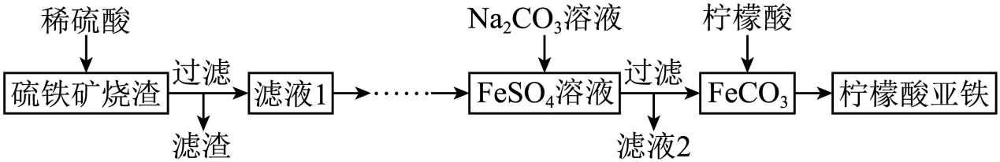
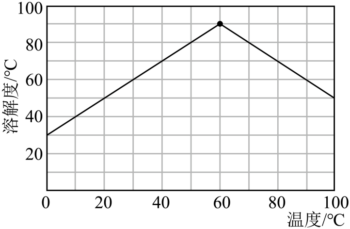

# Chemistry - 题目 319

**ID**: 6bf770f945824cedab1ae69f340a1343
**年级**: Grade 11
**难度**: Medium-Hard
**题型**: 非选择题

## 题目
柠檬酸亚铁是一种易吸收的高效铁制剂，研究性学习小组从硫铁矿烧渣(主要成分为 ${\rm{F}}{\rm{e}}{{}_{2}}{\rm{O}}{{}_{3}}、{\rm{A}}{\rm{l}}{{}_{2}}{\rm{O}}{{}_{3}}、{\rm{S}}{\rm{i}}{\rm{O}}{{}_{2}}$ )出发，设计了如下流程，制得硫酸亚铁溶液，最终获得柠檬酸亚铁。​​​​​​​‌下表列出了有关金属离子生成氢氧化物沉淀的pH(开始沉淀的pH按金属离子浓度为 $1{\rm{m}}{\rm{o}}{\rm{l}}\cdot {\rm{L}}{^{-1}}$ 计算)。金属离子开始沉淀的pH完全沉淀的pH${\rm{F}}{\rm{e}}{^{3+}}$1.13.2${\rm{A}}{\rm{l}}{^{3+}}$3.05.0${\rm{F}}{\rm{e}}{^{2+}}$5.88.8（1）由硫铁矿烧渣制备柠檬酸亚铁溶液的过程中过量硫酸的作用是：①提高铁元素的浸取率；②。（2）在生产中，常用 ${\rm{F}}{\rm{e}}{\rm{S}}{\rm{O}}{{}_{4}}$ 处理 ${\rm{p}}{\rm{H}}=3$ 的含 ${\rm{C}}{\rm{r}}{{}_{2}}{\rm{O}}{{}_{7}^{2-}}$ 废水得到 ${\rm{C}}{\rm{r}}{^{3+}}$ 和 ${\rm{F}}{\rm{e}}{^{3+}}$ 。写出离子反应方程式：。（3）在制备小组成员在制备碳酸亚铁的实验操作过程中将 ${\rm{F}}{\rm{e}}{\rm{S}}{\rm{O}}{{}_{4}}$ 溶液滴入碳酸钠溶液中，观察到白色沉淀变成灰绿色最终变成红褐色。试分析该白色沉淀的主要成分为，产生该沉淀的原因。（4）过程中会有少量 ${\rm{F}}{\rm{e}}{\rm{C}}{\rm{O}}{{}_{3}}$ ，在空气中被氧化为FeOOH，该反应的化学方程式为。（5）设计实验方案：绿矾 $\left ({{\rm{F}}{\rm{e}}{\rm{S}}{\rm{O}}{{}_{4}}\cdot 7{\rm{H}}{{}_{2}}{\rm{O}}}\right )$ 是补血剂的原料，请结合如图所示的绿矾溶解度曲线从滤液1中制备纯净的 ${\rm{F}}{\rm{e}}{\rm{S}}{\rm{O}}{{}_{4}}\cdot 7{\rm{H}}{{}_{2}}{\rm{O}}$ ，补充完整制备 ${\rm{F}}{\rm{e}}{\rm{S}}{\rm{O}}{{}_{4}}\cdot 7{\rm{H}}{{}_{2}}{\rm{O}}$ 晶体的实验步骤：，得到 ${\rm{F}}{\rm{e}}{\rm{S}}{\rm{O}}{{}_{4}}$ 溶液，，过滤，少量冰水洗涤，低温干燥，得到 ${\rm{F}}{\rm{e}}{\rm{S}}{\rm{O}}{{}_{4}}\cdot 7{\rm{H}}{{}_{2}}{\rm{O}}$ 晶体。(实验中必须使用的试剂：铁粉、 $1{\rm{m}}{\rm{o}}{\rm{l}}\cdot {\rm{L}}{^{-1}}{\rm{N}}{\rm{a}}{\rm{O}}{\rm{H}}$ 溶液，稀硫酸，pH计)

## 解答

1. （1）Fe^{3＋}易发生水解， ${\rm Fe^{3＋}+3H_{2}O}\rightleftharpoons {\rm Fe(OH)_{3}+3H^{+}}$ ，加过量的硫酸可以使水解平衡逆向移动，抑制Fe^{3＋}水解；
2. （2）根据已知条件，Fe^{2+}与 ${\rm{C}}{\rm{r}}{{}_{2}}{\rm{O}}{{}_{7}^{2-}}$ 反应生成Cr^{3＋}和Fe^{3＋}，离子方程式为 ${\rm 6Fe^{2+}+}{\rm{C}}{\rm{r}}{{}_{2}}{\rm{O}}{{}_{7}^{2-}}{\rm +14H^{+}=2Cr^{3＋}+6Fe^{3＋}+7H_{2}O}$ ；
3. （3）白色沉淀变成灰绿色最终变成红褐色说明该沉淀是Fe(OH)_{2}；由于碳酸钠溶液呈碱性，Fe^{2+}可与溶液中的OH^{-}反应生成Fe(OH)_{2}；
4. （4）根据已知条件，FeCO_{3}在空气中被氧化为FeOOH，Fe的化合价升高，说明氧化剂为O_{2}，根据质量守恒定律，产物除了FeOOH之外还有CO_{2}，反应的化学方程式为4FeCO_{3}+O_{2}+2H_{2}O=4FeOOH+4CO_{2}；
5. （5）根据分析，滤液1中含有Fe^{3+}、Al^{3+}和过量的H^{+}，边搅拌边向滤液1中加入足量的铁粉，将Fe^{3+}还原为Fe^{2+}，将H^{+}转化为H_{2}，充分反应后，滴加1mol/L的NaOH溶液至用pH计测定pH在 ${\rm 5}\sim {\rm 5.8}$ 之间，保证Al^{3+}完全沉淀，Fe^{2+}不沉淀，静置，过滤除去Al(OH)_{3}，得到FeSO_{4}溶液；为防止Fe^{2+}水解，滴加稀硫酸酸化，由图可知60℃时FeSO_{4}的溶解度最大，蒸发浓缩得到60℃饱和溶液，冷却至0℃结晶析出绿矾，再经过滤、洗涤、干燥得到绿矾晶体。

## 知识点

**中文**:
  - 外加酸碱对盐类水解的影响
  - 陌生氧化还原反应方程式的书写
  - 离子方程式的书写及正误判断
  - 物质分离和提纯的综合应用

**English**:
  - Effect of Adding Acid or Base
  - Writing Equations for Unfamiliar Redox Reactions
  - Writing and Verifying Ionic Equations
  - Comprehensive Applications

---
