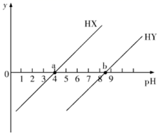

# Chemistry - 题目 132

**ID**: 6eb6b97d37e6456cafd930285257d9d2
**年级**: Grade 11
**难度**: Medium-Hard
**题型**: Multiple-choice

## 题目
已知HX和HY是两种一元弱酸，常温下用NaOH溶液分别滴定这两种弱酸溶液，若pK_{a}=-lgK_{a}，y= $\frac {c{\rm{(}}{\rm{X}}^{{\rm{-}}}{\rm{)}}}{c{\rm{(}}{\rm{H}}{\rm{X}}{\rm{)}}}$ 或lg $\frac {c{\rm{(}}{\rm{Y}}^{{\rm{-}}}{\rm{)}}}{c{\rm{(}}{\rm{H}}{\rm{Y}}{\rm{)}}}$ ，得到y和溶液pH的变化关系如图所示。​​​​​​​‌下列有关叙述错误的是（      ）

## 解答

1. 根据一元弱酸HA的电离平衡常数 $K_{{\rm{a}}}=\frac {{\rm{c}}\left ({{\rm{H}}^{+}}\right )\cdot {\rm{c}}\left ({{\rm{A}}^{-}}\right )}{{\rm{c}}\left ({{\rm{H}}{\rm{A}}}\right )}$ 可得： $-{\rm{l}}{\rm{g}}K_{{\rm{a}}}=-{\rm{l}}{\rm{g}}\frac {c\left ({{\rm{H}}^{+}}\right )\cdot c\left ({{\rm{A}}^{-}}\right )}{c\left ({{\rm{H}}{\rm{A}}}\right )}$ ，则 ${\rm{y}}={\rm{p}}{\rm{H}}-{\rm{p}}K_{{\rm{a}}}$ 。
2. A.a点和b点对应的纵坐标为0，此时 ${\rm{p}}{\rm{H}}-{\rm{p}}{\rm{K}}_{{\rm{a}}}$ ，a点 ${\rm{p}}{\rm{H}}=4$ ，b点 ${\rm{p}}{\rm{H}}=8.5$ ，则酸HX、XY的电离平衡常数分别为 $10^{-4}$ 、 $10^{-8.5}$ ，A正确；
3. B.a点溶液呈酸性，则溶液中 $c\left ({{\rm{H}}^{+}}\right )>c\left ({{\rm{O}}{\rm{H}}^{-}}\right )$ ，根据电荷守恒可知 $c\left ({{\rm{X}}^{-}}\right )>c\left ({{\rm{N}}{\rm{a}}^{+}}\right )$ ，由于a点的纵坐标为0，则a点 $c\left ({{\rm{X}}^{-}}\right )=c\left ({{\rm{H}}{\rm{X}}}\right )$ ，溶液中离子浓度大小为： $c\left ({{\rm{X}}^{-}}\right )=c\left ({{\rm{H}}{\rm{X}}}\right )>c\left ({{\rm{N}}{\rm{a}}^{+}}\right )>c\left ({{\rm{H}}^{+}}\right )>c\left ({{\rm{O}}{\rm{H}}^{-}}\right )$ ，B正确；
4. C.根据 $K_{{\rm{a}}}\left ({{\rm{H}}{\rm{X}}}\right )=10^{-4}$ 、 $K_{{\rm{a}}}\left ({{\rm{H}}{\rm{Y}}}\right )=10^{-8.5}$ 可知，HX的酸性强于HY，酸的酸性越强，对应盐的水解程度越弱，所以 $0.1{\rm{m}}{\rm{o}}{\rm{l}}/{\rm{L}}{\rm{N}}{\rm{a}}{\rm{Y}}$ 溶液的碱性较强，pH较大，C错误；
5. D.根据 ${\rm{y}}={\rm{l}}{\rm{g}}\frac {c\left ({{\rm{Y}}^{-}}\right )}{c\left ({{\rm{H}}{\rm{Y}}}\right )}={\rm{p}}{\rm{H}}-{\rm{p}}K_{{\rm{a}}}\left ({{\rm{H}}{\rm{Y}}}\right )$ 可知： $\frac {c\left ({{\rm{Y}}^{-}}\right )}{c\left ({{\rm{H}}{\rm{Y}}}\right )}=10^{{\rm{p}}{\rm{H}}-{\rm{p}}K_{{\rm{a}}}\left ({{\rm{H}}{\rm{Y}}}\right )}$ ，D正确。
6. 故选C。

## 知识点

**中文**:
  - 测定溶液pH的方法
  - 溶液的酸碱性与pH的关系
  - 酸碱溶液稀释时pH的变化图像
  - 生活中常见物质的酸碱性

**English**:
  - Methods for Measuring pH
  - Relationship between Acidity/Basicity and pH
  - pH Changes during Dilution
  - Acidity/Basicity of Common Substances

---
