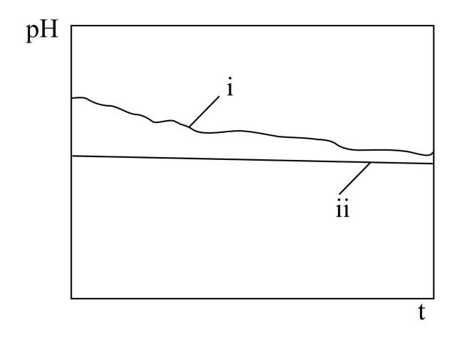

# Chemistry - 题目 355

**ID**: 84ca24f735df41f396ae28a6da91585b
**年级**: Grade 11
**难度**: Medium-Hard
**题型**: 非选择题

## 题目
兴趣小组在实验室探究饱和 ${\rm{N}}{\rm{a}}{{}_{2}}{\rm{C}}{\rm{O}}{{}_{3}}$ 溶液可用于收集乙酸乙酯的原因。​​​​​​​‌Ⅰ．研究乙酸乙酯在碱性溶液中的水解程度。查阅资料：常温下，乙酸乙酯在NaOH溶液， ${\rm{N}}{\rm{a}}{{}_{2}}{\rm{C}}{\rm{O}}{{}_{3}}$ 溶液中水解的平衡常数分别为 $K{{}_{1}}=3.14\times 10{^{9}}$ ， $K{{}_{2}}=7.03\times 10{^{5}}$ ，说明在 ${\rm{N}}{\rm{a}}{{}_{2}}{\rm{C}}{\rm{O}}{{}_{3}}$ 溶液中乙酸乙酯理论上也可以完全水解。(1)乙酸乙酯能在NaOH溶液中水解的化学反应方程式为。Ⅱ．探究影响乙酸乙酯水解速率的因素。(2)兴趣小组探究 ${\rm{O}}{\rm{H}}{^{-}}$ 浓度及温度对乙酸乙酯的水解速率的影响。a．配制 ${\rm 100mL}0.400{\rm{m}}{\rm{o}}{\rm{l}}\cdot {\rm{L}}{^{-1}}{\rm NaOH}$ 溶液。b．取a中的NaOH溶液，按下表配制系列溶液，水浴加热和搅拌条件下，利用pH计测得体系的pH随时间t变化的曲线如图。序号$V{\rm (NaOH)}$ /mL$V$ ( ${\rm{H}}{{}_{2}}{\rm{O}}$ )/mL$V$ (乙酸乙酯)/mL温度/℃ⅰ35.05.010.025ⅱ10.0$x$10.025ⅲ10.030.0$y$60①则 $x=$， $y=$。②根据实验数据，至少可获得三点实验结论。结论1：增大 ${\rm{O}}{\rm{H}}{^{-}}$ 浓度，乙酸乙酯水解速率（填“增大”或“减小”）。结论2：当 $c\left ({{\rm{O}}{\rm{H}}{^{-}}}\right )$ 低于一定数值时，乙酸乙酯水解速率较小。结论3：水解速率与温度有关，水解速率随温度升高而增大。③根据结论3，忽略温度对水电离的影响，在上图中，画出实验ⅲ中pH变化曲线。④已知25℃时饱和 ${\rm{N}}{\rm{a}}{{}_{2}}{\rm{C}}{\rm{O}}{{}_{3}}$ 溶液中 $c\left ({{\rm{O}}{\rm{H}}{^{-}}}\right )$ 约为 $0.03{\rm{m}}{\rm{o}}{\rm{l}}\cdot {\rm{L}}{^{-1}}$ ，依据上述结论，甲同学认为乙酸乙酯在饱和 ${\rm{N}}{\rm{a}}{{}_{2}}{\rm{C}}{\rm{O}}{{}_{3}}$ 溶液中水解速率较小的原因是。(3)兴趣小组继续探究乙酸乙酯在水中的溶解度对其水解速率的影响。提出假设：乙酸乙酯在水中溶解度较小，也可能使得水解速率较慢。查阅资料：有关物质的极性值（极性值越大，物质极性越大）如表：物质乙醇乙酸乙酯水$0.4{\rm{m}}{\rm{o}}{\rm{l}}\cdot {\rm{L}}{^{-1}}{\rm NaOH}$ 溶液极性值4.34.410.2>10.2验证假设：以（2）中“实验ⅰ”为对照组，取10.0mL乙酸乙酯、35.0mL0.400mol/LNaOH溶液、以及配成50.0mL混合溶液，25℃和搅拌条件下，测定体系pH随时间变化，相同时间与试验ⅰ相比，pH下降幅度，假设成立。结论应用：室温下，向密闭容器中加入10.0mL饱和 ${\rm{N}}{\rm{a}}{{}_{2}}{\rm{C}}{\rm{O}}{{}_{3}}$ 溶液，5.0mL乙酸乙酯，振荡静置。测得油层高度随时间t变化曲线如图， $t{{}_{1}}$ 时间点之后油层高度变化加快的原因是。

## 解答

1. （1）乙酸乙酯能在NaOH溶液中水解的化学反应方程式为 ${\rm{C}}{\rm{H}}{{}_{3}}{\rm{C}}{\rm{O}}{\rm{O}}{\rm{C}}{{}_{2}}{\rm{H}}{{}_{5}}+{\rm{N}}{\rm{a}}{\rm{O}}{\rm{H}}\xrightarrow []{\mathrm{Δ}}{\rm{C}}{\rm{H}}{{}_{3}}{\rm{C}}{\rm{O}}{\rm{O}}{\rm{N}}{\rm{a}}+{\rm{C}}{{}_{2}}{\rm{H}}{{}_{5}}{\rm{O}}{\rm{H}}$
2. （2）①根据实验的控制变量法，实验ⅰ、ⅱ、ⅲ总体积应该均为50mL， 所以x=30.0，y=10.0；
3. ②又根据实验ⅱ、ⅲ可知，总体积相同， ${\rm{c}}{\rm{(}}{\rm{O}}{\rm{H}}{^{{{-}}}}{\rm{)}}$ 越大，相同时间内pH变化越大，消耗的氢氧根离子越多，乙酸乙酯水解速率增大；
4. ③根据实验ⅱ、ⅲ可知，总体积相同， ${\rm{c}}{\rm{(}}{\rm{O}}{\rm{H}}{^{{{-}}}}{\rm{)}}$ 相同，实验ⅲ的温度高于实验ⅱ，相同时间内，温度越高，乙酸乙酯水解速率越大，消耗的氢氧根离子越多，pH变化越大，所以实验ⅲ的图像斜率大于图像ⅱ，故图像为：；
5. ④结合本小题题干探究 ${\rm{O}}{\rm{H}}{^{{{-}}}}$ 浓度及温度对乙酸乙酯的水解速率的影响与表格信息，且饱和 ${\rm{N}}{\rm{a}}{{}_{{{2}}}}{\rm{C}}{\rm{O}}{{}_{{{3}}}}$ 溶液中 ${\rm{c}}{\rm{(}}{\rm{O}}{\rm{H}}{^{{{-}}}}{\rm{)}}$ 约为0.03mol⋅L^{−1}，所以乙酸乙酯在饱和 ${\rm{N}}{\rm{a}}{{}_{{{2}}}}{\rm{C}}{\rm{O}}{{}_{{{3}}}}$ 溶液中水解速率较小的原因是25℃饱和碳酸钠溶液中 ${\rm{c}}\left ({{\rm{O}}{\rm{H}}{^{{{-}}}}}\right )$ 过小；
6. （3）乙同学认为，乙酸乙酯在水中溶解度较小，使得水解速率较慢，又结合题干信息的极性值及相似相溶，把5.0mL水换成5.0mL乙醇，增大乙酸乙酯的溶解度，与实验i形成对照，验证乙同学的方案成立；乙酸乙酯的水解会生成乙醇，增加乙酸乙酯在饱和碳酸钠溶液中溶解度，水解速率加快。

## 知识点

**中文**:
  - 酯的化学性质

**English**:
  - Chemical Properties of Esters

---
