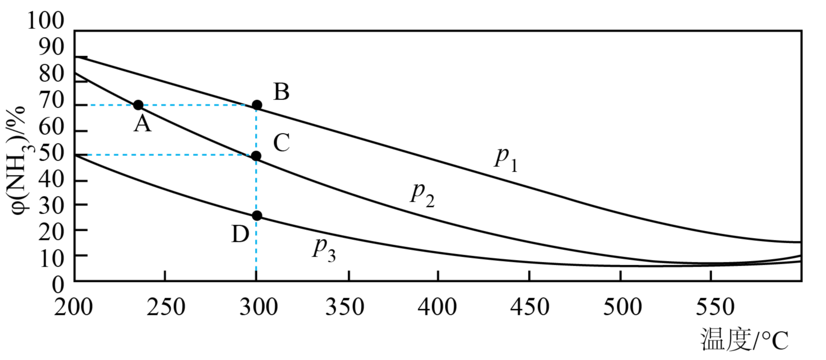

# Chemistry - 题目 91

**ID**: 8d6df90377ca4e85b27e3da56478d3d5
**年级**: Grade 11
**难度**: Medium-Hard
**题型**: Multiple-choice

## 题目
合成氨反应N_{2}+3H_{2}=2NH_{3}，初始时氮气、氢气的体积比为1：3，在相同催化剂条件下平衡混合物中氨的体积分数φ(NH_{3})与温度、压强的关系如图所示；​​​​​​​‌下列说法正确的是

## 解答

1. A．该反应是气体体积减小的反应，相同温度下，增大压强，平衡正向移动，平衡后混合物中氨的物质的量分数(φ)增大，则p_{1}＞p_{2}＞p_{3}，A错误；
2. B．化学平衡常数只与温度有关，该反应为放热反应，升高温度，平衡逆向移动，K值减小，则A、B、C、D的平衡常数大小关系A＞B=C=D，B错误；
3. C．温度：B＞A，压强：p_{B}＞p_{A}，则反应速率 $υ$_{逆}(状态A)＜ $υ$_{逆}(状态B)，C错误；
4. D．在C点时，氨的体积分数为50%，设初始冲入氮气、氢气的物质的量分别为1mol、3mol，反应的氮气为xmol， ${\rm\hspace{-0.5em}\begin{array}{l}\rm\hspace{-0.5em}\begin{array}{}&{\rm{N}}{{}_{{\rm{2}}}}（{\rm{g}}）&{\rm{+}}{\rm{3}}{\rm{H}}{{}_{{\rm{2}}}}（{\rm{g}}）&\rightleftharpoons \\起始量{\rm{(}}{\rm{m}}{\rm{o}}{\rm{l}}{\rm{)}}&{\rm{1}}&{\rm{3}}&\\转化量{\rm{(}}{\rm{m}}{\rm{o}}{\rm{l}}{\rm{)}}&{\rm{x}}&{\rm{3}}{\rm{x}}&\\平衡量{\rm{(}}{\rm{m}}{\rm{o}}{\rm{l}}{\rm{)}}&{\rm{1}}{\rm{-}}{\rm{x}}&{\rm{3}}{\rm{-}}{\rm{3}}{\rm{x}}&\end{array}\hspace{-0.5em}\begin{array}{}{\rm{2}}{\rm{N}}{\rm{H}}{{}_{{\rm{3}}}}（{\rm{g}}）\\{\rm{0}}\\{\rm{2}}{\rm{x}}\\{\rm{2}}{\rm{x}}\end{array}\hspace{-0.5em}\end{array}\hspace{-0.5em}}$ ，则有 $\frac {2x}{1-x+3-3x+2x}$ =50%，则x= $\frac {2}{3}$ mol，N_{2}的转化率为 $\frac {⅔{\rm mol}}{1{\rm mol}}$ ×100%≈67%，D正确；
5. 故答案为：D。

## 知识点

**中文**:
  - 压强对化学平衡的影响
  - 温度对化学平衡的影响

**English**:
  - Effect of Pressure
  - Effect of Temperature

---
