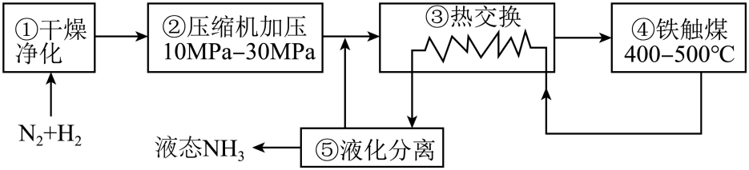
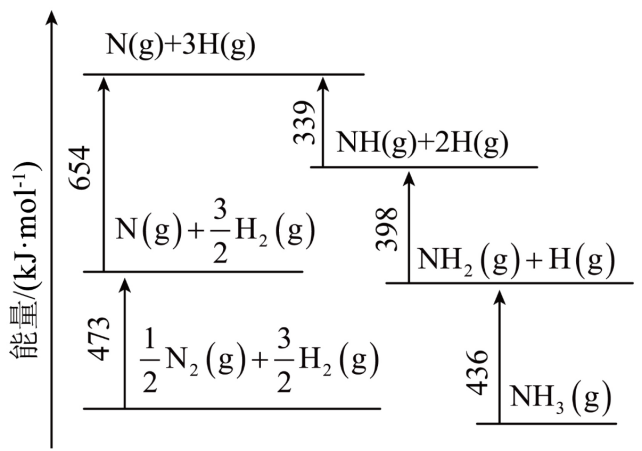

# Chemistry - 题目 263

**ID**: 8f8978077b454db18335bbeccc12348e
**年级**: Grade 11
**难度**: Medium-Hard
**题型**: 非选择题

## 题目
Haber法是工业上常使用的合成氨技术，该反应的原理为 ${\rm{N}}{{}_{2}}+3{\rm{H}}{{}_{2}}\rightleftharpoons 2{\rm{N}}{\rm{H}}{{}_{3}}$ ，对该技术的改进一直是科学家探索的重要课题。​​​​​​​‌下图为工业合成氨的流程图：回答下列问题：(1)流程图中采取的措施可提高原料平衡转化率的是(填序号)。(2)根据下图数据信息，合成氨反应热化学方程式为：。(3)对于工业合成氨的说法正确的是。

## 解答

1. （1）该反应为气体分子数减少的反应，所以增加压强使平衡正向移动可以提高平衡转化率；该反应为化合反应，正反应放热，升高温度反应逆向移动，不能提高平衡转化率；液化分离产物氨气，使平衡正向移动，可以提高平衡转化率，所以措施②⑤可以提高平衡转化率。
2. （2）反应热为反应物键能减去生成物键能，由图得焓变为 ${\rm{Δ}}H=\left ({654+473-436-398-339}\right )\,{\rm{k}}{\rm{J}}{\rm{·}}{\rm{m}}{\rm{o}}{\rm{l}}{^{{{-}}{{1}}}}=-46\,{\rm{k}}{\rm{J}}{\rm{·}}{\rm{m}}{\rm{o}}{\rm{l}}{^{-1}}$ ，热化学反应式为 $\frac {1}{2}{\rm{N}}{{}_{2}}({\rm{g}})+\frac {3}{2}{\rm{H}}{{}_{2}}({\rm{g}})\rightleftharpoons {\rm{N}}{\rm{H}}{{}_{{{3}}}}({\rm{g}})ΔH=-46{\rm{k}}{\rm{J}}{\rm{·}}{\rm{m}}{\rm{o}}{\rm{l}}{^{-1}}$ 。
3. （3）用勒夏特列原理，该反应放热，500℃高温下反应逆向移动，不利于氨的合成，A错误；催化剂不改变反应焓变，会通过降低反应活化能而加快反应速率，B错误；及时分离氨气，可以使平衡正向移动，提高转化率，但不能加快反应速率，C错误；催化剂中毒会降低反应性能，所以必须净化原料气，D正确；
4. （4）升温使反应逆向移动，氨气的体积分数减少，所以温度大小关系为T_{1}<T_{2}<T_{3}。
5. （5）由图中得：氢气、氮气在“热”Fe表面断键，有利于提高合成氨反应速率；氨气在低温区生成，有利于提高氨的平衡产率。
6. （6）同温下，设N_{2}物质的量不变，增大初始投入H_{2}的物质的量，平衡正向移动，但由于增大了初始H_{2}的量，平衡移动只能减弱影响，不能消除影响，所以H_{2}平衡转化率降低，则a点转化率小于b点；不妨设b点初始投入 H_{2}与N_{2}均为1 mol，设平衡时NH_{3}的物质的量为x mol，根据N_{2}+3H_{2}=2NH_{3}，则消耗H_{2}物质的量为1.5x mol，消耗N_{2}物质的量为0.5x mol，平衡时总气体物质的量为(1-0.5x+1-1.5x+x)=(2-x) mol，根据NH_{3}体积分数为5%，则有 $\frac {{\rm{x}}}{2-{\rm{x}}}\times 100\%=5\%$ ，解得 ${\rm x=}\frac {2}{21}$  mol，所以平衡时H_{2}物质的量分数为 $\frac {1-1.5{\rm{x}}}{2-{\rm{x}}}=\frac {9}{20}{\rm ，N_{2}}$ 物质的量分数为 $\frac {1-0.5{\rm{x}}}{2-{\rm{x}}}=\frac {1}{2}$ ，总物质的量为(2-x)  ${\rm mol=}\frac {40}{21}{\rm{m}}{\rm{o}}{\rm{l}}$ 平衡常数为 $K{{}_{{\rm{p}}}}=\frac {(\frac {{\rm{p}}}{20}){^{2}}}{(\frac {9{\rm{p}}}{20}){^{3}}(\frac {{\rm{p}}}{2})}$ ，根据PV=nRT，恒容条件下，平衡时总压强p为 $21{\rm{M}}{\rm{P}}{\rm{a}}\times \frac {\frac {40}{21}{\rm{m}}{\rm{o}}{\rm{l}}}{2{\rm{m}}{\rm{o}}{\rm{l}}}=20{\rm{M}}{\rm{P}}{\rm{a}}$ ，代入到平衡常数表达式中得 $K=\frac {1}{1280}{\rm{M}}{\rm{P}}{\rm{a}}{^{-2}}$ 。

## 知识点

**中文**:
  - 勒夏特列原理及应用
  - 热化学方程式的书写

**English**:
  - Le Chatelier's Principle and Applications
  - Writing Thermochemical Equations

---
