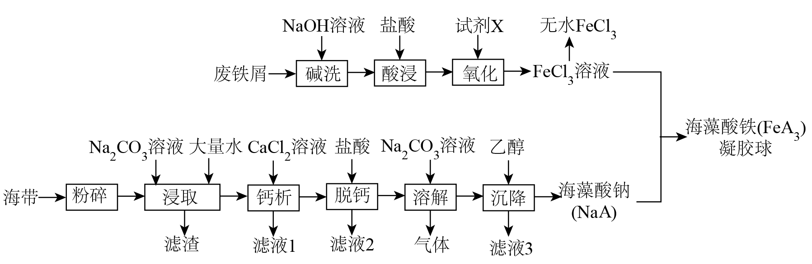
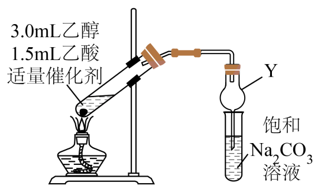

# Chemistry - 题目 278

**ID**: 9510e20893604b809567706854cf3423
**年级**: Grade 11
**难度**: Medium-Hard
**题型**: 非选择题

## 题目
利用沾有油污的废铁屑和含有难溶于水的海藻酸盐( ${\rm{M}}{\rm{g}}{\rm{A}}{{}_{2}}、{\rm{C}}{\rm{a}}{\rm{A}}{{}_{2}}$ )的海带为原料，协同制备具有吸水性的催化剂海藻酸铁( ${\rm{F}}{\rm{e}}{\rm{A}}{{}_{3}}$ )凝胶球的流程如下，回答下列问题：(1)“碱洗”的目的为。​​​​​​​‌(2)“氧化”中可选择的试剂X为(填标号，选一种即可)，该反应的离子方程式。结合工业实际说明选择的理由：。${\rm a．}{\rm{H}}{{}_{2}}{\rm{O}}{{}_{2}}$          ${\rm b．}{\rm{C}}{\rm{l}}{{}_{2}}$          ${\rm c．}{\rm{H}}{\rm{N}}{\rm{O}}{{}_{3}}$(3)若略去“钙析→脱钙→溶解”步骤，NaA纯度(填“偏大”“偏小”或“不变”)。(4) ${\rm{F}}{\rm{e}}{\rm{C}}{\rm{l}}{{}_{3}}$ 溶液与NaA反应的化学方程式为。(5)为循环利用“滤液3”中的乙醇，应采用的操作名称为。(6)用上述流程制得的无水 ${\rm{F}}{\rm{e}}{\rm{C}}{\rm{l}}{{}_{3}}$ 和海藻酸铁( ${\rm{F}}{\rm{e}}{\rm{A}}{{}_{3}}$ )凝胶球为催化剂分别制备乙酸乙酯并探究催化效果，实验装置如图。①仪器Y的名称为，其作用有。②其他条件均相同时，测得实验数据如下表。实验编号催化剂乙醇/mL乙酸/mL乙酸乙酯/g产率/%1${\rm{F}}{\rm{e}}{\rm{A}}{{}_{3}}$3.01.51.7676.92${\rm{F}}{\rm{e}}{\rm{C}}{\rm{l}}{{}_{3}}$3.01.51.6170.6${\rm{F}}{\rm{e}}{\rm{A}}{{}_{3}}$ 作催化剂产率更高的原因为。

## 解答

1. （1）废铁屑表面有油污会阻碍反应的发生，由于油脂能够与碱性溶液发生反应变为可溶性物质，因此对废铁屑进行“碱洗”的目的为去除铁屑表面的油污；
2. （2）Fe与HCl反应产生FeCl_{2}和H_{2}，要制取得到FeCl_{3}，就要加入氧化剂氧化FeCl_{2}变为FeCl_{3}。
3. a．H_{2}O_{2}具有氧化性，可以氧化FeCl_{2}，该反应的离子方程式为：H_{2}O_{2}+2H^{+}+2Fe^{2+}=2Fe^{3+}+2H_{2}O，氧化剂被还原产物是H_{2}O，无污染，绿色环保，能够达到实验目的，a符合题意；
4. b．Cl_{2}具有氧化性，可以将Fe^{2+}氧化为Fe^{3+}，该反应的离子方程式为：2Fe^{2+}+Cl_{2}=2Fe^{3+}+2Cl^{-}，氧化产物与还原产物都是FeCl_{3}，无其它产物生成，也可以达到实验目的，b符合题意；
5. c．HNO_{3}具有强氧化性，可以氧化Fe^{2+}变为Fe^{3+}，但会引入杂质离子，HNO_{3}的还原产物是NO或NO_{2}都是有毒气体，会造成大气污染，c不符合题意；
6. 故合理选项是a或b；
7. 结合工业实际说明选择的理由是：H_{2}O_{2}作氧化剂时，还原产物是H_{2}O无污染；使用Cl_{2}有毒会污染；若用HNO_{3}产物中会引入且产生NO_{x}污染；因此一般是使用H_{2}O_{2}作氧化剂；
8. （3）若略去“钙析→脱钙→溶解”步骤，海藻酸盐中的Ca^{2+}、Mg^{2+}不能很好的被除去，导致NaA纯度偏小，不能很好的提纯NaA；
9. （4）FeCl_{3}与NaA在溶液中发生复分解反应：FeCl_{3}+3NaA=FeA_{3}↓+3NaCl，就得到海藻酸铁FeA_{3}凝胶球；
10. （5）乙醇的沸点较低，加热时易挥发变为气体从液体混合物中逸出，而Na_{2}CO_{3}沸点高，不易挥发，因此从含有Na_{2}CO_{3}水溶液及乙醇的“滤液3”中的分离出乙醇，应采用的操作名称为蒸馏；
11. （6）①乙酸与乙醇在FeA_{3}催化下加热，发生酯化反应乙酸乙酯和水，酯化反应与酯的水解反应是可逆反应，该反应的化学方程式为： ${\rm{C}}{\rm{H}}{{}_{{{3}}}}{\rm{C}}{\rm{O}}{\rm{O}}{\rm{H}}{{+}}{\rm{C}}{\rm{H}}{{}_{{{3}}}}{\rm{C}}{\rm{H}}{{}_{{{2}}}}{\rm{O}}{\rm{H}}\hspace{-0.5em}\begin{array}{}\xrightleftharpoons []{\mathrm{{\rm{F}}{\rm{e}}{\rm{A}}{{}_{3}}}}\\\vartriangle \end{array}\hspace{-0.5em}{\rm{C}}{\rm{H}}{{}_{{{3}}}}{\rm{C}}{\rm{O}}{\rm{O}}{\rm{C}}{\rm{H}}{{}_{{{2}}}}{\rm{C}}{\rm{H}}{{}_{{{3}}}}+{\rm{H}}{{}_{{{2}}}}{\rm{O}}$ ；根据图示可知：仪器Y名称是球形干燥管，其作用是冷凝和防倒吸；
12. ②根据实验数据可知：在其他条件不变时，使用FeA_{3}比使用FeCl_{3}产生的乙酸乙酯更多，乙酸乙酯产率更高，这是由于FeCl_{3}只作催化剂；而FeA_{3}作催化剂时，既作催化剂加快反应速率，同时又由于其具有吸水性，可以同时作吸水剂，减少生成物H_{2}O的浓度，利于酯化反应正向进行。

## 知识点

**中文**:
  - 乙酸乙酯的制备
  - 离子方程式的书写及正误判断
  - 物质分离和提纯的综合应用

**English**:
  - Preparation of Ethyl Acetate
  - Writing and Verifying Ionic Equations
  - Comprehensive Applications

---
