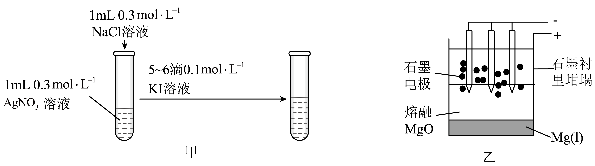
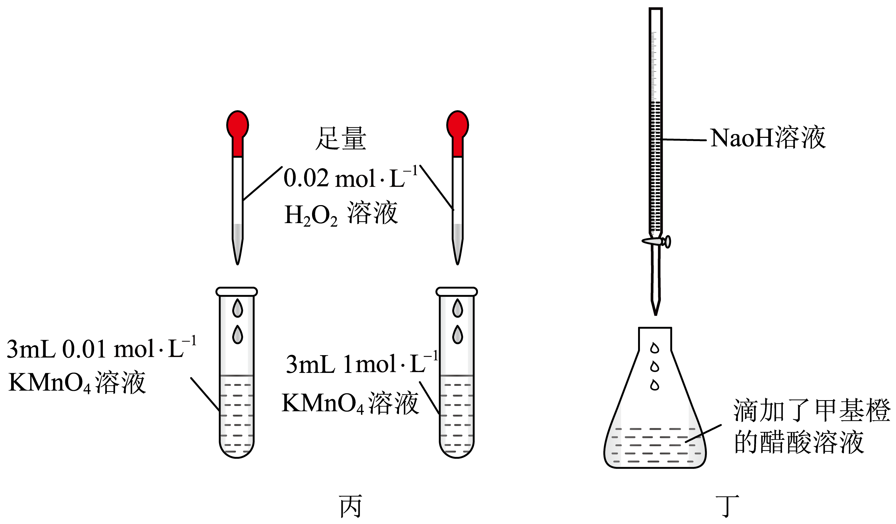

# Chemistry - 题目 347

**ID**: 98dbb58ea6f74d55b9fd9af8f6623615
**年级**: Grade 11
**难度**: Medium-Hard
**题型**: Multiple-choice

## 题目
下列实验操作规范且能达到实验目的的是​​​​​​​‌

## 解答

1. A．由图甲可知，硝酸银和氯化钠溶液恰好完全反应得到氯化银沉淀和硝酸钠溶液，继续滴入几滴碘化钾，则白色沉淀转化为黄色，由于氯化银和碘化银沉淀类型相同，说明氯化银的溶解度大于碘化银，则可得到： ${\rm{K}}_{{\rm{s}}{\rm{p}}}\left ({{\rm{A}}{\rm{g}}{\rm{C}}{\rm{l}}}\right )$ ＞ ${\rm{K}}_{{\rm{s}}{\rm{p}}}\left ({{\rm{A}}{\rm{g}}{\rm{I}}}\right )$ ，A正确；
2. B．氧化镁熔点高达2800°C，因此工业上不电解熔融氧化镁、而是电解熔融MgCl_{2}制备金属Mg，B错误；
3. C． 要证明浓度越大反应时间越短，图丙的对比实验中，紫红色的高锰酸钾溶液的浓度和体积要相同，再分别与足量的等体积的不同浓度的双氧水反应，双氧水浓度越大则褪色时间越短，C错误；
4. D． 醋酸钠溶液呈碱性，则图丁中测定某醋酸溶液的物质的量浓度时应选择酚酞作指示剂，D错误；
5. 答案选A。

## 知识点

**中文**:
  - 沉淀的转化
  - 浓度对于化学反应速率的影响
  - 酸碱中和滴定实验
  - 电解法冶炼金属

**English**:
  - Transformation of Precipitates
  - Effect of Concentration
  - Titration Experiment
  - Electrolysis

---
