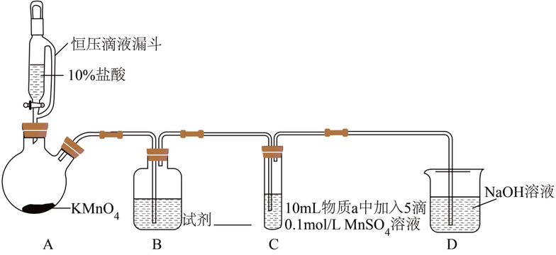

# Chemistry - 题目 4

**ID**: 9a90fa6fe5ab4803b5802fb9b45186a6
**年级**: Grade 11
**难度**: Medium-Hard
**题型**: 非选择题

## 题目
某同学探究不同条件下氯气与二价锰化合物的反应。​​​​​​​‌实验装置如下图(夹持装置略)滴液漏斗资料：i．Mn^{2+}在一定条件下被Cl_{2}或ClO^{-}氧化成MnO_{2}(棕黑色)、 ${\rm{M}}{\rm{n}}{\rm{O}}{{}_{{{4}}}^{{{2}}{{-}}}}$ (绿色)、 ${\rm{M}}{\rm{n}}{\rm{O}}{{}_{{{4}}}^{{{-}}}}$ (紫色)。ⅱ．浓碱条件下， ${\rm{M}}{\rm{n}}{\rm{O}}{{}_{{{4}}}^{{{-}}}}$ 可被OH^{-}还原为 ${\rm{M}}{\rm{n}}{\rm{O}}{{}_{{{4}}}^{{{2}}{{-}}}}$ 。ⅲ．Cl_{2}的氧化性与溶液的酸碱性无关，NaClO的氧化性随碱性增强而减弱。序号物质aC中实验现象通入Cl_{2}前通入Cl_{2}后I水得到无色溶液产生棕黑色沉淀，且放置后不发生变化Ⅱ5%NaOH溶液产生白色沉淀Mn(OH)_{2}，在空气中缓慢棕黑色沉淀棕黑色沉淀增多，放置后溶液变为紫色，仍有沉淀Ⅲ40%NaOH溶液产生白色沉淀Mn(OH)_{2}，在空气中缓慢棕黑色沉淀棕黑色沉淀增多，放置后溶液变为紫色，仍有沉淀(1)B中试剂是，装置D的作用为。(2)滴液漏斗的弯管作用为。(3)通入Cl_{2}前，Ⅱ、Ⅲ中沉淀在空气中缓慢由白色变为棕黑色的化学方程式为。(4)根据资料ⅱ，Ⅲ中应得到绿色溶液，实验中得到的是紫色溶液，分析现象与资料不符的原因：原因一：可能是通入Cl_{2}导致溶液的碱性减弱。原因二：可能是氧化剂过量，氧化剂将 ${\rm{M}}{\rm{n}}{\rm{O}}{{}_{{{4}}}^{{{2}}{{-}}}}$ 氧化为 ${\rm{M}}{\rm{n}}{\rm{O}}{{}_{{{4}}}^{{{-}}}}$ 。①用化学方程式表示可能导致溶液碱性减弱的原因：，但通过实验测定溶液的碱性变化很小。②取Ⅲ中放置后的1mL悬浊液，加入4mL40%NaOH溶液，溶液紫色迅速变为绿色，且绿色缓慢加深。溶液紫色变为绿色的离子方程式为，溶液绿色缓慢加深，原因是MnO_{2}被(填“化学式”)氧化，可证明Ⅲ的悬浊液中氧化剂过量。

## 解答

1. （1）B的作用是除去氯气中的HCl，则B中试剂是饱和NaCl溶液；Cl_{2}有毒，装置D的作用为：吸收尾气Cl_{2}，防止污染环境；
2. （2）弯管连通漏斗和反应器，则滴液漏斗的弯管作用为：平衡气压，使液体顺利滴下；
3. （3）Mn(OH)_{2}被O_{2}氧化为MnO_{2}，所以通入Cl_{2}前，Ⅱ、Ⅲ中沉淀在空气中缓慢由白色变为棕黑色的化学方程式为：2Mn(OH)_{2}+O_{2}=2MnO_{2}+2H_{2}O；
4. （4）①氯气与NaOH溶液发生反应，则用化学方程式表示可能导致溶液碱性减弱的原因：2NaOH+Cl_{2}=NaCl+NaClO+H_{2}O；
5. ②溶液由紫色变为绿色，即 ${\rm{M}}{\rm{n}}{\rm{O}}{{}_{{{4}}}^{{{-}}}}$ 变为 ${\rm{M}}{\rm{n}}{\rm{O}}{{}_{{{4}}}^{{{2}}{{-}}}}$ ，反应的离子方程式为： ${{4}}{\rm{M}}{\rm{n}}{\rm{O}}{{}_{{{4}}}^{{{-}}}}{\rm +4OH^{-}=4}$  ${\rm{M}}{\rm{n}}{\rm{O}}{{}_{{{4}}}^{{{2}}{{-}}}}{\rm +O_{2}↑+2H_{2}O}$ ；溶液绿色缓慢加深，原因是Cl_{2}与NaOH产生的强氧化剂NaClO能将MnO_{2}氧化为 ${\rm{M}}{\rm{n}}{\rm{O}}{{}_{{{4}}}^{{{2}}{{-}}}}$ 。

## 知识点

**中文**:
  - 氯气的氧化性

**English**:
  - Oxidizing Property of Chlorine

---
