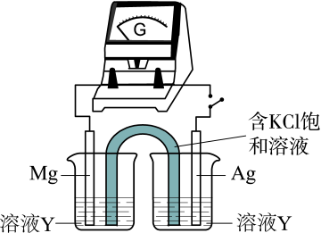

# Chemistry - 题目 175

**ID**: b3869537ee3d4e8eb664e9ee849de397
**年级**: Grade 11
**难度**: Medium-Hard
**题型**: 非选择题

## 题目
某学习小组从海水晒盐后的盐卤(主要含Na^{+}、Mg^{2+}、Cl^{-}、Br^{-})中模拟工业提镁，并探究镁的相关反应。​​​​​​​‌Ⅰ.工业提镁过程如下图所示：(1)过程i发生的主要反应的离子方程式是。(2)过程i得到的沉淀中混有少量Ca(OH)_{2}，除去少量Ca(OH)_{2}的方法是：先将沉淀放到盛有(填化学式)饱和溶液的烧杯中，充分搅拌后，经过滤、(填操作方法)、干燥，得到纯净的Mg(OH)_{2}。(3)工业上通过过程iii制得金属镁，反应的化学方程式为。Ⅱ.探究镁的相关反应实验1：向5mL0.2mol·L^{-1}KCl溶液中加入5mL0.1mol·L^{-1}AgNO_{3}溶液，产生白色沉淀后过滤，取约5mL滤液，放入5cm打磨后的镁条，快速产生大量气泡。小组同学对“快速产生大量气泡”的原因进行探究。查阅资料：①常温下镁能与水缓慢反应。②体积较小的阴离子，能够“钻透”Mg(OH)_{2}膜。③K^{+}对该反应无影响。提出猜想：可能是 ${\rm{N}}{\rm{O}}\hspace{-0.5em}\begin{array}{}{^{{{-}}}}\\{{}_{{{3}}}}\end{array}\hspace{-0.5em}$ 、Cl^{-}促进了镁与水的反应。设计并实施如下实验：实验操作实验现象实验2-1将5cm打磨后的镁条放入5mL水中细微气泡附着实验2-2将5cm打磨后的镁条放入5mL0.05mol·L^{-1}A溶液中细微气泡附着实验2-3将5cm打磨后的镁条放入5mL0.05mol·L^{-1}B溶液中细小气泡冒出实验结论：Cl^{-}促进了镁与水的反应； ${\rm{N}}{\rm{O}}\hspace{-0.5em}\begin{array}{}{^{{{-}}}}\\{{}_{{{3}}}}\end{array}\hspace{-0.5em}$ 对反应无影响。(4)实验2-2、实验2-3中，试剂A、B的化学式分别是、。(5)小组同学对比发现：实验1中镁条与AgCl滤液的反应速率比实验2-3更快。猜想滤液中存在微量Ag^{+}，可能形成了微小Mg-Ag原电池，加快了反应速率。小组同学继续完成如下实验：实验3-1实验3-2装置试剂20mL0.05mol·L^{-1}KCl溶液20mL液体Y①实验3-2中液体Y是。②小组同学观察到产生气泡的速率：3-2>3-1，得出的结论是。③小组同学设计实验3-2时，有同学使用如图所示装置，甲同学认为不合理，甲同学的理由是。

## 解答

1. （1）过程i目的为使Mg^{2+}转化为Mg(OH)_{2}沉淀，故主要反应的离子方程式为 ${\rm{M}}{\rm{g}}{^{{{2}}{{+}}}}{{+}}{\rm{C}}{\rm{a}}{\rm{(}}{\rm{O}}{\rm{H}}{\rm{)}}{{}_{{{2}}}}\hspace{-0.5em}\begin{array}{}{\underline{{\underline{~{\,}{\,}{\,}{\,}{\,}{\,}{\,}~}}}}\atop{}\end{array}\hspace{-0.5em}{\rm{M}}{\rm{g}}{\rm{(}}{\rm{O}}{\rm{H}}{\rm{)}}{{}_{{{2}}}}{{+}}{\rm{C}}{\rm{a}}{^{{{2}}{{+}}}}$ ；
2. 故答案为； ${\rm{M}}{\rm{g}}{^{{{2}}{{+}}}}{{+}}{\rm{C}}{\rm{a}}{\rm{(}}{\rm{O}}{\rm{H}}{\rm{)}}{{}_{{{2}}}}\hspace{-0.5em}\begin{array}{}{\underline{{\underline{~{\,}{\,}{\,}{\,}{\,}{\,}{\,}~}}}}\atop{}\end{array}\hspace{-0.5em}{\rm{M}}{\rm{g}}{\rm{(}}{\rm{O}}{\rm{H}}{\rm{)}}{{}_{{{2}}}}{{+}}{\rm{C}}{\rm{a}}{^{{{2}}{{+}}}}$
3. （2）根据沉淀转化原理，使Ca(OH)_{2}转化为更难溶的Mg(OH)_{2}，故除去Mg(OH)_{2}沉淀中少量Ca(OH)_{2}的方法是：先将沉淀放到盛有MgCl_{2}饱和溶液的烧杯中，使Ca(OH)_{2}转化为更难溶的Mg(OH)_{2}，充分搅拌后，经过滤、洗涤、干燥，得到纯净的Mg(OH)_{2}；
4. 故答案为 ①MgCl_{2}②洗涤；
5. （3）电解熔融氯化镁来冶炼金属镁，化学方程式为 ${\rm{M}}{\rm{g}}{\rm{C}}{\rm{l}}{{}_{{{2}}}}（熔融）\hspace{-0.5em}\begin{array}{}{\underline{{\underline{~{\,}{\,}{\,}电解{\,}{\,}{\,}~}}}}\atop{}\end{array}\hspace{-0.5em}{\rm{M}}{\rm{g}}{{+}}{\rm{C}}{\rm{l}}{{}_{{{2}}}}\uparrow $ ；
6. 故答案为 ${\rm{M}}{\rm{g}}{\rm{C}}{\rm{l}}{{}_{{{2}}}}（熔融）\hspace{-0.5em}\begin{array}{}{\underline{{\underline{~{\,}{\,}{\,}电解{\,}{\,}{\,}{\,}~}}}}\atop{}\end{array}\hspace{-0.5em}{\rm{M}}{\rm{g}}{{+}}{\rm{C}}{\rm{l}}{{}_{{{2}}}}\uparrow $ ；
7. （4）实验1中KCl过量，故滤液中有KCl和KNO_{3}，加入打磨后的镁条快速产生大量气泡，实验证明Cl^{-}促进了镁与水的反应； ${\rm NO}{{}_{3}^{-}}$ 对反应无影响，实验2-2将5cm打磨后的镁条放入5mL0.05mol·L^{-1}A溶液中，有细微气泡附着，A溶液应为KNO_{3}溶液；实验2-3将5cm打磨后的镁条放入5mL0.05mol·L^{-1}B溶液中，B溶液应为KCl溶液；
8. 故答案为①KNO_{3 }②KCl；
9. （5）①实验3-1和实验3-2目的是验证微量Ag^{+}是否会加快Mg和水的反应速率，实验3-2用Ag作电极，溶液中存在微量的银离子，实验需要控制单一变量，故液体Y应为20mL0.05mol·L^{-1}KCl溶液；
10. ②实验3-2产生气泡的速率大于实验3-1，因为实验3-2形成Mg-Ag-KCl原电池，加快镁与水的反应速率；
11. ③形成原电池，Mg为原电池的负极，Ag为正极，盐桥中的Cl^{-}进入左侧烧杯中，导致两烧杯中Cl^{-}浓度不再相等，使得实验3-1、3-2的反应速率不能比较；
12. 故答案为：
13. ①0.05mol/LKCl溶液
14. ②Mg-Ag原电池加快了镁与水的反应速率
15. ③盐桥中离子的迁移能改变单位时间内左侧Cl^{-}的浓度，使得实验3-2、3-1的反应速率不可比。

## 知识点

**中文**:
  - 沉淀的转化
  - 离子方程式的书写及正误判断
  - 电解法冶炼金属

**English**:
  - Transformation of Precipitates
  - Writing and Verifying Ionic Equations
  - Electrolysis

---
