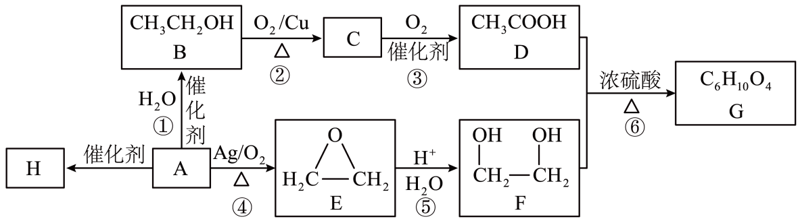
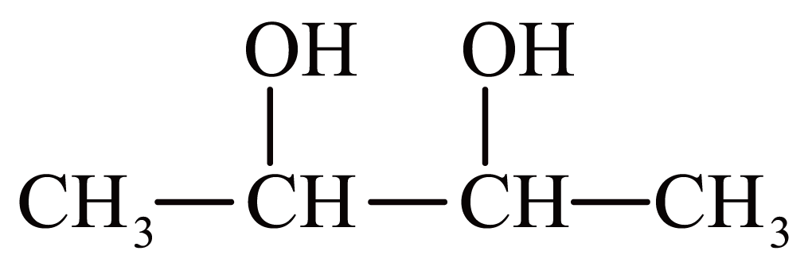

# Chemistry - 题目 24

**ID**: bae96c0c300e4923b9da001786f6ae80
**年级**: Grade 11
**难度**: Medium-Hard
**题型**: 非选择题

## 题目
A的产量可以用来衡量一个国家石油化学工业的发展水平。​​​​​​​‌以A为原料合成香料G和高分子材料H的流程如下：请回答下列问题：(1)A→H的反应类型为，反应⑥的反应类型为。(2)C中官能团名称，常用检验该官能团的一种试剂（填名称）。(3)1molF与足量金属钠反应可产生L气体（标准状况）。(4)已知同一个碳原子上不能连接两个羟基，则的同分异构体中与F互为同系物的有种。(5)写出反应②的化学方程式。(6)有关上述物质的说法错误的是。a.可通过酸性高锰酸钾溶液洗气的方法除去乙烷中含有的A杂质b.B可以与酸性重铬酸钾溶液反应生成Dc.反应②中B断裂了 ${\rm{C}}-{\rm{H}}$ 键和 ${\rm{O}}-{\rm{H}}$ 键d.C和E互为同分异构体e.H可以使溴水褪色

## 解答

1. （1）根据分析可知，A发生加聚反应生成H为聚乙烯；D含有羧基，F含有羟基，G分子中含有6个碳原子，反应条件为浓硫酸加热，则一分子F与两分子D发生酯化反应生成G，酯化反应属于取代反应；
2. （2）B发生催化氧化生成C为乙醛，官能团名称为醛基，常用检验该官能团的一种试剂为银氨溶液或新制氢氧化铜；
3. （3）1molF含有2mol羟基，与足量金属钠反应可产生1mol氢气，体积为22.4L气体(标准状况)；
4. （4）
5. 的同分异构体中与F互为同系物的物质应为二元醇，可以采用定一移二的思路书写，但是两个羟基不能连接在同一个碳原子上，、、，去除自身共5种；
6. （5）反应②为乙醇发生催化氧化生成乙醛，化学方程式： $2{\rm{C}}{\rm{H}}{{}_{3}}{\rm{C}}{\rm{H}}{{}_{2}}{\rm{O}}{\rm{H}}+{\rm{O}}{{}_{2}}\xrightarrow [\mathrm{\Delta }]{\mathrm{{\rm{C}}{\rm{u}}或{\rm{A}}{\rm{g}}}}2{\rm{C}}{\rm{H}}{{}_{3}}{\rm{C}}{\rm{H}}{\rm{O}}+2{\rm{H}}{{}_{2}}{\rm{O}}$ ；
7. （6）a. 乙烯被酸性高锰酸钾溶液氧化为二氧化碳，因此通过酸性高锰酸钾溶液洗气的方法除去乙烷中含有的乙烯时会引入新杂质二氧化碳，a错误；
8. b. 乙醇可以与酸性重铬酸钾溶液反应生成乙酸，b正确；
9. c. 反应②为乙醇发生催化氧化生成乙醛，对比乙醇和乙醛的结构可知， B断裂了 ${\rm{C}}-{\rm{H}}$ 键和 ${\rm{O}}-{\rm{H}}$ 键，c正确；
10. d. C和E的分子式相同，结构不同，互为同分异构体，d正确；
11. e. 聚乙烯不含有碳碳双键，不可以使溴水褪色，e错误；
12. 答案选ae。

## 知识点

**中文**:
  - 乙烯的来源及用途
  - 同分异构体的书写和数目判断
  - 常见有机物（官能团）的检验

**English**:
  - Source and Uses of Ethylene
  - Writing and Counting Isomers
  - Testing for Common Functional Groups

---
