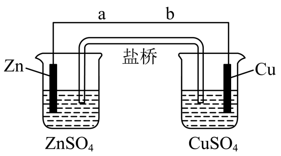

# Chemistry - 题目 21

**ID**: 3c774f526956473ab1cddb700b8d0cc8
**年级**: Grade 11
**难度**: Medium
**题型**: 非选择题

## 题目
某学生利用下面实验装置探究盐桥式原电池的工作原理。​​​​​​​‌按照实验步骤依次回答下列问题：(1)锌电极为电池的极，电极上发生的是反应(“氧化”或“还原”)，电极反应式为。(2)导线中电子流向为(用a、b表示)。(3)若装置中铜电极的质量增加0.64g，则溶解的 ${\rm{Z}}{\rm{n}}$ 的质量为；(4)装置中盐桥中除添加琼脂外，还要添加 ${\rm{K}}{\rm{C}}{\rm{l}}$ 的饱和溶液，电池工作时，对盐桥中的 ${\rm{K}}{^{+}}$ ， ${\rm{C}}{\rm{l}}{^{-}}$ 的移动方向描述正确的是。

## 解答

1. （1）Zn为负极，发生氧化反应，电极反应式： ${\rm{Z}}{\rm{n}}-2{\rm{e}}{^{-}}={\rm{Z}}{\rm{n}}{^{2+}}$ ；
2. （2）原电池中，电子经导线，由负极流向正极；
3. （3）该装置中Cu为正极，发生还原反应，电极反应式： ${\rm{C}}{\rm{u}}{^{2+}}+2{\rm{e}}{^{-}}={\rm{C}}{\rm{u}}$ ，若装置中铜电极的质量增加0.64g，对应物质的量0.01mol，需转移0.02mol电子，根据负极电极反应式： ${\rm{Z}}{\rm{n}}-2{\rm{e}}{^{-}}={\rm{Z}}{\rm{n}}{^{2+}}$ ，需消耗Zn物质的量为0.01mol，对应质量0.65g；
4. （4）原电池中阳离子向正极移动，阴离子向负极移动，右侧为正极，左侧为负极，即 ${\rm{K}}{^{+}}$ 向右移动， ${\rm{C}}{\rm{l}}{^{-}}$ 向左移动，答案选C；
5. （5） ${\rm A．}{\rm{N}}{\rm{a}}{\rm{O}}{\rm{H}}$ 与 ${\rm{C}}{\rm{u}}{^{2+}}$ 和 ${\rm{Z}}{\rm{n}}{^{2+}}$ 均反应，A错误；
6. B．锌可以和铜离子生成铜单质除去铜，生成锌离子，不引入新杂质，B正确；
7. C．铁和铜离子生成铜和亚铁离子，引入新杂质，C错误；
8. D．稀硫酸和铜离子不反应，D错误；
9. 答案选B；
10. （6）Cu为正极，发生还原反应，根据电极反应式： ${\rm{C}}{\rm{u}}{^{2+}}+2{\rm{e}}{^{-}}={\rm{C}}{\rm{u}}$ 可知，反应一段时间后右侧烧杯中 ${\rm{C}}{\rm{u}}{^{2+}}$ 浓度减小。

## 知识点

**中文**:
  - 原电池有关计算
  - 原电池的结构与判断

**English**:
  - Calculations related to Galvanic Cells
  - Structure and Identification of Galvanic Cells

---
