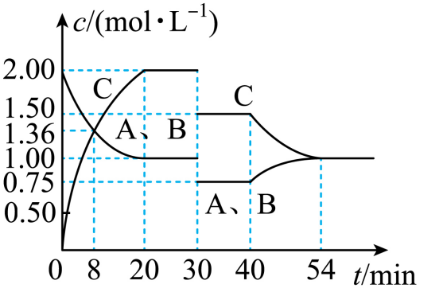

# Chemistry - 题目 275

**ID**: 844dc4dfd6684a3bbc01b1f3fb215fd3
**年级**: Grade 11
**难度**: Medium
**题型**: Multiple-choice

## 题目
某密闭容器中充入等物质的量的A(g)和B(g)发生反应。​​​​​​​‌A(g)+B(g) ⇌2C(g)，达到平衡后，在不同的时间段，分别改变反应的一个条件，测得容器中各物质的物质的量浓度随时间的变化如下图所示。下列说法正确的是（      ）

## 解答

1. A．8 min时反应物A、B与生成物C的浓度相等，由于此后物质的浓度还在发生变化，因此8 min时反应未达到平衡状态，A错误；
2. B．由图象可知：30 min时反应物与生成物的浓度瞬时降低，反应仍处于平衡状态，反应条件是扩大容器的体积降低了压强；但是温度没变，平衡常数不变，B错误；
3. C．40 min时，C浓度降低，化学平衡逆向移动，若改变条件应是升高温度，升温，逆向移动，逆向吸热，正向放热，△H<0，C正确；
4. D．由图象可知，在反应开始时加入2.0 mol/L的A、B，达到平衡时A、B浓度都是1.0 mol/L，C的浓度是2.0 mol/L，C的平均反应速率 $\frac {{{2}}{{.}}{{0}}{\rm{m}}{\rm{o}}{\rm{l}}{\rm{/}}{\rm{L}}}{20{\rm \min }}{\rm{=}}$  0.1mol·L^{-1}·min^{-1}，不是瞬时速率，D错误；
5. 故合理选项是C。

## 知识点

**中文**:
  - 外界条件对化学平衡影响的图像

**English**:
  - Graphs of External Conditions

---
