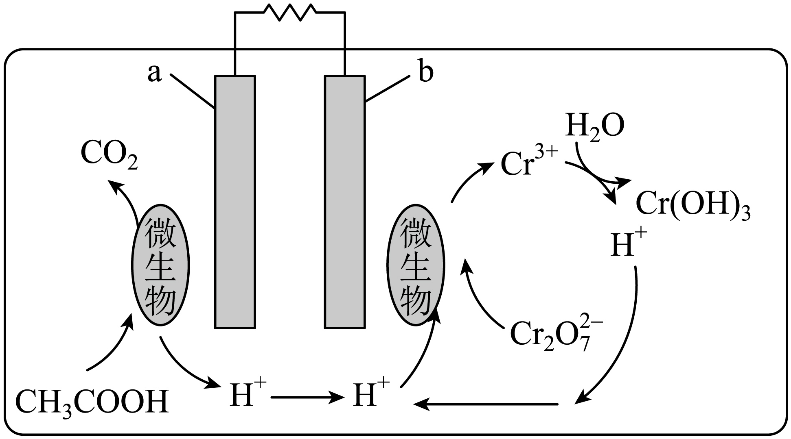

# Chemistry - 题目 337

**ID**: 9efc39c932f34f4db938b051f8bd3a7e
**年级**: Grade 11
**难度**: Medium
**题型**: Multiple-choice

## 题目
微生物燃料电池是一种利用微生物将有机物中的化学能直接转化成电能的装置.​​​​​​​‌某污水处理厂利用微生物电池将镀铬废水中的 ${\rm {\rm{C}}{\rm{r}}{{}_{2}}{\rm{O}}{{}_{7}^{2-}}}$ 催化还原，其工作原理如图所示.下列说法不正确的是

## 解答

1. A．a极为负极乙酸发生氧化反应生成二氧化碳，b极 ${\rm {\rm{C}}{\rm{r}}{{}_{{\rm{2}}}}{\rm{O}}{{}_{{\rm{7}}}^{{\rm{2}}{\rm{-}}}}}$ 中铬由+6变成+3价，得电子发生还原反应为正极，所以电池工作过程中电流由b极流向a极，A正确；
2. B．b极 ${\rm {\rm{C}}{\rm{r}}{{}_{{\rm{2}}}}{\rm{O}}{{}_{{\rm{7}}}^{{\rm{2}}{\rm{-}}}}}$ 中铬由+6变成+3价，得电子发生还原反应，电极反应式为： ${\rm {\rm{C}}{\rm{r}}{{}_{{\rm{2}}}}{\rm{O}}{{}_{{\rm{7}}}^{{\rm{2}}{\rm{-}}}}}$ +6e^{-}+14H^{+}=2Cr^{3+}+7H_{2}O，B正确；
3. C．根据反应可知每生成 ${\rm l{\rm mol}{\rm{\;}}{\rm{C}}{\rm{r}}({\rm{O}}{\rm{H}}){{}_{3}}}$ ，电路中转移了3mol电子，即有3molH^{+}从进入右池，同时Cr^{3+}水解生成了3molH^{+}，而 ${\rm {\rm{C}}{\rm{r}}{{}_{{\rm{2}}}}{\rm{O}}{{}_{{\rm{7}}}^{{\rm{2}}{\rm{-}}}}}$ 反应过程中消耗7molH^{+}，故右池 ${\rm n\left ({{\rm{H}}{^{+}}}\right )}$ 减少 ${\rm 1{\rm{\;}}{\rm{m}}{\rm{o}}{\rm{l}}}$ ，C错误；
4. D、根据得失电子守恒，每处理0.5mol  ${\rm {\rm{C}}{\rm{r}}{{}_{{\rm{2}}}}{\rm{O}}{{}_{{\rm{7}}}^{{\rm{2}}{\rm{-}}}}}$ ，转移3mol的电子，所以生成二氧化碳的物质的量为： ${\rm \frac {{\rm{3}}{\rm{×}}{\rm{2}}}{{\rm{8}}}}$ =0.75mol，标况下的体积为：0.75mol×22.4L/mol=16.8L，D正确；
5. 故答案为：C。

## 知识点

**中文**:
  - 原电池有关计算
  - 原电池的结构与判断
  - 原电池的工作原理

**English**:
  - Calculations related to Galvanic Cells
  - Structure and Identification of Galvanic Cells
  - Working Principle of Galvanic Cells

---
