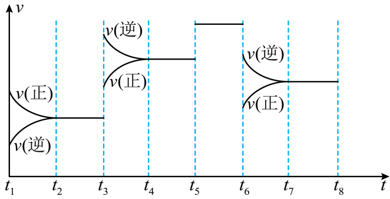

# Chemistry - 题目 50

**ID**: b21c7ce229f449efb88e49f9569dbaf0
**年级**: Grade 11
**难度**: Medium
**题型**: Multiple-choice

## 题目
在某一恒容容器中发生反应： ${\rm {\rm{M}}\left ({{\rm{g}}}\right )+2{\rm{N}}\left ({{\rm{g}}}\right )\rightleftharpoons {\rm{Q}}\left ({{\rm{g}}}\right )}$    ${\rm ΔH<0}$ 。​​​​​​​‌当反应达到平衡时， $t{{}_{1}}$ 、 $t{{}_{3}}$ 、 $t{{}_{5}}$ 、 $t{{}_{6}}$ 改变某一条件，反应速率与反应时间的曲线关系如图。下列说法错误的是

## 解答

1. A．由图可知，t_{1}为正反应速率大于逆反应速率，平衡正向移动，采取的措施可能是降低温度或增大压强，A正确；
2. B．由图可知，t_{1}为正反应速率大于逆反应速率，平衡正向移动，采取的措施可能是降低温度或增大压强，活化分子百分数可能减小或不变，B错误；
3. C．t_{5}时刻，正逆反应速率同等程度增大，平衡不移动，改变条件为使用催化剂，C正确；
4. D．由题干图示信息可知，t_{3}~t_{4}平衡逆向移动，t_{5}~t_{6}平衡不移动，t_{6}~t_{7}平衡逆向移动，故Q(g)的体积分数最高的时间段是 $t{{}_{2}}-t{{}_{3}}$ ，D正确；
5. 故答案为：B。

## 知识点

**中文**:
  - 外因对化学反应速率的综合分析
  - 综合分析外界条件对化学平衡状态的影响

**English**:
  - Comprehensive Analysis of External Factors
  - Comprehensive Analysis of External Conditions

---
