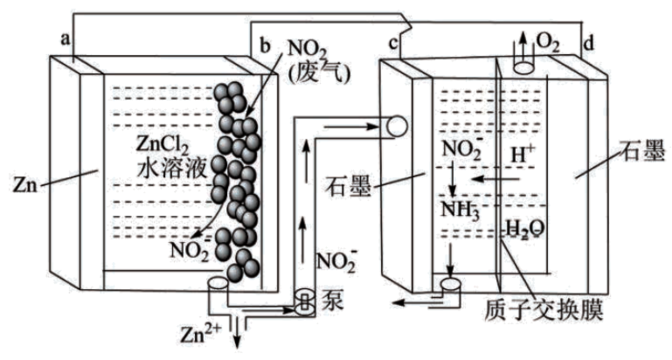

# Chemistry - 题目 177

**ID**: c7a7413b59e24ca48d942d1a9006a414
**年级**: Grade 11
**难度**: Medium
**题型**: Multiple-choice

## 题目
西北工业大学推出一种新型 ${\rm{Z}}{\rm{n}}{{-}}{\rm{N}}{\rm{O}}{{}_{{{2}}}}$ 电池。​​​​​​​‌该电池能有效地捕获NO_{2}，将其转化为 ${\rm{N}}{\rm{O}}{{}_{{{2}}}^{{{-}}}}$ ，再将产生的 ${\rm{N}}{\rm{O}}{{}_{{{2}}}^{{{-}}}}$ 电解制氨，过程如图所示。下列说法错误的是

## 解答

1. A．新型 ${\rm{Z}}{\rm{n}}{{-}}{\rm{N}}{\rm{O}}{{}_{{{2}}}}$ 电池中，Zn为负极，b为正极，所以d电极为电解池的阳极，A正确；
2. B． ${\rm{Z}}{\rm{n}}{{-}}{\rm{N}}{\rm{O}}{{}_{{{2}}}}$ 电池总反应式为 ${\rm{Z}}{\rm{n}}{{+}}{{2}}{\rm{N}}{\rm{O}}{{}_{{{2}}}}\hspace{-0.5em}\begin{array}{}{\underline{{\underline{~{\,}{\,}{\,}{\,}{\,}{\,}{\,}~}}}}\atop{}\end{array}\hspace{-0.5em}{\rm{Z}}{\rm{n}}\left ({{\rm{N}}{\rm{O}}{{}_{{{2}}}}}\right ){{}_{{{2}}}}{\rm ，B}$ 正确；
3. C．c极为电解池的阴极，电极反应式为 ${\rm{N}}{\rm{O}}{{}_{{{2}}}^{{{-}}}}{{+}}{{5}}{\rm{H}}{{}_{2}}{\rm{O}}{{+}}{{6}}{\rm{e}}{^{{{-}}}}\hspace{-0.5em}\begin{array}{}{\underline{{\underline{~{\,}{\,}{\,}{\,}{\,}{\,}{\,}~}}}}\atop{}\end{array}\hspace{-0.5em}{\rm{N}}{\rm{H}}{{}_{3}}{{+}}{{7}}{\rm{O}}{\rm{H}}{^{-}}$ ，所以c极区溶液的pH升高，C正确；
4. D．N元素化合价由反应前+3价到NH_{3}中-3价，电路中转移 ${{3}}{\rm{m}}{\rm{o}}{\rm{l}}{\rm{e}}{^{{{-}}}}$ 时，理论上能得到 ${{0}}{{.}}{{5}}{\rm{m}}{\rm{o}}{\rm{l}}{\rm{N}}{\rm{H}}{{}_{{{3}}}}{\rm ，D}$ 错误；
5. 故选D。

## 知识点

**中文**:
  - 原电池的工作原理

**English**:
  - Working Principle of Galvanic Cells

---
