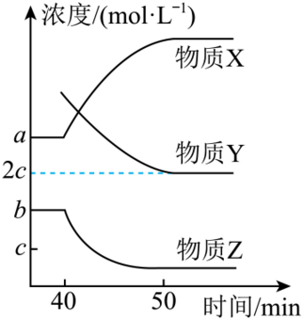

# Chemistry - 题目 148

**ID**: cd33e446c7224db9a98d7d03d58377ae
**年级**: Grade 11
**难度**: Medium
**题型**: 非选择题

## 题目
Ⅰ.炽热的碳与水蒸气可发生反应： ${\rm C(s)＋H_{2}O(g)}\rightleftharpoons {\rm H_{2}(g)＋CO(g)}$ ，该反应对煤的综合利用具有积极的研究意义。​​​​​​​‌(1)已知碳(石墨)、H_{2}、CO的燃烧热分别为393.5 kJ·mol^{－1}、285.8 kJ·mol^{－1}、283 kJ·mol^{－1}，又知H_{2}O(l)=H_{2}O(g)　ΔH′＝＋44 kJ·mol^{－1}，则 ${\rm C(s)＋H_{2}O(g)}\rightleftharpoons {\rm CO(g)＋H_{2}(g)}$ 　ΔH＝。Ⅱ.一定温度下，在体积为VL的密闭容器中加入足量活性炭，并充入x mol H_{2}O(g)发生上述反应，反应时间与容器内气体总压强的数据如下表。时间/min010203040总压强/100 kPa1.01.21.31.41.4(2)平衡时，容器中气体总物质的量为mol，H_{2}O(g)的转化率为。(3)该温度下反应的平衡常数K＝。(4)保持恒温、恒压，向容器内充入少量N_{2}，H_{2}O的转化率将(填“增大”“减小”或“不变”)。(5)保持恒温、恒容，在40 min时再充入H_{2,}50 min时再次达到平衡，反应过程中各物质的浓度随时间变化如图所示。①物质X为。②50 min时，CO的浓度为mol·L^{－1}。

## 解答

1. （1）由燃烧热可写出热化学方程式：
2. ① ${\rm{C}}\left ({{\rm{s}}}\right )+{\rm{O}}{{}_{{{2}}}}\left ({{\rm{g}}}\right ){\rm{=}}{\rm{=}}{\rm{=}}{\rm{C}}{\rm{O}}{{}_{{{2}}}}\left ({{\rm{g}}}\right )$   ${\rm{Δ}}H{{}_{1}}=-{{3}}{{9}}{{3}}{{.}}{{5}}{\rm{\;}}{\rm{k}}{\rm{J}}\cdot {\rm{m}}{\rm{o}}{\rm{l}}{^{-{{1}}}}$ ；
3. ② ${\rm{H}}{{}_{{{2}}}}\left ({{\rm{g}}}\right ){{+}}\frac {1}{2}{\rm{O}}{{}_{{{2}}}}\left ({{\rm{g}}}\right ){\rm{=}}{\rm{=}}{\rm{=}}{\rm{H}}{{}_{{{2}}}}{\rm{O}}\left ({{\rm{l}}}\right )$   ${\rm{Δ}}H{{}_{2}}=-{{2}}{{8}}{{5}}{{.}}{{8}}{\rm{\;}}{\rm{k}}{\rm{J}}\cdot {\rm{m}}{\rm{o}}{\rm{l}}{^{-{{1}}}}$ ；
4. ③ ${\rm{C}}{\rm{O}}\left ({{\rm{g}}}\right )+\frac {{{1}}}{{{2}}}{\rm{O}}{{}_{{{2}}}}\left ({{\rm{g}}}\right ){\rm{=}}{\rm{=}}{\rm{=}}{\rm{C}}{\rm{O}}{{}_{{{2}}}}\left ({{\rm{g}}}\right )$   ${\rm{Δ}}H{{}_{3}}=-{{2}}{{8}}{{3}}{\rm{\;}}{\rm{k}}{\rm{J}}\cdot {\rm{m}}{\rm{o}}{\rm{l}}{^{-{{1}}}}$ ；
5. ④ ${\rm{H}}{{}_{{{2}}}}{\rm{O}}\left ({{\rm{l}}}\right ){\rm{=}}{\rm{=}}{\rm{=}}{\rm{H}}{{}_{{{2}}}}{\rm{O}}\left ({{\rm{g}}}\right )$   ${\rm{Δ}}H=+{{4}}{{4}}{\rm{\;}}{\rm{k}}{\rm{J}}\cdot {\rm{m}}{\rm{o}}{\rm{l}}{^{-{{1}}}}$ ；
6. 根据盖斯定律①－②－③－④可得： ${\rm{C}}\left ({{\rm{s}}}\right )+{\rm{H}}{{}_{{{2}}}}{\rm{O}}\left ({{\rm{g}}}\right )\xrightleftharpoons []{}{\rm{C}}{\rm{O}}\left ({{\rm{g}}}\right ){{+}}{\rm{H}}{{}_{{{2}}}}\left ({{\rm{g}}}\right )$
7. ${\rm{Δ}}H=+{{1}}{{3}}{{1}}{{.}}{{3}}{\rm{\;}}{\rm{k}}{\rm{J}}\cdot {\rm{m}}{\rm{o}}{\rm{l}}{^{-{{1}}}}$ ；
8. （2）根据阿伏加德罗定律，温度、体积一定时，压强之比等于气体物质的量之比，可知平衡时容器中气体总物质的量为1.4xmol；由差量法可知生成 ${\rm{H}}{{}_{{{2}}}}{\rm 0.4\mathit{x}}$  mol，反应的 ${\rm{H}}{{}_{{{2}}}}{\rm{O}}\left ({{\rm{g}}}\right )$ 为0.4xmol，故其转化率为40%；
9. （3）设有ymol水发生转化，根据 ${\rm{C}}\left ({{\rm{s}}}\right ){{+}}{\rm{H}}{{}_{{{2}}}}{\rm{O}}\left ({{\rm{g}}}\right )\xrightleftharpoons []{}{\rm{C}}{\rm{O}}\left ({{\rm{g}}}\right )+{\rm{H}}{{}_{{{2}}}}\left ({{\rm{g}}}\right )$ 反应可知，起始n(H_{2}O)=xmol， n(CO)= n(H_{2})=0mol，变化量，n(H_{2}O)=ymol ，n(CO)= n(H_{2})=ymol，平衡后，n(H_{2}O)=x-ymol， n(CO)= n(H_{2})=ymol ；所以 $x-y+y+y=1.4x$ ，解得 $y=0.4x$ ， $K=\frac {{\rm{c}}\left ({{\rm{H}}{{}_{{{2}}}}}\right ){\rm{c}}{\rm{(}}{\rm{C}}{\rm{O}}{\rm{)}}}{{\rm{c}}\left ({{\rm{H}}{{}_{{{2}}}}{\rm{O}}}\right )}=\frac {(0.4x/V)\cdot {\rm{m}}{\rm{o}}{\rm{l}}\cdot {\rm{L}}{^{-1}}\times (0.4x/V)\cdot {\rm{m}}{\rm{o}}{\rm{l}}\cdot {\rm{L}}{^{-1}}}{(0.6x/V)\cdot {\rm{m}}{\rm{o}}{\rm{l}}\cdot {\rm{L}}{^{-1}}}=\frac {4x}{15V}{\rm{m}}{\rm{o}}{\rm{l}}\cdot {\rm{L}}{^{-1}}$ ；
10. （4）恒压充入非反应性气体相当于扩大体积，平衡正向移动， ${\rm{H}}{{}_{{{2}}}}{\rm{O}}\left ({{\rm{g}}}\right )$ 转化率增大；
11. （5）①加入氢气，平衡逆向移动，水蒸气浓度逐渐增大，CO浓度逐渐减小，而氢气浓度为瞬间增大，故Z为CO，Y为氢气，X为水蒸气；
12. ②温度没变，化学平衡常数没变。设40～50 min内增加的水蒸气的浓度为x，根据反应 ${\rm{C}}\left ({{\rm{s}}}\right )+{\rm{H}}{{}_{{{2}}}}{\rm{O}}\left ({{\rm{g}}}\right )\xrightleftharpoons []{}{\rm{C}}{\rm{O}}\left ({{\rm{g}}}\right )+{\rm{H}}{{}_{{{2}}}}\left ({{\rm{g}}}\right )$ 分析可知，原平衡时，c(H_{2}O)=amol/L， n(CO)=b mol/L，c(H_{2})=cmol/L，新平衡时，c(H_{2}O)=(a+x)mol/L，n(CO)=(b-x) mol/L，c(H_{2})=2cmol/L，所以 $K=\frac {bc}{a}=\frac {2c(b-x)}{a+x}$ ，解得 $x=\frac {ab}{2a+b}$ ；CO的浓度为 $\left ({b-\frac {ab}{2a+b}}\right ){\rm {\rm mol}}\cdot {\rm{L}}{^{-1}}$ 。

## 知识点

**中文**:
  - 利用盖斯定律计算反应热
  - 压强对化学平衡的影响

**English**:
  - Calculating Reaction Heat using Hess's Law
  - Effect of Pressure

---
