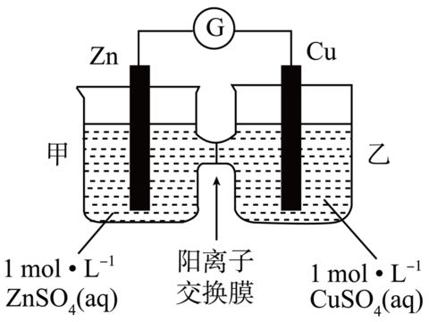

# Chemistry - 题目 141

**ID**: dd9256aa17cd440ab542750e9f5272cc
**年级**: Grade 11
**难度**: Medium
**题型**: Multiple-choice

## 题目
锌铜原电池装置如下图所示，其中阳离子交换膜只允许阳离子和水分子通过，下列有关叙述正确的是​​​​​​​‌

## 解答

1. A．铜锌原电池，锌作负极，铜作正极，铜电极上发生还原反应，故A错误；
2. B．甲池的 ${\rm{c}}\left ({{\rm{S}}{\rm{O}}_{{\rm{4}}}^{{\rm{2}}{\rm{-}}}}\right )$ 不参加反应，浓度不变，故B正确；
3. C．铜锌原电池，锌作负极，铜作正极，铜离子在铜电极上沉淀，锌离子通过阳离子交换膜进入乙池，根据电荷守恒，每析出64g铜，就补充65g锌离子，所以电池工作一段时间后，乙池溶液的总质量增加，故C错误；
4. D．由于中间存在阳离子交换膜，只有阳离子能通过，阴离子不能通过，故D错误；
5. 答案为B。

## 知识点

**中文**:
  - 原电池有关计算
  - 原电池的结构与判断
  - 原电池的工作原理

**English**:
  - Calculations related to Galvanic Cells
  - Structure and Identification of Galvanic Cells
  - Working Principle of Galvanic Cells

---
