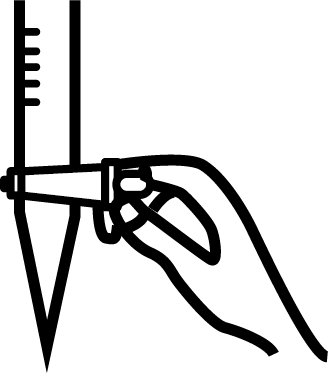

# Chemistry - 题目 266

**ID**: e316f36706a8486480f6f52af3bacf9f
**年级**: Grade 11
**难度**: Medium
**题型**: 非选择题

## 题目
酸碱中和滴定、氧化还原滴定和沉淀滴定法在科研和工业生产中都很重要。​​​​​​​‌I．某化学兴趣小组在室温下用标准盐酸滴定未知浓度的氢氧化钠溶液。(1)向碱式滴定管中注入未知浓度氢氧化钠溶液之前的一步操作为，排气泡时，应选择下图中的(填字母)。a．b．c．d．(2)实验数据如下表，其中一次滴定所用盐酸体积有明显偏差，其可能的原因是。序号1234标准溶液体积 ${\rm{/}}{\rm{m}}{\rm{l}}$20.6020.7020.1020.50a．碱式滴定管润洗后用蒸馏水洗净再装入待测液b．接近滴定终点时，用少量蒸馏水将锥形瓶内壁冲洗一下c．滴定结束时，仰视读数d．滴定达终点时发现滴定管尖嘴内有气泡生成Ⅱ．为了测定草酸 $\left ({{\rm{H}}{{}_{{{2}}}}{\rm{C}}{{}_{{{2}}}}{\rm{O}}{{}_{{{4}}}}}\right )$ 溶液的浓度，进行如下实验：取 ${{2}}{{5}}{{.}}{{0}}{{0}}{\rm{m}}{\rm{L}}$ 草酸溶液于锥形瓶内，加入适量稀 ${\rm{H}}{{}_{{{2}}}}{\rm{S}}{\rm{O}}{{}_{{{4}}}}$ ，用 ${{0}}{{.}}{{0}}{{1}}{{0}}{{0}}{\rm{m}}{\rm{o}}{\rm{l}}\cdot {\rm{L}}{^{{{-}}{{1}}}}{\rm{K}}{\rm{M}}{\rm{n}}{\rm{O}}{{}_{{{4}}}}$ 溶液滴定。(3)滴定时应将 ${\rm{K}}{\rm{M}}{\rm{n}}{\rm{O}}{{}_{{{4}}}}$ 溶液加入酸式滴定管中：在规格为 ${{5}}{{0}}{{.}}{{0}}{{0}}{\rm{m}}{\rm{L}}$ 的滴定管中，若 ${\rm{K}}{\rm{M}}{\rm{n}}{\rm{O}}{{}_{{{4}}}}$ 溶液起始读数为 ${{1}}{{5}}{{.}}{{0}}{{0}}{\rm{m}}{\rm{L}}$ ，此时滴定管中 ${\rm{K}}{\rm{M}}{\rm{n}}{\rm{O}}{{}_{{{4}}}}$ 溶液的实际体积为(填标号)。

## 解答

1. （1）向碱式滴定管中注入未知浓度氢氧化钠溶液之前的一步操作为用NaOH溶液润洗碱式滴定管，防止产生实验误差；碱式滴定管的气泡通常在橡胶管内，只要将滴定玻璃头朝上，并挤压橡皮管中的玻璃珠就可以将气泡冲出，故排气泡时，应选择下图中的c；
2. （2）根据表中数据可知，第3次滴定所用盐酸的体积偏小；
3. a．碱式滴定管润洗后用蒸馏水洗净再装入待测液，所取NaOH溶液体积偏小，消耗盐酸的体积偏小，选项a符合；
4. b．接近滴定终点时，用少量蒸馏水将锥形瓶内壁冲洗一下，无影响，选项b不符合；
5. c．滴定结束时，仰视读数，则盐酸的读数偏大，选项c不符合；
6. d．滴定达终点时发现滴定管尖嘴内有气泡生成，则盐酸的读数偏小，选项d符合；
7. 答案选ad；
8. （3）滴定管中的0刻度在上方，50.00mL-15.00mL=35.00mL，因尖嘴部分也有溶液而没有刻度，故此时滴定管中溶液的实际体积应大于35.00mL，答案选B；
9. （4）高锰酸钾溶液为紫红色，滴定终点时的现象为：当滴入最后半滴高锰酸钾溶液时，溶液由无色变为紫红色且30s内不褪色；
10. （5）由表，AgI、AgBr比AgCl更难溶于水，若用NaBr或KI作指示剂，最先生成的沉淀可能是AgBr或AgI，因此不能用NaBr、KI作指示剂，AgSCN和AgCl的颜色相同，无法区分，因此不能用KSCN作指示剂，达到滴定终点时，AgNO_{3}与 ${\rm{N}}{\rm{a}}{{}_{{{2}}}}{\rm{C}}{\rm{r}}{\rm{O}}{{}_{{{4}}}}$ 反应生成 ${\rm{A}}{\rm{g}}{{}_{{{2}}}}{\rm{C}}{\rm{r}}{\rm{O}}{{}_{{{4}}}}$ 沉淀，即有砖红色沉淀生成，现象明显，因此选择 ${\rm{N}}{\rm{a}}{{}_{{{2}}}}{\rm{C}}{\rm{r}}{\rm{O}}{{}_{{{4}}}}$ 作为滴定Cl^{-}的指示剂，故答案为 C；
11. （6）相同实验条件下，若改为 ${{0}}{{.}}{{0}}{{4}}{{0}}{{0}}{\rm{m}}{\rm{o}}{\rm{l}}\cdot {\rm{L}}{^{{{-}}{{1}}}}{\rm{C}}{\rm{l}}{^{{{-}}}}$ ，则所需AgNO_{3}溶液体积变为 $\frac {{{0}}{{.}}{{0}}{{4}}{{0}}{{0}}{\rm{m}}{\rm{o}}{\rm{l}}\cdot {\rm{L}}{^{{{-}}{{1}}}}\times 50{\rm{m}}{\rm{L}}}{{{0}}{{.}}{{1}}{{0}}{{0}}{{0}}{\rm{m}}{\rm{o}}{\rm{l}}\cdot {\rm{L}}{^{{{-}}{{1}}}}}{\rm{=}}{{2}}{{0}}{\rm{m}}{\rm{L}}$ ，相同实验条件下，反应终点横坐标20mL，纵坐标为5的位置，故为(20，5) 。

## 知识点

**中文**:
  - 酸碱中和滴定实验
  - 酸碱中和滴定的拓展应用

**English**:
  - Titration Experiment
  - Extended Applications of Titration

---
