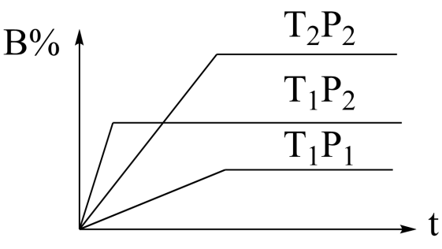

# Chemistry - 题目 233

**ID**: f8412ad9d4c94b59800401bc51880c11
**年级**: Grade 11
**难度**: Medium
**题型**: Multiple-choice

## 题目
已知某可逆反应mA(g)+ nB(g) $\rightleftharpoons $ p C(g)；​​​​​​​‌在密闭容器中进行，下图表示在不同反应时间t、温度T和压强P与反应物B在混合气体中的百分含量B%的关系曲线，由曲线分析，下列判断正确的是

## 解答

1. 根据“先拐先平，数值大”， 可知P_{1}<P_{2}，T_{1}>T_{2}；增大压强，B在混合气体中的百分含量增大，说明平衡逆向移动，可知正反应气体系数和增大，m+n<P；升高温度，B在混合气体中的百分含量减小，说明平衡正向移动，可知正反应吸热，ΔH >0，故选B。

## 知识点

**中文**:
  - 外界条件对化学平衡影响的图像

**English**:
  - Graphs of External Conditions

---
