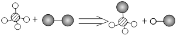

# Chemistry - 题目 312

**ID**: 0456ca0cd9a542398483d00781797e67
**年级**: Grade 12
**难度**: Easy
**题型**: Multiple-choice

## 题目
已知某两种物质在光照条件下能发生化学反应，其微观示意图如下：(说明：一种小球代表一种原子）则下列说法正确的是​​​​​​​‌

## 解答

1. A. 图示中的反应物中由两种小球组成，应为化合物，A错误；
2. B. 图示中构成4种分子的小球都不完全相同，所以共有4种分子，B正确；
3. C. 该反应中，生成物没有单质，不属于置换反应，C错误；
4. D. 该图示中，原子的种类和数目都不变，符合质量守恒定律，D错误；
5. 故选B。

## 知识点

**中文**:
  - 四种基本反应类型

**English**:
  - Four Basic Reaction Types

---
