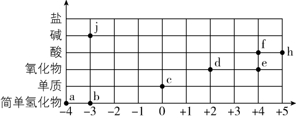

# Chemistry - 题目 225

**ID**: 289cefc2f8614ec4ab1e674e24a5fea2
**年级**: Grade 12
**难度**: Easy
**题型**: Multiple-choice

## 题目
部分N或C及其化合物的“价—类”二维图如图所示。​​​​​​​‌下列说法正确的是    	（      ）

## 解答

1. 本题考查物质推断与性质判断。由图可知,d为NO或CO、e为NO_{2}或CO_{2},只有CO_{2}是酸性氧化物,A错误;c为N_{2}或C单质,N_{2}的结构式为,既含有σ键又含有π键,若C单质为金刚石,只含有σ键,若为C_{60}等,则含有π键,B错误;j为NH_{3}∙H_{2}O、h为HNO_{3},二者发生复分解反应生成NH_{4}NO_{3}等,NH_{4}NO_{3}为离子化合物,C正确;b为NH_{3},a为CH_{4},NH_{3}分子间能形成氢键,使其沸点高于CH_{4},与NH_{3}分子内的化学键无关,D错误。

## 知识点

**中文**:
  - σ键与π键
  - 酸性氧化物与碱性氧化物

**English**:
  - Sigma Bonds and Pi Bonds
  - Acidic Oxides and Basic Oxides

---
