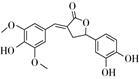

# Chemistry - 题目 90

**ID**: 35564f88dc8d47918957ae32c367fd28
**年级**: Grade 12
**难度**: Easy
**题型**: 选择题：本题共10小题，每小题2分，共20分。每小题只有一个选项符合题目要求。

## 题目
某种除草剂的结构简式如图所示，下列关于该化合物的说法正确的是(    )​​​​​​​‌

## 解答

1. 该物质由碳、氢、氧三种元素组成，因此不属于烃，该物质含有酯基，可发生水解反应，A错误；苯环上有4种氢，则苯环上的一氯代物有4种，B正确；该分子中甲氧基与苯环相连的单键可旋转，甲氧基中碳原子可能不在苯环所在平面上，C错误；苯环和碳碳双键可与氢气加成，则1 mol该物质最多能与7 mol H_{2}加成，D错误。
2. 【易错警示】烃只由碳和氢两种元素组成，故又称碳氢化合物，其中包括烷烃、烯烃、炔烃、芳香烃等，醇、酚、酯、卤代烃等均为烃的衍生物。

## 知识点

**中文**:
  - 同分异构体的书写和数目判断
  - 烯烃的结构与性质
  - 苯的加成反应

**English**:
  - Writing and Counting Isomers
  - Structure and Properties of Alkenes
  - Addition Reactions of Benzene

---
