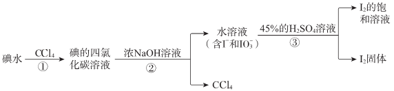

# Chemistry - 题目 329

**ID**: 368929c95c1b4906ad7fcfd2acb7c89d
**年级**: Grade 12
**难度**: Easy
**题型**: Multiple-choice

## 题目
实验室模拟工业回收碘水中的碘，其操作流程如下：下列判断正确的是​​​​​​​‌

## 解答

1. A．卤素在四氯化碳中溶解度大于水中溶解度，A错误；
2. B．②是将四氯化碳与水溶液分离，二者互不相容，且为液态混合物，故是分液；③是将固体与液体分离，故为过滤，B正确；
3. C．由方程式可以看出，每 ${\rm{3}}{\rm{m}}{\rm{o}}{\rm{l}}{\rm{I}}_{2}$ 与足量 ${\rm{N}}{\rm{a}}{\rm{O}}{\rm{H}}$ 完全反应转移了 $5{\rm{m}}{\rm{o}}{\rm{l}}{\rm{e}}^{-}$ ，故 ${\rm{1}}{\rm{m}}{\rm{o}}{\rm{l}}{\rm{I}}_{2}$ 与足量 ${\rm{N}}{\rm{a}}{\rm{O}}{\rm{H}}$ 完全反应转移了 $\frac {5}{3}{\rm{m}}{\rm{o}}{\rm{l}}{\rm{e}}^{-}$ ，C错误；
4. D．设②中消耗6mol氢氧化钠，则③中硫酸的物质的量为3mol（含有6mol氢离子），二者之比是2:1，D错误；
5. 答案选B。

## 知识点

**中文**:
  - 化学实验基本操作
  - 基于氧化还原反应守恒规律的计算

**English**:
  - Basic Laboratory Operations
  - Calculations Based on Conservation Laws in Redox Reactions

---
