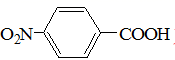
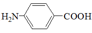
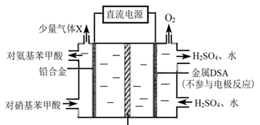

# Chemistry - 题目 221

**ID**: c150eaf890be44018a8b6ee12d3a991d
**年级**: Grade 12
**难度**: Easy
**题型**: Multiple-choice

## 题目
以为原料，采用电解法制取的装置如图。​​​​​​​‌下列说法中正确的是

## 解答

1. A．金属阳极DSA发生2H_{2}O-4e^{-}=O_{2}$\uparrow $ +4H^{+}，失去的电子由金属阳极DSA经导线流向直流电源的正极，由直流电源的负极经导线流向铅合金，故A错误；
2. B．由金属阳极DSA发生2H_{2}O-4e^{-}=O_{2}$\uparrow $ +4H^{+}知，每转移1mol e^{-}时，消耗0.5mol水，以氧气形式放出的是8g，通过阳离子交换膜的氢离子1g，阳极电解质溶液的质量减少9g，故B错误；
3. C．阴极的主要电极反应式为+6e^{-}+6H^{+}→+2H_{2}O，故C正确；
4. D．阳极区电极反应为2H_{2}O-4e^{-}=O_{2}$\uparrow $ +4H^{+}，硫酸的浓度增大，反应结束后阳极区pH减小，故D错误；
5. 故选：C。

## 知识点

**中文**:
  - 电解池有关计算
  - 电解池的结构与判断
  - 电解池的工作原理

**English**:
  - Calculations related to Electrolytic Cells
  - Structure and Identification of Electrolytic Cells
  - Working Principle of Electrolytic Cells

---
