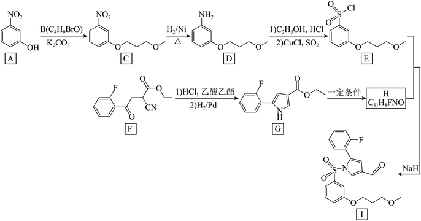
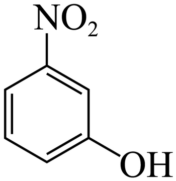
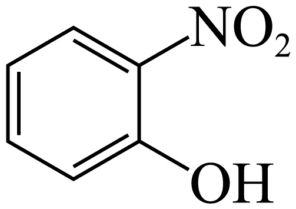
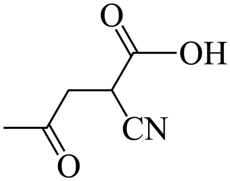
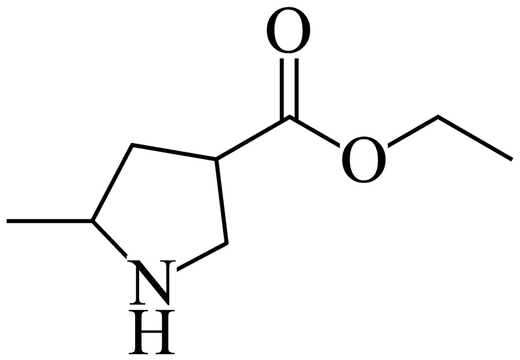

# Chemistry - 题目 193

**ID**: 69f2a53bb8eb4855b68d7e3bf24a3adc
**年级**: Grade 12
**难度**: Hard
**题型**: Calculation

## 题目
物质Ⅰ是合成消化类药物盐酸凯普拉生的一种中间体，其合成路线如图：回答以下问题：（1）物质A的系统命名为，的沸点比的（填“高”或“低”）。​​​​​​​‌（2）物质D中官能团的名称为，C→D的反应类型为。（3）A+B→C的化学方程式为，若将该步骤的 ${\rm{K}}{{}_{2}}{\rm{C}}{\rm{O}}{{}_{3}}$ 试剂更换为 ${\rm{K}}{\rm{H}}{\rm{C}}{\rm{O}}{{}_{3}}$ ，化合物C的产率大幅下降，可能的原因是。（4）H的结构简式为。（5）同时满足下列条件的D的同分异构体的结构简式为（写出一种）。① $-{\rm{N}}{\rm{H}}{{}_{2}}$ 直接与苯环相连②1 mol该物质与足量Na反应可生成1 mol  ${\rm{H}}{{}_{2}}$③核磁共振氢谱图有5组峰，峰面积之比为1:2:2:4:6（6）参照以上合成路线，写出以、乙醇和乙酸乙酯为主要原料制备的合成路线。（无机试剂任选）。

## 解答

1. （1）物质A为含有硝基的酚类物质，硝基在3号碳上，因此系统命名为3-硝基苯酚；能形成分子间氢键，形成分子内氢键，因此的沸点比的高，故答案为：3-硝基苯酚；高；
2. （2）物质D中官能团的名称为氨基、醚键；由分析可知，C中的硝基（ ${{-}}{\rm{N}}{\rm{O}}{{}_{{{2}}}}$ ）与氢气发生还原反应生成D中的氨基（ ${{-}}{\rm{N}}{\rm{H}}{{}_{{{2}}}}$ ），故答案为：氨基、醚键；还原反应；
3. （3）由分析可知，A+B→C的化学方程式为2+2${\rm +}{\rm{K}}{{}_{{{2}}}}{\rm{C}}{\rm{O}}{{}_{{{3}}}}$  $\to $${\rm +}{{2}}{\rm{K}}{\rm{B}}{\rm{r}}{{+}}{\rm{H}}{{}_{{{2}}}}{\rm{O}}{{+}}{\rm{C}}{\rm{O}}{{}_{{{2}}}}\uparrow $ ； ${\rm{K}}{\rm{H}}{\rm{C}}{\rm{O}}{{}_{3}}$ 的碱性比 ${\rm{K}}{{}_{{{2}}}}{\rm{C}}{\rm{O}}{{}_{{{3}}}}$ 弱，难以与酚羟基反应，使反应速率显著降低，从而使化合物C的产率大幅下降，故答案为：2→+2${\rm +}{\rm{K}}{{}_{{{2}}}}{\rm{C}}{\rm{O}}{{}_{{{3}}}}$  $\to $${\rm +}{{2}}{\rm{K}}{\rm{B}}{\rm{r}}{{+}}{\rm{H}}{{}_{{{2}}}}{\rm{O}}{{+}}{\rm{C}}{\rm{O}}{{}_{{{2}}}}\uparrow $ ； ${\rm{K}}{\rm{H}}{\rm{C}}{\rm{O}}{{}_{3}}$ 的碱性比 ${\rm{K}}{{}_{2}}{\rm{C}}{\rm{O}}{{}_{3}}$ 弱，难以与酚羟基反应，从而使反应速率显著降低；
4. （4）由分析可知，H的结构简式为，故答案为：；
5. （5）1 mol该物质与足量Na反应可生成1 mol  ${\rm{H}}{{}_{2}}$ ，且分子中有2个氧原子，则结构中可能含有2个羟基或一个羧基，又因为取代基中没有不饱和度，因此只能是两个羟基，结合条件①和③可得符合条件的同分异构体为、、、，故答案为：、、、；
6. （6）结合题目中F到G的反应原理，以、乙醇和乙酸乙酯为主要原料制备的合成路线为。

## 知识点

**中文**:
  - 同分异构体的书写和数目判断
  - 氧化反应和还原反应的判断
  - 常见官能团名称、组成及结构
  - 有机合成与推断综合

**English**:
  - Writing and Counting Isomers
  - Identifying Oxidation and Reduction
  - Names, Composition and Structure of Functional Groups
  - Synthesis and Deduction

---
