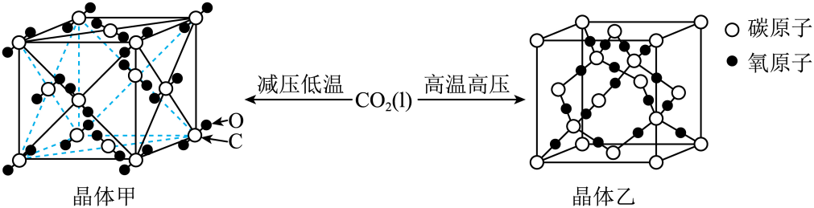
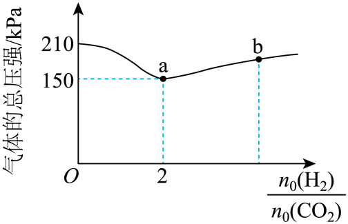

# Chemistry - 题目 314

**ID**: 45de279ea6304c85bf11353b812c4046
**年级**: Grade 12
**难度**: Hard
**题型**: 非选择题

## 题目
${\rm{C}}{\rm{O}}{{}_{2}}$ 的回收利用是减缓温室效应的方法之一，其中将 ${\rm{C}}{\rm{O}}{{}_{2}}$ 转化为有机物是重要应用之一，如制取甲醛的化学方程式为 ${\rm{C}}{\rm{O}}{{}_{2}}({\rm{g}})+2{\rm{H}}{{}_{2}}({\rm{g}})\rightleftharpoons {\rm{H}}{\rm{C}}{\rm{H}}{\rm{O}}({\rm{g}})+{\rm{H}}{{}_{2}}{\rm{O}}({\rm{g}})$ 。​​​​​​​‌回答下列问题：（1） ${\rm{C}}{\rm{O}}{{}_{2}}$ 在一定条件下能转化为晶体甲和晶体乙，其晶胞结构如图所示：①晶体甲中存在的作用力有。②晶体乙与晶体 ${\rm{S}}{\rm{i}}{\rm{O}}{{}_{2}}$ 相比，熔点较高的是(填“晶体乙”或“晶体 ${\rm{S}}{\rm{i}}{\rm{O}}{{}_{2}}$ ”)，其原因为。③若晶体乙的晶胞参数为 $a{\rm{p}}{\rm{m}}$ ，其晶体密度为 $ρ{\rm{g}}\cdot {\rm{c}}{\rm{m}}{^{-3}}$ ，则阿伏加德罗常数 $N{{}_{{\rm{A}}}}=$${\rm{m}}{\rm{o}}{\rm{l}}{^{-1}}$ (用含 $a、ρ$ 的代数式表示)。（2） ${\rm{T}}{}\degree {\rm{C}}$ 时，向恒温恒容密闭容器中充入 ${\rm{C}}{\rm{O}}{{}_{2}}、{\rm{H}}{{}_{2}}$ 的混合气体使起始压强为 $210\mathrm{k}\mathrm{P}\mathrm{a}$ ，只发生反应： ${\rm{C}}{\rm{O}}{{}_{2}}({\rm{g}})+2{\rm{H}}{{}_{2}}({\rm{g}})\rightleftharpoons {\rm{H}}{\rm{C}}{\rm{H}}{\rm{O}}({\rm{g}})+{\rm{H}}{{}_{2}}{\rm{O}}({\rm{g}})$ ，达到平衡时混合气体的总压强随充入 $\frac {n{{}_{0}}\left ({{\rm{H}}{{}_{2}}}\right )}{n{{}_{0}}\left ({{\rm{C}}{\rm{O}}{{}_{2}}}\right )}$ 的变化曲线如图所示。① ${\rm{C}}{\rm{O}}{{}_{{{2}}}}$ 的平衡转化率：a点(填“>”或“<”)b点。②a点和b点时的反应速率： ${\rm{v}}{{}_{正}}{\rm{(}}{\rm{a}}{\rm{)}}$(填“>”“=”或“<”) ${\rm{v}}{{}_{正}}{\rm{(}}{\rm{b}}{\rm{)}}$ ，判断方法为。③ $T{}\degree {\rm{C}}$ 时， ${\rm{C}}{\rm{O}}{{}_{2}}({\rm{g}})+2{\rm{H}}{{}_{2}}({\rm{g}})\rightleftharpoons {\rm{H}}{\rm{C}}{\rm{H}}{\rm{O}}({\rm{g}})+{\rm{H}}{{}_{2}}{\rm{O}}({\rm{g}})$ 的平衡常数 $K{{}_{{\rm{p}}}}=$${\rm{k}}{\rm{P}}{\rm{a}}{^{-1}}$ ( $K{{}_{{\rm{p}}}}$ 为用分压表示的平衡常数，分压=总压×物质的量分数)。

## 解答

1. （1）①晶体甲属于分子晶体，则晶体甲中存在的作用力有共价键、范德华力；
2. ②两者都为共价晶体，但是晶体乙中的共价键更短一些，键能更大一些，熔点更高一些，故答案为：晶体乙；晶体乙和晶体 ${\rm{S}}{\rm{i}}{\rm{O}}{{}_{2}}$ 都是共价晶体，碳原子半径小， ${\rm{C}}-{\rm{O}}$ 键能更大；
3. ③由图可知，晶体乙中包含有8个二氧化碳，结合密度公式可知，若晶体乙的晶胞参数为 $a{\rm{p}}{\rm{m}}$ ，其晶体密度为 $ρ{\rm{g}}\cdot {\rm{c}}{\rm{m}}{^{-3}}$ ，则阿伏加德罗常数 ${\rm{N}}{{}_{{\rm{A}}}}{\rm{=}}\frac {{{8}}\times {{4}}{{4}}}{{\rm{ρ}}\times \left ({{\rm{a}}\times {{1}}{{0}}{^{{{-}}{{1}}{{0}}}}}\right ){^{{{3}}}}}{\rm{m}}{\rm{o}}{\rm{l}}{^{{{-}}{{1}}}}=\frac {352}{ρa{^{3}}}\times 10{^{30}}{\rm{m}}{\rm{o}}{\rm{l}}{^{{{-}}{{1}}}}$ ；
4. （2）①随着横坐标的增大，则氢气含量在增加，平衡正向移动，二氧化碳转化率增大，则 ${\rm{C}}{\rm{O}}{{}_{{{2}}}}$ 的平衡转化率：a点< b点；
5. ②反应速率和浓度有关，浓度越大，反应速率越快，该反应是气体分子数减小的反应，且起始压强相同，对比a点和b点，a点平衡时压强小，说明其反应程度大，产物浓度大，逆反应速率大，平衡时正逆反应速率相等，说明a点正反应速率也大，故答案为：>；平衡时a点的压强小于b点，说明a点反应进行的程度大于b点，a点产物浓度大，逆反应速率大，平衡时刻正、逆反应速率相等，故a点正反应速率也大；
6. ③结合a点数据计算平衡常数，此时氢气和二氧化碳的物质的量比为2∶1，起始压强为 $210\mathrm{k}\mathrm{P}\mathrm{a}$ ，则可得以下三段式： $\hspace{-0.5em}\begin{array}{}\;&{\rm{C}}{\rm{O}}{{}_{2}}({\rm{g}})&+&2{\rm{H}}{{}_{2}}({\rm{g}})&\rightleftharpoons &{\rm{H}}{\rm{C}}{\rm{H}}{\rm{O}}({\rm{g}})&+&{\rm{H}}{{}_{2}}{\rm{O}}({\rm{g}})\\起始分压(\mathrm{k}\mathrm{P}\mathrm{a})&70&\;&140&\;&0&\;&0\\分压变化(\mathrm{k}\mathrm{P}\mathrm{a})&\mathrm{x}&\;&2\mathrm{x}&\;&\mathrm{x}&\;&\mathrm{x}\\平衡分压(\mathrm{k}\mathrm{P}\mathrm{a})&70-\mathrm{x}&\;&140-2\mathrm{x}&\;&\mathrm{x}&\;&\mathrm{x}\end{array}\hspace{-0.5em}$
7. 由图可知，平衡时总压为150kP，则 ${\rm{(}}{{7}}{{0}}{{-}}{\rm{x}}{\rm{)}}{{+}}{\rm{(}}{{1}}{{4}}{{0}}{{-}}{{2}}{\rm{x}}{\rm{)}}{{+}}{\rm{x}}{{+}}{\rm{x}}{\rm{=}}{{1}}{{5}}{{0}}{\rm ，x=60}$ ，
8. 则 ${\rm{K}}{{}_{{\rm{p}}}}{\rm{=}}\frac {{\rm{p}}\left ({{\rm{H}}{\rm{C}}{\rm{H}}{\rm{O}}}\right )\cdot {\rm{p}}\left ({{\rm{H}}{{}_{{{2}}}}{\rm{O}}}\right )}{{\rm{p}}\left ({{\rm{C}}{\rm{O}}{{}_{{{2}}}}}\right )\cdot {\rm{p}}{^{{{2}}}}\left ({{\rm{H}}{{}_{{{2}}}}}\right )}{\rm{=}}{{0}}{{.}}{{9}}\left ({{\rm{k}}{\rm{P}}{\rm{a}}}\right ){^{{{-}}{{1}}}}$ 。

## 知识点

**中文**:
  - 浓度对于化学反应速率的影响
  - 晶体的类型与物质熔点、硬度、导电性的关系

**English**:
  - Effect of Concentration
  - Relationship with Melting Point, Hardness, Conductivity

---
