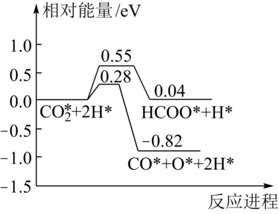
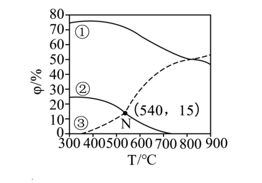

# Chemistry - 题目 102

**ID**: 480423543ffe4a459f8741a0bd3577b2
**年级**: Grade 12
**难度**: Hard
**题型**: 非选择题

## 题目
${\rm{C}}{\rm{O}}{{}_{2}}$ 的高效利用对缓解能源危机以及实现“碳中和”目标具有重要的战略意义。​​​​​​​‌利用 ${\rm{C}}{\rm{O}}{{}_{2}}$ 加氢制备各种有机燃料和无机燃料是一条重要的途径，其原理为：Ⅰ ${\rm .}{\rm{C}}{\rm{O}}{{}_{2}}\left ({{\rm{g}}}\right )+3{\rm{H}}{{}_{2}}\left ({{\rm{g}}}\right )\rightleftharpoons {\rm{C}}{\rm{H}}{{}_{3}}{\rm{O}}{\rm{H}}\left ({{\rm{g}}}\right )+{\rm{H}}{{}_{2}}{\rm{O}}\left ({{\rm{g}}}\right )$    ${\rm{Δ}}H{{}_{1}}$Ⅱ ${\rm .}{\rm{C}}{\rm{O}}{{}_{2}}\left ({{\rm{g}}}\right )+{\rm{H}}{{}_{2}}\left ({{\rm{g}}}\right )\rightleftharpoons {\rm{C}}{\rm{O}}\left ({{\rm{g}}}\right )+{\rm{H}}{{}_{2}}{\rm{O}}\left ({{\rm{g}}}\right )$    ${\rm{Δ}}H{{}_{2}}=+41{\rm{k}}{\rm{J}}/{\rm{m}}{\rm{o}}{\rm{l}}$Ⅲ ${\rm .}{\rm{C}}{\rm{O}}{{}_{2}}\left ({{\rm{g}}}\right )+4{\rm{H}}{{}_{2}}\left ({{\rm{g}}}\right )\rightleftharpoons {\rm{C}}{\rm{H}}{{}_{4}}\left ({{\rm{g}}}\right )+2{\rm{H}}{{}_{2}}{\rm{O}}\left ({{\rm{g}}}\right )$    ${\rm{Δ}}H{{}_{3}}=-162{\rm{k}}{\rm{J}}/{\rm{m}}{\rm{o}}{\rm{l}}$回答下列问题：(1)根据下表相关化学键的键能，计算反应Ⅰ的 ${\rm{Δ}}H{{}_{1}}=$；共价键C-OH-O${\rm{H}}-{\rm{H}}$C=OC-H键能 ${\rm{k}}{\rm{J}}/{\rm{m}}{\rm{o}}{\rm{l}}$326464436803414(2)下列措施能提高的 ${\rm{C}}{\rm{O}}{{}_{2}}$ 平衡转化率的是；a.在一定温度下，适当增大压强b.总体积一定时，增大反应物 ${\rm{C}}{\rm{O}}{{}_{2}}\left ({{\rm{g}}}\right )$ 与 ${\rm{H}}{{}_{2}}\left ({{\rm{g}}}\right )$ 的体积比c.选择高效催化剂及增大催化剂的比表面积(3)若只考虑反应Ⅱ， ${\rm{C}}{\rm{O}}{{}_{2}}$ 催化加氢合成 ${\rm{C}}{\rm{H}}{{}_{4}}$ 的过程中， ${\rm{C}}{\rm{O}}{{}_{2}}$ 活化的可能的途径如右图所示(“ ${\rm{*}}$ ”表示物质吸附在催化剂上)， ${\rm{C}}{\rm{O}}$ 是 ${\rm{C}}{\rm{O}}{{}_{2}}$ 活化的优势中间体，原因是；(4)在恒压条件下，若只考虑反应Ⅱ和反应Ⅲ，平衡时 ${\rm{C}}{\rm{O}}{{}_{2}}$ 、 ${\rm{C}}{\rm{H}}{{}_{4}}$ 和 ${\rm{C}}{\rm{O}}$ 在含碳物质中的体积分数 $φ$ [如 ${\rm \varphi ({\text{CO}}_{2})=\frac{n({\text{CO}}_{2})}{n({\text{CO}}_{2})+n(\text{CO})+n({\text{CH}}_{4})}×100\text{\%}}$ ]随温度 $T$ 的变化如下图所示：曲线①表示的含碳物质为，解释曲线②随温度升高，体积分数不断降低的原因；(5)温度 $570{\rm{K}}$ ，保持总压强为 $100{\rm{k}}{\rm{P}}{\rm{a}}$ 下，向体积可变密闭容器中充入 $1{\rm{m}}{\rm{o}}{\rm{l}}{\rm{C}}{\rm{O}}{{}_{2}}$ 和 $3{\rm{m}}{\rm{o}}{\rm{l}}{\rm{H}}{{}_{2}}$ ，若只考虑发生反应Ⅰ，下列现象可判断反应达到平衡状态的是(填字母)；

## 解答

1. （1）根据 ${\rm{C}}{\rm{O}}{{}_{2}}\left ({{\rm{g}}}\right )+3{\rm{H}}{{}_{2}}\left ({{\rm{g}}}\right )\rightleftharpoons {\rm{C}}{\rm{H}}{{}_{3}}{\rm{O}}{\rm{H}}\left ({{\rm{g}}}\right )+{\rm{H}}{{}_{2}}{\rm{O}}\left ({{\rm{g}}}\right )$ 和相关化学键的键能，计算反应Ⅰ的 ${\rm{Δ}}H{{}_{1}}=$ -（生成物总键能−反应物总键能）=-（3×414kJ/mol+464kJ/mol+326kJ/mol+2×464kJ/mol-2×803kJ/mol-3×436kJ/mol）=-46kJ/mol；故答案为：-46kJ/mol；
2. （2）a.反应为气体体积减小的反应，在一定温度下，适当增大压强，平衡正向移动，故符合；
3. b.总体积一定时，增大反应物 ${\rm{C}}{\rm{O}}{{}_{2}}\left ({{\rm{g}}}\right )$ 与 ${\rm{H}}{{}_{2}}\left ({{\rm{g}}}\right )$ 的体积比，相当于提高二氧化碳的浓度，转化率降低，故不符；
4. c.选择高效催化剂及增大催化剂的比表面积，只能加快反应速率，不能提高转化率，故不符；
5. 故答案为：a；
6. （3）若只考虑反应Ⅱ， ${\rm{C}}{\rm{O}}{{}_{2}}$ 催化加氢合成 ${\rm{C}}{\rm{H}}{{}_{4}}$ 的过程中， ${\rm{C}}{\rm{O}}{{}_{2}}$ 活化的可能的途径如右图所示(“ ${\rm{*}}$ ”表示物质吸附在催化剂上)， ${\rm{C}}{\rm{O}}$ 是 ${\rm{C}}{\rm{O}}{{}_{2}}$ 活化的优势中间体，原因是生成中间体CO的反应的活化能小、反应速率快，且产物能量低、稳定，有利于生成；故答案为：生成中间体CO的反应的活化能小、反应速率快，且产物能量低、稳定，有利于生成；
7. （4）曲线①表示的含碳物质为CO_{2}，曲线②随温度升高，体积分数不断降低的原因反应Ⅲ为放热反应，随着温度升高平衡逆向移动，CH_{4}的体积分数降低；故答案为：CO_{2}；反应Ⅲ为放热反应，随着温度升高平衡逆向移动，CH_{4}的体积分数降低；
8. （5）A.反应前后质量守恒，物质的量减小，平均摩尔质量为变量，当平均摩尔质量即相对分子质量不变时，说明反应达到平衡状态，故符合题意；
9. B.恒压条件下，气体的总质量不变，但体积发生变化，混合气体的密度保持不变，说明反应达到平衡状态，故符合题意；
10. C. ${\rm{C}}{\rm{H}}{{}_{3}}{\rm{O}}{\rm{H}}$ 和 ${\rm{H}}{{}_{2}}{\rm{O}}$ 的物质的量之比始终保持不变，不能证明反应达到平衡状态，故不符题意；
11. D.每消耗 $1{\rm{m}}{\rm{o}}{\rm{l}}{\rm{C}}{\rm{O}}{{}_{2}}\left ({{\rm{g}}}\right )$ 同时生成 $1{\rm{m}}{\rm{o}}{\rm{l}}{\rm{C}}{\rm{H}}{{}_{3}}{\rm{O}}{\rm{H}}\left ({{\rm{g}}}\right )$ ，均表示正速率，不能证明反应达到平衡状态，故不符题意；
12. ${\rm\hspace{-0.5em}\begin{array}{l}\rm\hspace{-0.5em}\begin{array}{cccccc} &{\text{CO}}_{2}\left(\text{g}\right)+&3{\text{H}}_{2}\left(\text{g}\right)&\stackrel{}{\underset{}{⇌}}&{\text{CH}}_{3}\text{OH}\left(\text{g}\right)+&{\text{H}}_{2}\text{O}\left(\text{g}\right)\\\mathrm{开始}/{\rm mol}&1&3& & & \\\mathrm{变化}/{\rm mol}&x&3x& &x&x\\\mathrm{平衡}/{\rm mol}&1-x&3-3x& &x&x\end{array}\hspace{-0.5em}\end{array}\hspace{-0.5em}}$
13. 达到平衡时 ${\rm{C}}{\rm{H}}{{}_{3}}{\rm{O}}{\rm{H}}$ 体积分数为 $\frac {1}{6}$ ， $\frac {x}{4-2x}$   ${\rm =}\frac {1}{6}{\rm ，x=0.5}$ ，平衡时总物质的量4-2x=3。该温度下，反应Ⅰ的压强平衡常数 $K{{}_{{\rm{p}}}}$  $\frac {100{\rm{k}}{\rm{P}}{\rm{a}}\times \frac {0.5}{3}\times 100{\rm{k}}{\rm{P}}{\rm{a}}\times \frac {0.5}{3}}{100{\rm{k}}{\rm{P}}{\rm{a}}\times \frac {1-0.5}{3}\times (100{\rm{k}}{\rm{P}}{\rm{a}}\times \frac {3-3\times 0.5}{3}){^{3}}}{\rm =}$  $\frac {1}{7500}$  ${\rm{k}}{\rm{p}}{\rm{a}}{^{-2}}$ 。故答案为：AB； $\frac {1}{7500}$ 。

## 知识点

**中文**:
  - 根据键能计算反应热
  - 化学平衡状态的判断
  - 温度对化学平衡的影响

**English**:
  - Calculating Reaction Heat from Bond Energies
  - Determination of Equilibrium State
  - Effect of Temperature

---
