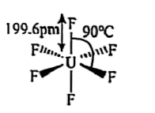

# Chemistry - 题目 349

**ID**: ad52a1f669ea4b1199e946cf73366567
**年级**: Grade 12
**难度**: Hard
**题型**: 非选择题

## 题目
UF_{4}、UF_{6}是提取核材料U的重要原料。​​​​​​​‌工业从铀矿（沥青铀矿，UO_{2}）中制备UF_{6}的原理如下：① ${{3}}{\rm{U}}{\rm{O}}{{}_{{{2}}}}{{+}}{{8}}{\rm{H}}{\rm{N}}{\rm{O}}{{}_{{{3}}}}{\rm{=}}{{3}}{\rm{U}}{\rm{O}}{{}_{{{2}}}}{\rm{(}}{\rm{N}}{\rm{O}}{{}_{{{3}}}}{\rm{)}}{{}_{{{2}}}}{{+}}{{2}}{\rm{N}}{\rm{O}}{{+}}{{4}}{\rm{H}}{{}_{{{2}}}}{\rm{O}}$② ${\rm{U}}{\rm{O}}{{}_{{{2}}}}{\rm{(}}{\rm{N}}{\rm{O}}{{}_{{{3}}}}{\rm{)}}{{}_{{{2}}}}{\rm{(}}{\rm{s}}{\rm{)}}\rightleftharpoons {\rm{U}}{\rm{O}}{{}_{{{3}}}}{\rm{(}}{\rm{s}}{\rm{)}}{{+}}{\rm{N}}{\rm{O}}{\rm{(}}{\rm{g}}{\rm{)}}{{+}}{\rm{N}}{\rm{O}}{{}_{{{2}}}}{\rm{(}}{\rm{g}}{\rm{)}}{{+}}{\rm{O}}{{}_{{{2}}}}{\rm{(}}{\rm{g}}{\rm{)}}$③ ${\rm{U}}{\rm{O}}{{}_{{{3}}}}{\rm{(}}{\rm{s}}{\rm{)}}{{+}}{\rm{H}}{{}_{{{2}}}}{\rm{(}}{\rm{g}}{\rm{)}}\rightleftharpoons {\rm{U}}{\rm{O}}{{}_{{{2}}}}{\rm{(}}{\rm{s}}{\rm{)}}{{+}}{\rm{H}}{{}_{{{2}}}}{\rm{O}}{\rm{(}}{\rm{g}}{\rm{)}}\quad {\rm{Δ}}{\rm{H}}{{}_{{{1}}}}$④ ${\rm{U}}{\rm{O}}{{}_{{{2}}}}{\rm{(}}{\rm{s}}{\rm{)}}{{+}}{{4}}{\rm{H}}{\rm{F}}{\rm{(}}{\rm{g}}{\rm{)}}\rightleftharpoons {\rm{U}}{\rm{F}}{{}_{{{4}}}}{\rm{(}}{\rm{g}}{\rm{)}}{{+}}{{2}}{\rm{H}}{{}_{{{2}}}}{\rm{O}}{\rm{(}}{\rm{g}}{\rm{)}}\quad {\rm{Δ}}{\rm{H}}{{}_{{{2}}}}$⑤ ${\rm{U}}{\rm{F}}{{}_{{{4}}}}{\rm{(}}{\rm{g}}{\rm{)}}{{+}}{\rm{F}}{{}_{{{2}}}}{\rm{(}}{\rm{g}}{\rm{)}}\rightleftharpoons {\rm{U}}{\rm{F}}{{}_{{{6}}}}{\rm{(}}{\rm{g}}{\rm{)}}\quad {\rm{Δ}}{\rm{H}}{{}_{{{3}}}}{\rm{<}}{{0}}$回答下列问题；(1)UF_{6}的结构如下图所示。UF_{6}的空间结构可能是_（填标号）。

## 解答

1. （1）由图可知，UF_{6}的空间结构可能是正八面体形，故选C；
2. （2）在高温下用镁还原制备U，结合质量守恒，还生成氟化镁，化学方程式为： ${\rm {\mathrm{U}\mathrm{F}}_{4}+2\mathrm{M}\mathrm{g}\stackrel{\mathrm{高温}}{=}\text{U}+2{\mathrm{M}\mathrm{g}\mathrm{F}}_{2}}$ ；
3. （3）③ ${\rm {\text{UO}}_{3}(\text{s})+{\text{H}}_{2}(\text{g})⇌{\text{UO}}_{2}(\text{s})+{\text{H}}_{2}\text{O}(\text{g})\text{Δ}{\mathrm{H}}_{1}}$ ；
4. ④ ${\rm {\text{UO}}_{2}(\text{s})+4\text{HF}(\text{g})⇌{\text{UF}}_{\text{4}}(\text{g})+2{\text{H}}_{2}\text{O}(\text{g})\text{Δ}{\mathrm{H}}_{2}}$ ；
5. ⑤ ${\rm {\text{UF}}_{4}(\text{g})+{\text{F}}_{2}(\text{g})⇌{\text{UF}}_{6}(\text{g})\text{Δ}{\mathrm{H}}_{3}<0}$ ；
6. 由盖斯定律可知，反应③+④+⑤得反应： ${\rm {\text{UO}}_{3}(\text{s})+{\text{H}}_{2}(\text{g})+4\text{HF}(\text{g})+{\text{F}}_{2}(\text{g})⇌{\text{UF}}_{6}(\text{g})+3{\text{H}}_{2}\text{O}(\text{g})}$ ，则 ${\rm \text{Δ}\mathrm{H}=\text{Δ}{\mathrm{H}}_{1}\text{+}{\mathrm{H}}_{2}\text{+Δ}{\mathrm{H}}_{3}}$ ；
7. （4）反应⑤为放热反应，反应物能量大于生成物能量，因此正反应活化能小于逆反应活化能；反应⑤气体分子数减少，ΔS<0，放热反应，ΔH<0，根据ΔG=ΔH-TΔS<0为自发反应可知，该反应在低温下自发进行。
8. （5）A．UO_{3}为固体，其浓度为定值，不变不能说明反应平衡，A错误；
9. B．恒容密闭容器中投入足量的UO_{2}(NO_{3})_{2}(s)，仅发生反应②，容器体积始终不变，而反应中气体的质量为变量，则混合气体的密度不变，说明反应已达平衡，B正确；
10. C．反应中固体生成一氧化氮、二氧化氮、氧气三种气体，则生成NO体积分数为定值，不随时间变化，不能说明反应平衡，C错误；
11. D．反应为气体分子数改变的反应，当压强不变，说明平衡不再移动，达到平衡状态，D正确；
12. 故答案为BD。
13. （6）①反应焓变小于0，为放热反应，相同条件下，升高温度，平衡逆向移动， ${\rm{U}}{\rm{F}}{{}_{4}}$ 平衡转化率降低，结合图可知， ${\rm{T}}{{}_{2}}<{\rm{T}}{{}_{1}}$ ；
14. ②T_{1}下，W点 ${\rm{U}}{\rm{F}}{{}_{4}}\left ({{\rm{g}}}\right )$ 转化率为80%，则反应 ${\rm{U}}{\rm{F}}{{}_{4}}\left ({{\rm{g}}}\right ){\rm 0.8mol}$ ，生成 ${\rm{U}}{\rm{F}}{{}_{6}}\left ({{\rm{g}}}\right ){\rm 0.8mol}$ ，平衡时 ${\rm{U}}{\rm{F}}{{}_{4}}\left ({{\rm{g}}}\right )$ 为0.2mol、 ${\rm{F}}{{}_{2}}\left ({{\rm{g}}}\right )$ 为0.2mol，总的物质的量为1.2mol，则平衡常数 ${\rm {\mathrm{K}}_{\text{p}}=\frac{\frac{0.8}{1.2}×4\text{MPa}}{(\frac{0.2}{1.2}×4\text{MPa})×(\frac{0.2}{1.2}×4\text{MPa})}\text{=}6{\text{MPa}}^{-1}}$ ；若保持温度和压强不变，再向W点对应的容器中通入 ${\rm 1{\text{{\rm mol}}}_{}{\text{UF}}_{4}(\text{g})}$ 和 $1{\rm{m}}{\rm{o}}{\rm{l}}{\rm{U}}{\rm{F}}{{}_{6}}\left ({{\rm{g}}}\right )$ ，则此时 ${\rm \text{Q=}\frac{\frac{1.8}{3.2}×4\text{MPa}}{(\frac{1.2}{3.2}×4\text{MPa})×(\frac{0.2}{3.2}×4\text{MPa})}{\text{=6MPa}}^{-1}\text{=}6{\text{MPa}}^{-1}}$ ，则反应正向进行， ${\rm{v}}{{}_{正}}={\rm{v}}{{}_{逆}}$ 。

## 知识点

**中文**:
  - 利用盖斯定律计算反应热
  - 化学平衡状态的判断
  - 温度对化学平衡的影响

**English**:
  - Calculating Reaction Heat using Hess's Law
  - Determination of Equilibrium State
  - Effect of Temperature

---
