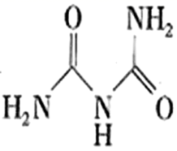
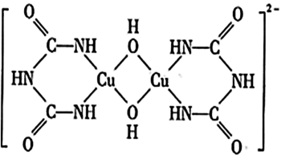
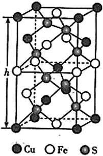

# Chemistry - 题目 162

**ID**: 1566f119cd9f47a98bebd7003910e7a2
**年级**: Grade 12
**难度**: Hard
**题型**: 结构与性质

## 题目
缩二脲的结构为，在碱性溶液中与硫酸铜反应生成，从而使溶液呈现紫红色。​​​​​​​‌凡是含有两个酰胺链段( ${\rm{-}}{\rm{C}}{\rm{O}}{\rm{N}}{\rm{H}}{\rm{-}}$ )的化合物都能发生这个反应，所以常用此法检验蛋白质。(1)从核外电子排布分析，Cu^{2+}和Cu^{+}相比，更稳定，原因是。(2)N、O、C三种元素的第一电离能从小到大的顺序为，最简单氢化物的沸点从低到高的顺序为(填化学式)。(3)在缩二脲分子中，碳原子的杂化类型为，氮原子的价层电子对数为。(4)黄铜矿的晶胞如图所示，则黄铜矿的化学式为，若该晶胞的高为h nm，密度为d g/cm^{3}，则该晶胞的底面边长为nm(用含d、h、N_{A}的代数式表示，设N_{A}表示阿伏加德罗常数的值)。

## 解答

1. (1)根据构造原理，可知基态Cu^{2+}核外电子排布是1s^{2}2s^{2}2p^{6}3s^{2}3p^{6}3d^{9}，基态Cu^{+}核外电子排布是1s^{2}2s^{2}2p^{6}3s^{2}3p^{6}3d^{10}，由于原子核外各个轨道电子排布处于全满、半满或全空时是稳定结构，Cu^{+}的3d轨道处于全满的稳定状态，所以Cu^{2+}和Cu^{+}相比，Cu^{+}更稳定；
2. (2)N、O、C是同一周期元素，一般情况下同一周期元素的原子序数越大，元素的第一电离能越大，但当元素处于第IIA族、第VA族时，电子所处的原子轨道处于全满、半满的稳定状态，失去电子消耗能量大于同一周期相邻元素，所以这三种元素的第一电离能从小到大的顺序为：C＜O＜N；C、N、O三种元素形成的简单氢化物化学式分别是CH_{4}、NH_{3}、H_{2}O。它们都属于分子晶体，分子之间以分子间作用力结合，分子间作用力越大，物质的熔沸点就越高。CH_{4}分子之间只存在分子间作用力，而NH_{3}、H_{2}O分子之间除存在分子间作用力外，还存在氢键，增加了分子之间的吸引力，且H_{2}O的氢键比NH_{3}强，所以三种元素形成最简单氢化物的沸点从低到高的顺序为：CH_{4}＜NH_{3}＜H_{2}O；
3. (3)在缩二脲分子中，碳原子与O原子形成了共价双键，另外2个价电子与N原子形成共价键，故其杂化类型为sp^{2}杂化；
4. 氮原子形成3个σ共价键，N原子上还有1对孤电子对，故N的价层电子对数为3+1=4；
5. (4)在该晶胞中含有的Cu原子个数：8× $\frac {{\rm{1}}}{{\rm{8}}}$ +4× $\frac {{\rm{1}}}{{\rm{2}}}$ +1=4，含有的Fe原子个数为：4× $\frac {{\rm{1}}}{4}$ +6× $\frac {{\rm{1}}}{{\rm{2}}}$ =4，含有的S原子个数为8个，n(Cu)：n(Fe)：n(S)=4：4：8=1：1：2，所以该晶体的化学式CuFeS_{2}；
6. 根据晶体密度公式d= $\frac {{\rm{m}}}{{\rm{V}}}{\rm{=}}\frac {{\rm{(}}{\rm{6}}{\rm{4}}{\rm{+}}{\rm{5}}{\rm{6}}{\rm{+}}{\rm{3}}{\rm{2}}{\rm{×}}{\rm{2}}{\rm{)}}{\rm{×}}{\rm{4}}}{{\rm{N}}_{{\rm{A}}}{\rm{h}}{\rm{L}}^{{\rm{2}}}{\rm{×}}{\rm{(}}{\rm{1}}{\rm{0}}^{{\rm{-}}{\rm{7}}}）^{{\rm{3}}}}{\rm{g}}{\rm{/}}{\rm{c}}{\rm{m}}^{{\rm{3}}}{\rm{=}}\frac {{\rm{7}}{\rm{3}}{\rm{6}}{\rm{×}}{\rm{1}}{\rm{0}}^{{\rm{2}}{\rm{1}}}}{{\rm{N}}_{{\rm{A}}}{\rm{h}}{\rm{L}}^{{\rm{2}}}}{\rm{g}}{\rm{/}}{\rm{c}}{\rm{m}}^{{\rm{3}}}$ ，可知该晶胞的底面边长L= $\sqrt {\frac {{\rm{7}}{\rm{3}}{\rm{6}}{\rm{×}}{\rm{1}}{\rm{0}}^{{\rm{2}}{\rm{1}}}}{{\rm{d}}{\rm{N}}_{{\rm{A}}}{\rm{h}}}}$ nm。

## 知识点

**中文**:
  - 范德华力及其对物质性质的影响

**English**:
  - Van der Waals Forces and Properties

---
