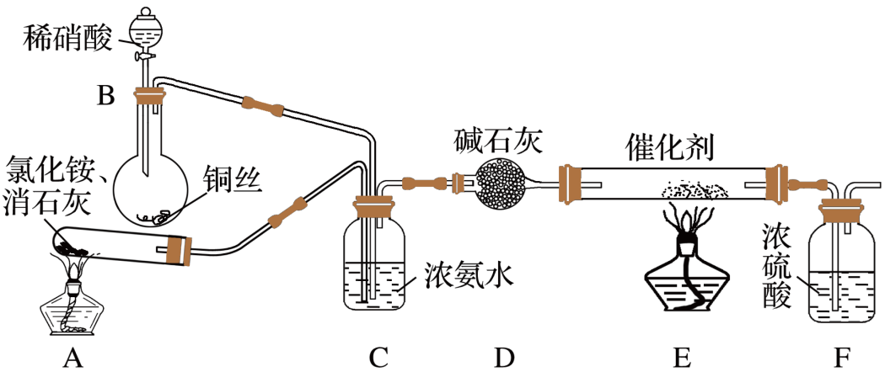
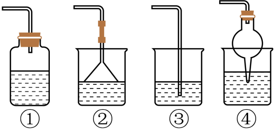
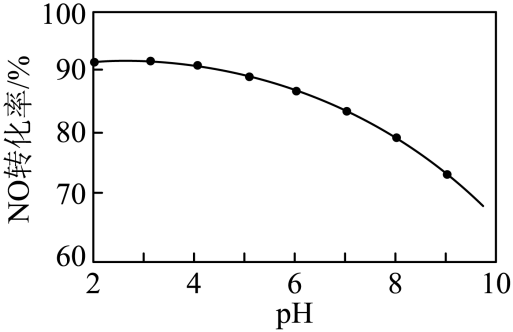

# Chemistry - 题目 253

**ID**: 42799601c79c4290adc73b27c26e8255
**年级**: Grade 12
**难度**: Medium-Hard
**题型**: Calculation

## 题目
氮的氧化物(NO_{x})是大气污染物之一，探究其性质并进行合理的治理和应用具有重要的意义。​​​​​​​‌按要求回答下列问题：Ⅰ．某化学兴趣小组认为一定条件(催化剂、加热)下，用NH_{3}与NO反应转化为无污染物质N_{2}可达到汽车尾气无害化处理的目的。该化学兴趣小组模拟氨催化吸收法处理NO的实验装置如图。（1）盛放碱石灰的仪器名称为；请写出NH_{3}与NO反应生成N_{2}的化学方程式：。（2）D中碱石灰能不能替换成无水氯化钙？(填“能”或“不能”)，原因是。（3）装置C的主要作用：①将气体混合均匀；②除去挥发出来的HNO_{3}；③。为防止污染环境，以下装置(盛放的液体均为水)可用于吸收多余氨气的是(填序号)。Ⅱ．工业制备硝酸的尾气中往往含有NO、NO_{2}，可用NaClO溶液氧化吸收以消除它们对环境的污染。其他条件相同，NO的转化率随NaClO溶液初始pH(用稀硫酸调节)的变化如图所示。（4）在酸性条件下，NaClO可转化为HClO，NO可被HClO氧化为 ${\rm{N}}{\rm{O}}{{}_{3}^{-}}{\rm ，HClO}$ 自身转化为Cl^{-}，则NO与HClO反应的离子方程式为；NaClO溶液的初始pH越大，NO转化率越低，其原因是。

## 解答

1. （1）盛放碱石灰的仪器名称为干燥管；NH_{3}与NO在催化剂、加热条件下反应生成N_{2}和水，化学方程式为： ${\rm 4NH_{3}+6NO}{\mathop {=}\limits_{催化剂}^{Δ}}{\rm 5N_{2}+6H_{2}O}$ 。
2. （2）无水氯化钙不能干燥氨气，因为两者会发生化学反应生成稳定的络合物CaCl_{2}·8NH_{3}（八氨合氯化钙），导致干燥剂失效并消耗氨气‌，因此D中碱石灰不能替换成无水氯化钙。
3. （3）据分析，装置C控制气体通入的速率及比例、吸收硝酸蒸汽及使气体混合均匀；吸收多余的氨气装置应使氨气充分接触液体并且防止倒吸，装置②和④满足要求。
4. （4）HClO氧化NO生成Cl^{-}和NO，根据化合价升降以及原子守恒进行配平，其离子方程式为 ${\rm 3HClO+2NO+H_{2}O=3Cl^{-}+2}NO{{}_{3}^{-}}{\rm +5H^{+}}$ ；溶液pH越大，溶液中HClO的浓度越小，氧化NO的能力越弱，NO转化率越低。

## 知识点

**中文**:
  - 一氧化氮的性质
  - 离子方程式的书写及正误判断
  - 尾气处理
  - 性质实验

**English**:
  - Properties of Nitric Oxide
  - Writing and Verifying Ionic Equations
  - Tail Gas Treatment
  - Property Experiments

---
