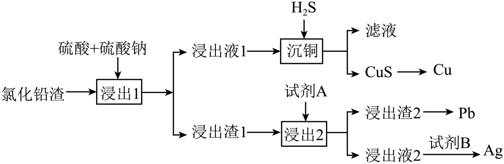
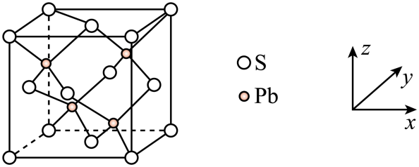

# Chemistry - 题目 12

**ID**: cbf19a00e8144b09bcc5f20302da3d1e
**年级**: Grade 12
**难度**: Medium-Hard
**题型**: Calculation

## 题目
氯化铅渣中含PbCl_{2}和少量AgCl、CuCl_{2}等物质，分步回收其中金属元素的工艺如下：已知：①常温溶液中各物质的K_{sp}物质PbCl_{2}PbSO_{4}AgClAg_{2}SO_{4}CuSK_{sp}1.7×10^{-5}1.7×10^{-8}1.8×10^{-10}1.6×10^{-5}6.0×10^{-36}②H_{2}S的K_{a1}=1.0×10^{-7}，K_{a2}=1.0×10^{-13}。​​​​​​​‌（1）已知银属于第5周期，与铜同族，写出基态银原子价层电子排布式。（2）“浸出1”需控温在75℃，适合采用的加热方式为；浸出渣1的主要成分为(写化学式)。（3）“沉铜”过程中，当通入H_{2}S达到饱和时测得溶液的pH=1，此时溶液中c(Cu^{2+})为mol/L。[已知：25℃下，H_{2}S溶于水形成饱和溶液时，c(H_{2}S)=0.1mol/L]（4）①浸出液2的主要阳离子为 $\left [{\rm{A}}{\rm{g}}\left ({{\rm{N}}{\rm{H}}{{}_{{{3}}}}}\right ){{}_{{{2}}}}\right ]{^{+}}$ ，试剂A为。②若试剂B选用甲酸，写出反应的离子反应方程式。（5）高纯度的硫化铅可作半导体，其立方晶胞如图所示。①已知硫离子采取面心立方堆积，则铅离子填在由硫离子形成的体空隙中。②硫化铅晶胞沿着y轴的投影图为(填选项字母)

## 解答

1. （1）Cu是第四周期ⅠB族元素，基态Cu原子价电子排布式为3d^{10}4s^{1}，银属于第5周期，与铜同族，基态银原子价层电子排布式4d^{10}5s^{1}。
2. （2）为便于控制“浸出1”反应温度75℃，适合采用的加热方式为水浴加热；向废渣中加入H_{2}SO_{4}和Na_{2}SO_{4}，PbCl_{2}和硫酸钠反应生成PbSO_{4}沉淀，AgCl难溶于水，与H_{2}SO_{4}和Na_{2}SO_{4}不反应，所以浸出渣1的主要成分为PbSO_{4}、AgCl。
3. （3）H_{2}S的K_{a1}=1.0×10^{-7}，K_{a2}=1.0×10^{-13}， $K{{}_{{\rm{a}}{{1}}}}\times K{{}_{{\rm{a}}{{2}}}}=\frac {c\left ({{\rm{H}}{\rm{S}}{^{-}}}\right )c\left ({{\rm{H}}{^{{{+}}}}}\right )}{c\left ({{\rm{H}}{{}_{{{2}}}}{\rm{S}}}\right )}\times \frac {c\left ({{\rm{S}}{^{2-}}}\right )c\left ({{\rm{H}}{^{{{+}}}}}\right )}{c\left ({{\rm{H}}{\rm{S}}{^{-}}}\right )}=\frac {c\left ({{\rm{S}}{^{2-}}}\right )c{^{2}}\left ({{\rm{H}}{^{{{+}}}}}\right )}{c\left ({{\rm{H}}{{}_{{{2}}}}{\rm{S}}}\right )}=10{^{-7}}\times 10{^{-13}}=10{^{-20}}$  “沉铜”过程中，当通入H_{2}S达到饱和时测得溶液的 ${\rm pH=1，}\frac {c\left ({{\rm{S}}{^{2-}}}\right )\times 0.1{^{2}}}{0.1}=10{^{-20}},c\left ({{\rm{S}}{^{2-}}}\right )=10{^{-19}}$ ，此时溶液中 ${\rm c(Cu^{2+})=}\frac {6\times 10{^{-36}}}{1\times 10{^{-19}}}=6\times 10{^{-17}}$  mol/L。
4. （4）①AgCl与浓氨水反应生成[Ag(NH_{3})_{2}]^{+}，浸出液2的主要阳离子为 $\left [{\rm{A}}{\rm{g}}\left ({{\rm{N}}{\rm{H}}{{}_{{{3}}}}}\right ){{}_{{{2}}}}\right ]{^{+}}$ ，则试剂A为氨水。
5. ②若试剂B选用甲酸， $\left [{\rm{A}}{\rm{g}}\left ({{\rm{N}}{\rm{H}}{{}_{{{3}}}}}\right ){{}_{{{2}}}}\right ]{^{+}}$ 与甲酸反应生成银、碳酸铵，反应的离子反应方程式为 ${{2}}\left [{\rm{A}}{\rm{g}}\left ({{\rm{N}}{\rm{H}}{{}_{{{3}}}}}\right ){{}_{{{2}}}}\right ]{^{{{+}}}}{{+}}{\rm{H}}{\rm{C}}{\rm{O}}{\rm{O}}{\rm{H}}{{+}}{\rm{H}}{{}_{{{2}}}}{\rm{O}}\to {\rm{C}}{\rm{O}}{{}_{3}^{2-}}{{+}}{{2}}{\rm{A}}{\rm{g}}\downarrow {{+}}{{4}}{\rm{N}}{\rm{H}}{{}_{{{4}}}^{{{+}}}}$ 。
6. （5）①根据图示，铅离子填在由硫离子形成的四面体空隙中。
7. ②硫离子采取面心立方堆积，铅离子填在由硫离子形成的四面体空隙中，所以硫化铅晶胞沿着y轴的投影图为B；
8. ③根据均摊原则，晶胞中S原子数为 $8\times \frac {1}{8}+6\times \frac {1}{2}=4$ 、Pb原子数为4，晶胞中S^{2-}与Pb^{2+}最近的距离为anm，则晶胞体对角线为4anm，晶胞的边长为 $\frac {4\sqrt {3}}{3}{\rm{a}}{\rm{n}}{\rm{m}}$ ，已知晶体密度为ρg·cm^{-3}，设PbS的摩尔质量为Mg/mol，则 $ρ=\frac {4{\rm{M}}}{{\left({\frac {4\sqrt {3}}{3}{\rm{a}}\times {{1}}{{0}}{^{-7}}}\right)^{3}}\times N{{}_{{\rm{A}}}}},N{{}_{{\rm{A}}}}=\frac {4{\rm{M}}}{{\left({\frac {4\sqrt {3}}{3}{\rm{a}}}\right)^{3}}{\rm{ρ}}}\times {{1}}{{0}}{^{21}}$ 。

## 知识点

**中文**:
  - 晶胞投影图
  - 离子方程式的书写及正误判断

**English**:
  - Unit Cell Projections
  - Writing and Verifying Ionic Equations

---
