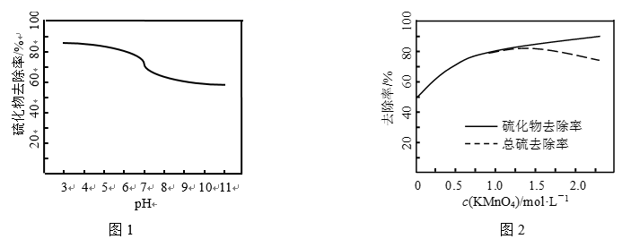

# Chemistry - 题目 307

**ID**: f21080c7589a4363894e39a0256c1940
**年级**: Grade 12
**难度**: Medium-Hard
**题型**: 原理综合题

## 题目
工业废水中常含有一定量的硫化物(以H_{2}S、HS^{-}、S^{2-}的形式存在)，通过氧化—沉淀相结合的方法处理后可使废水中含硫量达到国家规定的排放标准。​​​​​​​‌(1)氧化：将含有硫化物的废水引入氧化池，加入高锰酸钾溶液氧化。已知高锰酸钾在酸性条件下的还原产物为Mn^{2+}，碱性条件下的为MnO_{2}。①pH > 7时高锰酸钾将废水中的硫化物氧化为S，该反应的离子方程式为。②硫化物的去除率随pH的变化如图1所示，废水呈酸性时的去除率大于呈碱性时的原因是。硫化物的去除率和总硫去除率随高锰酸钾浓度的变化如图2所示，当高锰酸钾溶液的物质的量浓度大于1.25 mol∙L^{-1}时，总硫去除率下降的原因是。(2)沉淀：将氧化后的废水加入沉淀剂进一步沉降处理。①若用沉淀剂Fe_{2}Cl_{2}SO_{4}处理废水中的硫化钾，则反应的化学方程式为；若沉淀剂换成FeClSO_{4}，则硫化钾的去除率明显变大的原因是。②废水经沉降处理后过滤，测得滤液中c(Fe^{2+})为0.03 mol∙L^{-1}，则该滤液中c(S^{2-})为。（已知：Ksp(FeS) = 6.3×10^{-18}）

## 解答

1. (1)①根据题给信息知，高锰酸钾在碱性条件下被还原为MnO_{2}，则根据电子转移守恒及电荷守恒配平反应为：2 ${\rm{M}}{\rm{n}}{\rm{O}}_{{\rm{4}}}^{{\rm{-}}}$ +3S^{2-}+4H_{2}O=2MnO_{2}↓+3S↓+8OH^{-}，S^{2-}水解生成HS^{-}，离子方程式也可以写作：2 ${\rm{M}}{\rm{n}}{\rm{O}}_{{\rm{4}}}^{{\rm{-}}}$ +3HS^{-}+H_{2}O=2MnO_{2}↓+3S↓+5OH^{-}；故答案为：2 ${\rm{M}}{\rm{n}}{\rm{O}}_{{\rm{4}}}^{{\rm{-}}}$ +3S^{2-}+4H_{2}O=2MnO_{2}↓+3S↓+8OH^{-}或2 ${\rm{M}}{\rm{n}}{\rm{O}}_{{\rm{4}}}^{{\rm{-}}}$ +3HS^{-}+H_{2}O=2MnO_{2}↓+3S↓+5OH^{-}；
2. ②已知高锰酸钾在酸性条件下的还原产物为Mn^{2+}，碱性条件下的为MnO_{2}，则根据电荷转移守恒知高锰酸钾在酸性条件下得电子较多，对于硫的去除率大；高锰酸钾浓度越大，氧化性越强，将硫化物氧化为硫酸根离子，导致总硫去除率下降，所以如图2所示，当高锰酸钾溶液的物质的量浓度大于1.25 mol∙L^{-1}时，总硫去除率下降；故答案为：等物质的量的高锰酸钾在酸性条件下转移的电子数目比碱性条件下多；高锰酸钾浓度越大，氧化性越强，将硫化物氧化为硫酸根离子，导致总硫去除率下降；
3. (2)①Fe_{2}Cl_{2}SO_{4}与K_{2}S发生复分解反应：Fe_{2}Cl_{2}SO_{4}+2K_{2}S=2FeS↓+2KCl+K_{2}SO_{4}；FeClSO_{4}中Fe化合价为+3价，具有氧化性，与硫化钾发生氧化还原反应生成FeS和S，等物质的量的铁元素消耗硫化钾的物质的量大于Fe_{2}Cl_{2}SO_{4}，所以硫化钾的去除率明显变大；故答案为：Fe_{2}Cl_{2}SO_{4}+2K_{2}S=2FeS↓+2KCl+K_{2}SO_{4}；FeClSO_{4}中Fe化合价为+3价，与硫化钾发生氧化还原反应生成FeS和S，等物质的量的铁元素消耗硫化钾的物质的量大于Fe_{2}Cl_{2}SO_{4}；
4. ② ${\rm{c}}\left ({{\rm{S}}^{{\rm{2}}{\rm{-}}}}\right ){\rm{=}}\frac {K{\rm{s}}{\rm{p}}\left ({{\rm{F}}{\rm{e}}{\rm{S}}}\right )}{{\rm{c}}\left ({{\rm{F}}{\rm{e}}^{{\rm{2}}{\rm{+}}}}\right )}{\rm{=}}\frac {{\rm{6}}{\rm{.}}{\rm{3}}\times {\rm{1}}{\rm{0}}^{{\rm{-}}{\rm{1}}{\rm{8}}}}{{\rm{0}}{\rm{.}}{\rm{0}}{\rm{3}}{\rm{\;}}{\rm{m}}{\rm{o}}{\rm{l}}\cdot {\rm{L}}^{{\rm{-}}{\rm{1}}}}{\rm{=}}{\rm{2}}{\rm{.}}{\rm{1}}\times {\rm{1}}{\rm{0}}^{{\rm{-}}{\rm{1}}{\rm{6}}}{\rm{m}}{\rm{o}}{\rm{l}}\cdot {\rm{L}}^{{\rm{-}}{\rm{1}}}$ ，故答案为：2.1×10^{-16 }mol∙L^{-1}。

## 知识点

**中文**:
  - 氧化反应和还原反应的判断
  - 氧化性、还原性强弱的判断
  - 陌生氧化还原反应方程式的书写

**English**:
  - Identifying Oxidation and Reduction
  - Judging the Strength of Oxidizing and Reducing Properties
  - Writing Equations for Unfamiliar Redox Reactions

---
