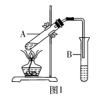
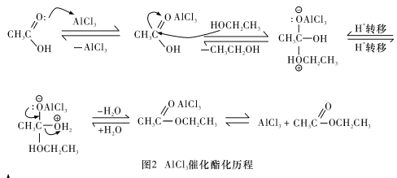
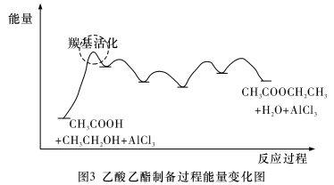
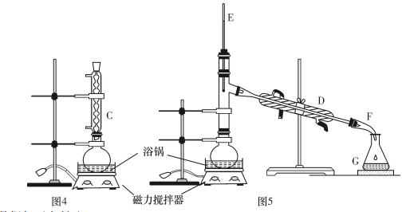

# Chemistry - 题目 118

**ID**: b9ee3d6e0a17438aa0b44cc79e8438d1
**年级**: Grade 12
**难度**: Medium-Hard
**题型**: Experiment

## 题目
乙酸乙酯是一种重要的化工原料，请针对乙酸乙酯的制备实验回答下列问题：(1)某化学小组用图1装置探究无机盐催化酯化反应的效果。​​​​​​​‌经充分反应测得实验数据，并查得相关信息如下：无机盐用量/mmol酯层厚度/cm无机盐用量/mmol酯层厚度/cm${\rm{A}}{\rm{l}}{\rm{C}}{\rm{l}}_{3}$12.1${\rm{F}}{\rm{e}}_{2}\left ({{\rm{S}}{\rm{O}}_{4}}\right )_{3}$12.133.232.453.552.4${\rm{C}}{\rm{a}}{\rm{C}}{\rm{l}}_{2}$30${\rm{N}}{\rm{a}}_{2}{\rm{S}}{\rm{O}}_{4}$30①实验结果表明 ${\rm{A}}{\rm{l}}{\rm{C}}{\rm{l}}_{3}$ 比 ${\rm{F}}{\rm{e}}_{2}\left ({{\rm{S}}{\rm{O}}_{4}}\right )_{3}$ 作催化剂产率相对较高，其可能原因是(填标号)。a.催化剂选择性不同    b.阴离子对反应的阻碍作用不同    c.催化剂用量不同②根据图2和图3写出 ${\rm{A}}{\rm{l}}{\rm{C}}{\rm{l}}_{3}$ 作催化剂时决速反应的化学方程式：。(2)精制乙酸乙酯实验的相关信息如下：部分实验数据如下表所示：原料熔点/℃沸点/℃实验用量/mL密度(g·cm^{-3})冰醋酸16.7118101.0595%乙醇-117.378.4160.8浓硫酸10.53385.61.84饱和碳酸钠溶液————16.7——饱和氯化钠溶液————20.8——饱和氯化钙溶液————13.8——硫酸镁固体————适量——实验步骤如下：①用图4装置制备乙酸乙酯。②用图5装置蒸馏出产品。③洗涤：a.用饱和碳酸钠溶液洗涤，用pH试纸测得产品pH约为7；b.用饱和氯化钠溶液洗涤；c.用饱和氯化钙溶液洗涤。④产品加入适量硫酸镁固体充分振荡，静置、过滤。⑤用图5装置蒸馏滤液，收集73~78℃的馏分。⑥称重产品为8.02g。回答下列问题：i.图4中仪器C的作用是，图5中仪器D的名称是。ii.三次洗涤均用饱和溶液的原因是，ac操作间缺少操作b洗涤可能造成的结果是，洗涤在(填仪器名称)进行，其具体操作为振荡和，反复几次然后静置。iii.已知冰醋酸、乙醇和乙酸乙酯相对分子质量分别为60、46和88，则该实验产率为%(保留四位有效数字)。

## 解答

1. (1) ①实验结果表明 ${\rm{A}}{\rm{l}}{\rm{C}}{\rm{l}}_{3}$ 比 ${\rm{F}}{\rm{e}}_{2}\left ({{\rm{S}}{\rm{O}}_{4}}\right )_{3}$ 作催化剂产率相对较高，但氯离子或硫酸根离子对产率没有影响，所以其可能原因是催化剂选择性不同，选a；
2. ②根据图2和图3写出 ${\rm{A}}{\rm{l}}{\rm{C}}{\rm{l}}_{3}$ 作催化剂时决速反应为活化能最大的的反应，即第一步反应，其化学方程式为： ${\rm{C}}{\rm{H}}_{3}{\rm{C}}{\rm{O}}{\rm{O}}{\rm{H}}+{\rm{A}}{\rm{l}}{\rm{C}}{\rm{l}}_{3}\rightleftharpoons \mathop {{\rm{C}}{\rm{H}}_{3}{\rm{C}}}\limits_{}^{}||$ 或 ${\rm{C}}{\rm{H}}_{3}{\rm{C}}{\rm{O}}{\rm{O}}{\rm{H}}+{\rm{A}}{\rm{l}}{\rm{C}}{\rm{l}}_{3}\rightleftharpoons {\rm{C}}{\rm{H}}_{3}{\rm{C}}{\rm{O}}{\rm{O}}{\rm{H}}\cdot {\rm{A}}{\rm{l}}{\rm{C}}{\rm{l}}_{3}$ ；
3. (2)i.图4中仪器C冷凝管，作用是冷凝回流，图5中仪器D 名称为冷凝管。
4. ii.酯在饱和盐溶液中的溶解度更小，所以三次洗涤均用饱和溶液的原因是减少酯的溶解损失，ac操作间缺少操作b洗涤，碳酸钠和氯化钙能反应生成碳酸钙沉淀，所以可能造成的结果是产生絮状碳酸钙沉淀，增加去除难度，因为酯是液体，所以洗涤在分液漏斗中进行，其具体操作为振荡和放气，反复几次然后静置，然后分液。
5. iii.冰醋酸的质量为10.5克，物质的量为0.175mol，95%乙醇的质量为16×0.8=12.8g，乙醇的物质的量为 $\frac {12.8\times 95\%}{46}=0.2643$ mol，乙醇过量，反应生成的乙酸乙酯的质量为8.02克，物质的量为 $\frac {8.02}{88}=0.0911$ mol，则该实验产率为 $\frac {0.0911}{0.175}\times 100\%=52.08\%$  。

## 知识点

**中文**:
  - 乙酸乙酯的制备
  - 常见仪器与药品的使用
  - 化学实验基本操作
  - 制备实验

**English**:
  - Preparation of Ethyl Acetate
  - Use of Common Instruments and Reagents
  - Basic Laboratory Operations
  - Preparation Experiments

---
