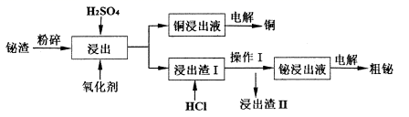
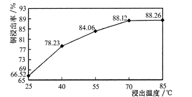
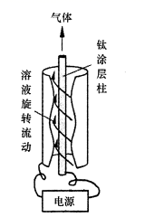

# Chemistry - 题目 273

**ID**: dce0a51eeff141c9b8a031cb0164f88e
**年级**: Grade 12
**难度**: Medium-Hard
**题型**: 工业流程题

## 题目
某化工厂产生的铋渣，主要成分为Bi_{2}O_{3}、PbO、CuO、Sb_{2}O_{3}，按如下流程回收Bi和Cu。​​​​​​​‌已知：Sb_{2}O_{3}难溶于H_{2}SO_{4}；Bi_{2}Oз+2H_{2}SO_{4}=2Bi(OH)SO_{4}↓+H_{2}O。回答下列问题：(1)“粉碎”的目的是。(2)①若氧化剂为H_{2}O_{2}，溶解Cu_{2}O反应的离子方程式为；②温度对铜浸出率的影响如图所示。工业浸出时一般选择70℃~80℃，温度过低时铜浸出率低的原因是；(3)“操作I”为减压过滤。与常压过滤比较，其优点是；(4)①“浸出渣II”的主要成分是SbOCl、；②写出SbCl_{3}水解生成SbOCl的化学方程式：；(5)“铜浸出液”用如图旋流式电解装置电解。①钛涂层柱的电极反应式是；②若“铜浸出液”中含铜92.16g·L^{-1}，选择合适条件进行旋流电解。取电解后溶液25.00mL，加入足量KI溶液充分反应，以淀粉为指示剂，用0.1000mol·L^{-1}的标准液Na_{2}S_{2}O_{3}滴定，反应为：2Cu^{2+}+4I^{-}=2CuI↓+I_{2}、I_{2}+2 ${\rm{S}}_{{\rm{2}}}{\rm{O}}_{{\rm{3}}}^{{\rm{2}}{\rm{-}}}$ =2I^{-}+ ${\rm{S}}_{{\rm{4}}}{\rm{O}}_{{\rm{6}}}^{{\rm{2}}{\rm{-}}}$ ，消耗18.00mL标准液。旋流电解铜回收率是。(用质量分数表示，保留一位小数)。

## 解答

1. (1) “粉碎”的目的是增大接触面积，加快反应速率，提高浸出率，故答案为：增大接触面积，加快反应速率，提高浸出率；
2. (2)① H_{2}O_{2}和Cu_{2}O反应的离子方程式为Cu_{2}O + H_{2}O_{2}+ 4H^{+}= 2Cu^{2+}+3H_{2}O，故答案为：Cu_{2}O + H_{2}O_{2}+ 4H^{+}= 2Cu^{2+}+3H_{2}O；
3. ②温度过低时，浸出速率减慢，从而导致铜浸出率低，故答案为：浸出速率减慢；
4. (3) “操作I”为减压过滤。与常压过滤比较，其优点是过滤和洗涤速度快，滤出的固体容易干燥，故答案为：过滤和洗涤速度快，滤出的固体容易干燥；
5. (4)①PbO与浓硫酸反应生成PbSO_{4}沉淀，加入盐酸PbSO_{4}沉淀不与盐酸反应，所以“浸出渣II”的主要成分是SbOCl，PbSO_{4}，故答案为：PbSO_{4}；
6. ②SbCl_{3}水解生成SbOCl的化学方程式：SbCl_{3}+ H_{2}O = SbOCl↓+2HCl ，故答案为：SbCl_{3}+ H_{2}O = SbOCl↓+2HCl ；
7. (5)①钛涂层柱的电极反应式是2H_{2}O-4e^{-}= O_{2}↑+4H^{+}，故答案为：2H_{2}O-4e^{-}= O_{2}↑+4H^{+}；
8. ②用0.1000mol·L^{-1}的标准液Na_{2}S_{2}O_{3}滴定，反应为：2Cu^{2+}+4I^{-}=2CuI↓+I_{2}、I_{2}+2 ${\rm{S}}_{{\rm{2}}}{\rm{O}}_{{\rm{3}}}^{{\rm{2}}{\rm{-}}}$ =2I^{-}+ ${\rm{S}}_{{\rm{4}}}{\rm{O}}_{{\rm{6}}}^{{\rm{2}}{\rm{-}}}$ ，消耗18.00mL标准液，由2 ${\rm{S}}_{{\rm{2}}}{\rm{O}}_{{\rm{3}}}^{{\rm{2}}{\rm{-}}}$ ～ I_{2}～2Cu^{2+}关系可知Cu^{2+}的物质的量为0.0018mol，Cu^{2+}的质量为0.0018mol×64g/mol=0.1152g，可知25.00mL中含有Cu^{2+}0.1152g，那么1L中含有4.608g，Cu^{2+}的浸出率= $\frac {4.608{\rm{g}}·{\rm{L}}^{-1}}{92.16{\rm{g}}·{\rm{L}}^{-1}}\times 100{\rm{\%}}{\rm{=}}5.0{\rm{\%}}$ ，则旋流电解铜回收率是1-5.0%=95%，故答案为：95.0%。

## 知识点

**中文**:
  - 列比例式根据方程式计算
  - 守恒法与关系式法
  - 盐类水解的原理
  - 过滤
  - 铜及其化合物

**English**:
  - Calculation using Proportional Expressions
  - Conservation Method and Relationship Method
  - Principle of Salt Hydrolysis
  - Filtration
  - Copper and Its Compounds

---
