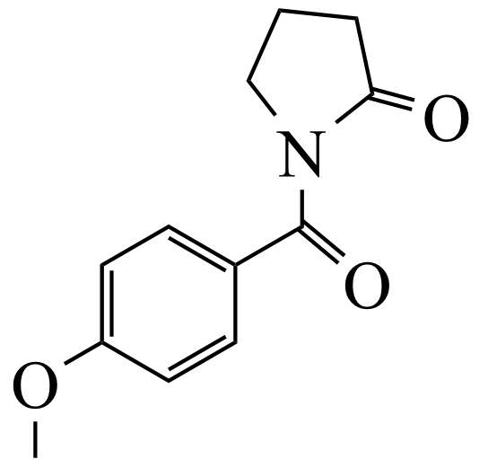
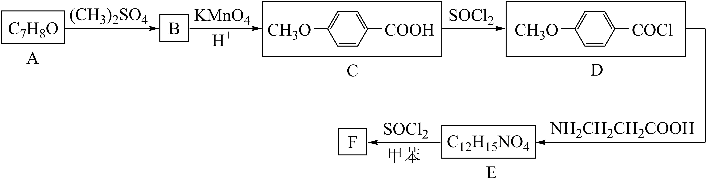
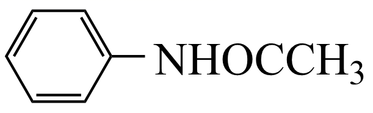

# Chemistry - 题目 283

**ID**: 9f1786bbdd174125bb6f06067eb81659
**年级**: Grade 12
**难度**: Medium-Hard
**题型**: 有机推断题

## 题目
阿尼西坦的主要成分为有机物F()，广泛用于脑血管病后的精神行为障碍，可使生活能力提高，记忆再现，一种合成方法如下：已知：A遇 ${\rm{F}}{\rm{e}}{\rm{C}}{\rm{l}}_{3}$ 溶液显紫色。​​​​​​​‌回答下列问题：(1)用系统命名法命名A为，C中官能团的名称为。(2)化合物F的分子式为。(3)D→E反应的化学方程式为，反应类型为。(4)C有多种同分异构体，满足下列条件的同分异构体还有种(不考虑立体异构)，其中核磁共振氢谱显示有4组峰，其蜂面积比为3∶2∶2∶1的结构简式。①除苯环外无其他环 ②能发生银镜反应和水解反应 ③分子中不存在过氧键(5)下列有关说法正确的是。a.可以用饱和碳酸钠溶液鉴别A和C     b.F中存在手性碳原子c.E能和氢氧化钠溶液反应    d.A与苯酚互为同系物(6)参照题中信息写出以乙烯和苯胺( ${\rm{C}}_{6}{\rm{H}}_{5}{\rm{N}}{\rm{H}}_{2}$ )为原料，合成的路线流程图(其他试剂自选)。

## 解答

1. (1)A为，系统命名法命名为4-甲基苯酚，观察C的结构，可知官能团为醚键和羧基；
2. (2)根据F的结构简式，可知分子式为 ${\rm{C}}_{12}{\rm{H}}_{13}{\rm{N}}{\rm{O}}_{3}$ ；
3. (3)对比D和E的结构简式可知D中Cl原子被其他原子团代替生成E，所以D→E为取代反应，化学方程式为；
4. (4)依题意，①除苯环外无其他环；②能发生银镜反应和水解反应，说明存在-OOCH结构；③分子中不存在过氧键；则如果苯环上只有一个侧链，为 ${\rm{-}}{\rm{O}}{\rm{C}}{\rm{H}}_{2}{\rm{O}}{\rm{O}}{\rm{C}}{\rm{H}}$ 、 ${\rm{-}}{\rm{C}}{\rm{H}}{\rm{O}}{\rm{H}}{\rm{O}}{\rm{O}}{\rm{C}}{\rm{H}}$ 两种，若有两个侧链，则侧链为-OH和 ${\rm{-}}{\rm{C}}{\rm{H}}_{2}{\rm{O}}{\rm{O}}{\rm{C}}{\rm{H}}$ 、 ${\rm{-}}{\rm{C}}{\rm{H}}_{2}{\rm{O}}{\rm{H}}$ 和-OOCH、 ${\rm{-}}{\rm{O}}{\rm{C}}{\rm{H}}_{3}$ 和-OOCH共三种可能，苯环上有三种位置，则有9种；若有三个侧链，只能是-OH和-OOCH、 ${\rm{-}}{\rm{C}}{\rm{H}}_{3}$ ，共10种，则一共有21种；其中核磁共振氢谱显示有4组峰，说明结构对称，其峰面积比为3∶2∶2∶1，说明含有一个甲基，则结构简式为；
5. (5)a. C中含有羧基，能和碳酸钠溶液反应产生气泡，故可以用饱和碳酸钠溶液鉴别A和C，a正确；
6. b. 连有四个不同的基团的碳原子称为手性碳原子，F中不存在手性碳原子，b错误；
7. c. E中存在羧基，能与氢氧化钠溶液反应，c正确；
8. d. A为对甲基苯酚与苯酚互为同系物，d正确；
9. (6)结合题目流程可知，将乙烯先转化为乙醇，再变成乙酸，然后与 ${\rm{S}}{\rm{O}}{\rm{C}}{\rm{l}}_{2}$ 反应得到 ${\rm{C}}{\rm{H}}_{3}{\rm{C}}{\rm{O}}{\rm{C}}{\rm{l}}$ ，再与苯胺反应即可，故流程为CH_{2}=CH_{2}$\xrightarrow []{\mathrm{{\rm{H}}_{{\rm{2}}}{\rm{O}}}}$ CH_{3}CH_{2}OH $\xrightarrow [\mathrm{{\rm{H}}^{{\rm{+}}}}]{\mathrm{{\rm{K}}{\rm{M}}{\rm{n}}{\rm{O}}_{{\rm{4}}}}}$ CH_{3}COOH $\xrightarrow []{\mathrm{{\rm{S}}{\rm{O}}{\rm{C}}{\rm{l}}_{{\rm{2}}}}}$ CH_{3}COCl。

## 知识点

**中文**:
  - 有机合成与推断综合

**English**:
  - Synthesis and Deduction

---
