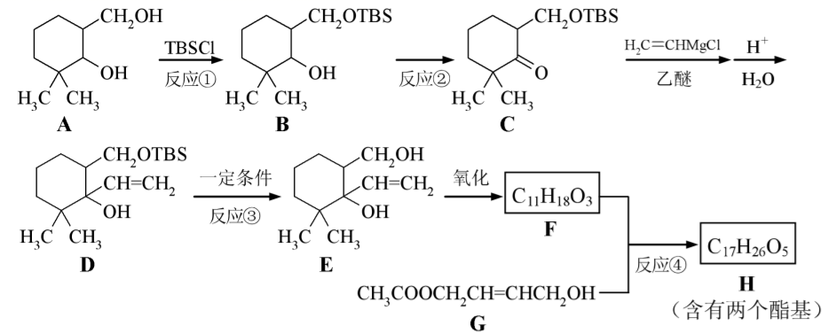

# Chemistry - 题目 326

**ID**: b6fe5673bfb6475cbe79d26d71fa52ec
**年级**: Grade 12
**难度**: Medium-Hard
**题型**: 元素或物质推断题

## 题目
有机物H是合成抗肿瘤药物的重要中间体，其合成路线如下：完成下列填空：(1)E中含有的官能团名称为。​​​​​​​‌A的分子式为。④的反应类型为。(2)反应②的化学方程式为。(3)合成过程中使用TBSCl试剂的目的是。(4)G的同分异构体有多种，写出一种满足下列条件的结构简式。①能使石蕊试液变色；②能发生银镜反应；③分子中含有两个甲基。(5)设计由乙酸和1，3-丁二烯为原料合成G( ${\rm{C}}{\rm{H}}_{3}{\rm{C}}{\rm{O}}{\rm{O}}{\rm{C}}{\rm{H}}_{2}{\rm{C}}{\rm{H}}={\rm{C}}{\rm{H}}{\rm{C}}{\rm{H}}_{2}{\rm{O}}{\rm{H}}$ )的路线。 (合成路线常用的表示方式为：甲 $\xrightarrow [\mathrm{{\rm{反}}{\rm{应}}{\rm{条}}{\rm{件}}}]{\mathrm{{\rm{反}}{\rm{应}}{\rm{试}}{\rm{剂}}}}$ 乙…… $\xrightarrow [\mathrm{{\rm{反}}{\rm{应}}{\rm{条}}{\rm{件}}}]{\mathrm{{\rm{反}}{\rm{应}}{\rm{试}}{\rm{剂}}}}$ 目标产物)

## 解答

1. (1)通过E的结构简式可知，E中含有的官能团名称为碳碳双键、羟基；通过观察A的分子结构式，可知其不饱和度为1，数其碳原子数为9，测其分子式为 ${\rm{C}}_{9}{\rm{H}}_{18}{\rm{O}}_{2}$ ；H的结构中含有两个酯基，G和F生成H ,G的结构中有一个酯基和一个羟基，则F的结构中比含有一个羧基和G的羟基酯化，酯化反应是取代反应，故④的反应类型为取代反应。
2. (2)反应②是B生成了C，观察两种物质的结构简式，B结构中的羟基被氧化成C中的醛基，其他结构没变，由乙醇氧化为乙醛，可得反应②的化学方程式为O_{2}$\xrightarrow [\mathrm{加热}]{\mathrm{Cu}}$+2H_{2}O。
3. (3)从A→B→C→D→E的反应路线来看，使用TBSCl试剂的目的是防止A结构中的 ${\rm{-}}{\rm{\;}}{\rm{C}}{\rm{H}}{\rm{\;}}_{{\rm{2}}}{\rm{O}}{\rm{H}}$ 基团在反应②中被氧化，故答案为保护 ${\rm{-}}{\rm{\;}}{\rm{C}}{\rm{H}}{\rm{\;}}_{{\rm{2}}}{\rm{O}}{\rm{H}}$ 基团不被氧化。
4. (4) G的同分异构体有多种，满足能使石蕊试液变色，说明结构中含有羧基，满足能发生银镜反应，则结构中有醛基，还要有两个双键，则满足这三个条件的G的同分异构体结构简式很多，如：或或或或。
5. (5)由G的结构简式 ${\rm{C}}{\rm{H}}_{{\rm{3}}}{\rm{C}}{\rm{O}}{\rm{O}}{\rm{C}}{\rm{H}}_{{\rm{2}}}{\rm{C}}{\rm{H}}{\rm{=}}{\rm{C}}{\rm{H}}{\rm{C}}{\rm{H}}_{{\rm{2}}}{\rm{O}}{\rm{H}}$ 可知，要合成G，必须想法找到乙酸和 ${\rm{H}}{\rm{O}}{\rm{C}}{\rm{H}}_{2}{\rm{C}}{\rm{H}}={\rm{C}}{\rm{H}}{\rm{C}}{\rm{H}}_{2}{\rm{O}}{\rm{H}}$ ，题目提供了乙酸，那就要想办法由1，3-丁二烯 ${\rm{C}}{\rm{H}}_{2}={\rm{C}}{\rm{H}}-{\rm{C}}{\rm{H}}={\rm{C}}{\rm{H}}_{2}$ 为原料合成出 ${\rm{H}}{\rm{O}}{\rm{C}}{\rm{H}}_{2}{\rm{C}}{\rm{H}}={\rm{C}}{\rm{H}}{\rm{C}}{\rm{H}}_{2}{\rm{O}}{\rm{H}}$ ，要在结构中引入羟基，就要想法引入卤素原子，利用卤代烃的水解反应引入羟基，故G的合成路线为 ${\rm{C}}{\rm{H}}_{2}={\rm{C}}{\rm{H}}-{\rm{C}}{\rm{H}}={\rm{C}}{\rm{H}}_{2}\xrightarrow []{\mathrm{{\rm{B}}{\rm{r}}_{2}}}{\rm{B}}{\rm{r}}{\rm{C}}{\rm{H}}_{2}{\rm{C}}{\rm{H}}={\rm{C}}{\rm{H}}{\rm{C}}{\rm{H}}_{2}{\rm{B}}{\rm{r}}\xrightarrow [\mathrm{Δ}]{\mathrm{{\rm{N}}{\rm{a}}{\rm{O}}{\rm{H}}/{\rm{H}}_{2}{\rm{O}}}}{\rm{H}}{\rm{O}}{\rm{C}}{\rm{H}}_{2}{\rm{C}}{\rm{H}}={\rm{C}}{\rm{H}}{\rm{C}}{\rm{H}}_{2}{\rm{O}}{\rm{H}}$  $\xrightarrow [\mathrm{{\rm{浓}}{\rm{硫}}{\rm{酸}}{\rm{/}}{\rm{Δ}}}]{\mathrm{{\rm{C}}{\rm{H}}_{{\rm{3}}}{\rm{C}}{\rm{O}}{\rm{O}}{\rm{H}}}}{\rm{C}}{\rm{H}}_{{\rm{3}}}{\rm{C}}{\rm{O}}{\rm{O}}{\rm{C}}{\rm{H}}_{{\rm{2}}}{\rm{C}}{\rm{H}}{\rm{=}}{\rm{C}}{\rm{H}}{\rm{C}}{\rm{H}}_{{\rm{2}}}{\rm{O}}{\rm{H}}$ 。

## 知识点

**中文**:
  - 从简单物质开始的顺向合成
  - 常见官能团名称、组成及结构
  - 同分异构体的书写和数目判断
  - 官能团的保护

**English**:
  - Linear Synthesis from Simple Substances
  - Names, Composition and Structure of Functional Groups
  - Writing and Counting Isomers
  - Protection of Functional Groups

---
