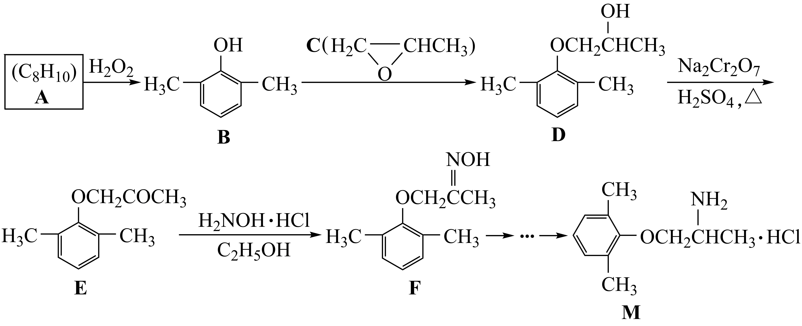
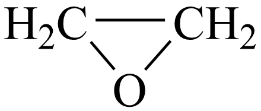
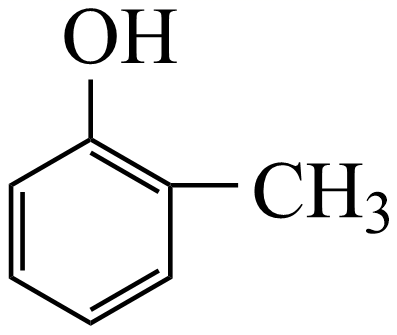
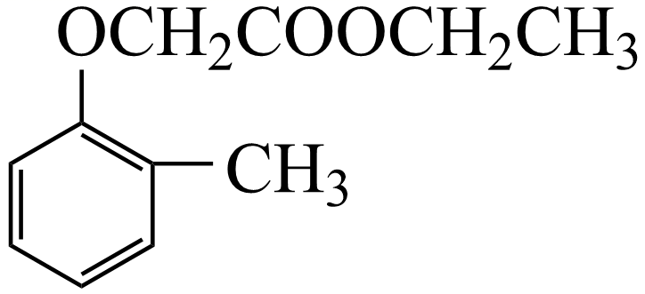

# Chemistry - 题目 302

**ID**: fbafab6f3b49479c91d2a2d2d33387ef
**年级**: Grade 12
**难度**: Medium-Hard
**题型**: 有机推断题

## 题目
有机物M可用于治疗室性早搏、室性心动过速、心室颤动等心血管疾病，其合成路线如图所示：请回答下列问题：(1)A的名称为，E中含氧官能团的名称为和。​​​​​​​‌(2)A→B的反应类型是，B→D的反应类型是。(3)由B制备D的过程中有少量副产物G产生，它与D互为同分异构体，写出G的结构简式。(4)化合物H与C为同分异构体，H能与新制的氧化铜悬浊液共热反应生成红色沉定，写出H发生银镜反应的化学方程式。(5)写出同时满足下列条件的化合物F的一种同分异构体的结构简式。①属于α一氨基酸；②苯环上的一氯代物只有两种。③分子中有2个手性碳原子(连接4个不相同的原子或原子团的碳原子)。(6)已知乙烯在催化剂作用下与氧气反应可以生成环氧乙烷()，参照题干的合成路线流程图，写出以邻甲基苯酚()和乙醇为原料制备的合成路线流程图(无机试剂任用)。。

## 解答

1. (1)A的结构简式为，A为间二甲苯；E中含氧官能团的名称为醚键、羰基；
2. (2)和H_{2}O_{2}反应生成，该反应为氧化反应；和反应生成，该反应为取代反应；
3. (3)由B制备D的过程中有少量副产物G产生，它与D互为同分异构体，则G的结构简式为；
4. (4)化合物H与C为同分异构体，H能与新制的氢氧化铜悬浊液共热反应生成红色沉定，H中含有醛基，则H的结构简式为CH_{3}CH_{2}CHO，则H发生银镜反应的化学方程式为CH_{3}CH_{2}CHO+2 $\left [{\rm{A}}{\rm{g}}\left ({{\rm{N}}{\rm{H}}_{{\rm{3}}}}\right )_{{\rm{2}}}\right ]{\rm{O}}{\rm{H}}$  $\xrightarrow []{\mathrm{\vartriangle }}$ CH_{3}CH_{2}COONH_{4}+2Ag↓+2NH_{3}↑+H_{2}O；
5. (5)①属于α一氨基酸，说明含有-NH_{2}和-COOH，且二者连在同一个碳原子上；②苯环上的一氯代物只有两种，说明苯环上有2种不同环境的H原子；③分子中有2个手性碳原子(连接4个不相同的原子或原子团的碳原子)；满足条件的化合物F的一种同分异构体的结构简式为；
6. (6)乙醇分子间发生消去反应生成乙烯，乙烯氧化可生成，和反应生成，被氧化生成，被氧化生成，和乙醇发生酯化反应生成，合成路线为。

## 知识点

**中文**:
  - 乙醛的银镜反应
  - 常见官能团名称、组成及结构
  - 同分异构体的书写和数目判断
  - 有机合成与推断综合

**English**:
  - Silver Mirror Reaction
  - Names, Composition and Structure of Functional Groups
  - Writing and Counting Isomers
  - Synthesis and Deduction

---
