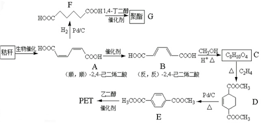

# Chemistry - 题目 172

**ID**: 01e78078adbf401da72f4530595cf1d8
**年级**: Grade 12
**难度**: Medium-Hard
**题型**: 非选择题

## 题目
秸秆（含多糖物质）的综合应用具有重要的意义。​​​​​​​‌下面是以秸秆为原料合成聚酯类高分子化合物的路线：回答下列问题：（1）下列关于糖类的说法正确的是。（填标号）

## 解答

1. （1）A．糖类不一定有甜味，如纤维素等，组成通式不一定都是C_{n}H_{2m}O_{m}形式，如脱氧核糖(C_{6}H_{10}O_{4})，故A错误；
2. B．葡萄糖与果糖互为同分异构体，但麦芽糖水解生成葡萄糖，故B错误；
3. C．淀粉水解生成葡萄糖，能发生银镜反应说明含有葡萄糖，说明淀粉水解了，不能说明淀粉完全水解，故C正确；
4. D．淀粉和纤维素都属于多糖类，是天然高分子化合物，故D正确；
5. 故选CD；
6. （2）B与甲醇发生酯化反应生成C，属于取代反应，故答案为酯化反应或取代反应；
7. （3）由D的结构简式可知，含有的官能团有酯基、碳碳双键，D脱去2分子氢气形成苯环得到E，属于氧化反应，故答案为酯基、碳碳双键；氧化反应；
8. （4）F的名称为己二酸，己二酸与1，4-丁二醇发生缩聚反应生成，反应方程式为：n HOOC(CH_{2})_{4}COOH+n HOCH_{2}CH_{2}CH_{2}CH_{2}OH→+(2n-1)H_{2}O，故答案为己二酸；n HOOC(CH_{2})_{4}COOH+n HOCH_{2}CH_{2}CH_{2}CH_{2}OH→+(2n-1)H_{2}O；
9. （5）具有一种官能团的二取代芳香化合物W是E的同分异构体，0.5mol W与足量碳酸氢钠溶液反应生成44gCO_{2}，生成二氧化碳为1mol，说明W含有2个羧基，2个取代基为-COOH、-CH_{2}CH_{2}COOH，或者为-COOH、-CH(CH_{3})COOH，或者为-CH_{2}COOH、-CH_{2}COOH，或者-CH_{3}、-CH(COOH)_{2}，各有邻、间、对三种，共有12种，其中核磁共振氢谱为三组峰的结构简式为：，故答案为12；；
10. （6）(反，反)-2，4-己二烯与乙烯发生加成反应生成，在Pd/C作用下生成，然后用酸性高锰酸钾溶液氧化生成，合成路线流程图为：，故答案为。
11. 〖点晴〗
12. 本题考查有机物的合成、官能团的结构与性质、有机反应类型、限制条件同分异构体书写等，是对有机化学基础基础的综合考查，（6）中注意根据题目中转化关系涉及合成路线，较好的考查学生知识迁移运用能力。

## 知识点

**中文**:
  - 有机合成与推断综合

**English**:
  - Synthesis and Deduction

---
