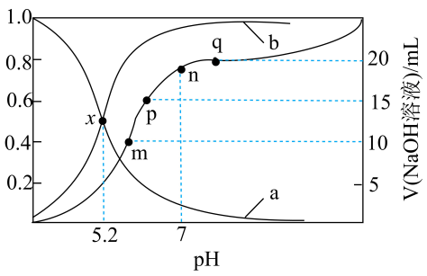

# Chemistry - 题目 308

**ID**: 124ac51680fc48cbbee4a1bdc27a712d
**年级**: Grade 12
**难度**: Medium-Hard
**题型**: Multiple-choice

## 题目
常温下，用0.1mol/L的NaOH溶液滴定20mL0.1mol/LHA溶液。​​​​​​​‌溶液中 ${\rm{A}}{^{-}}$ （或HA）的分布系数δ、NaOH溶液体积V与pH的关系如图所示［已知： $δ({\rm{H}}{\rm{A}})=\frac {c({\rm{H}}{\rm{A}})}{c({\rm{H}}{\rm{A}})+c\left ({{\rm{A}}{^{-}}}\right )}$ ］。下列说法正确的是（      ）

## 解答

1. A．m点对应的溶液中的溶质为等量NaA和HA，此时溶液pH小于7即c(H^{+})＞c(OH^{-})，说明A^{-}水解程度小于HA电离程度，则c(A^{-})>c(Na^{+})，故A错误；
2. B．由图可知，曲线a、b的交点x表示HA和A^{-}的分布系数相同，即溶液中c(HA)=c(A^{-})，由电离平衡常数计算式 ${\rm Ka=}\frac {{\rm{c}}\left ({{\rm{A}}{^{{{-}}}}}\right )\cdot {\rm{c}}\left ({{\rm{H}}{^{+}}}\right )}{{\rm{c}}\left ({{\rm{H}}{\rm{A}}}\right )}{\rm{=}}{\rm{c}}\left ({{\rm{H}}{^{+}}}\right ){\rm{=}}10{^{{{-}}5.2}}{\rm ，0.1mol}$ /LHA溶液的 ${\rm{c}}\left ({{\rm{H}}{^{+}}}\right )\approx \sqrt {{\rm{K}}{{}_{{\rm{a}}}}\cdot {\rm{c}}\left ({{\rm{H}}{\rm{A}}}\right )}{\rm{=}}\sqrt {10{^{{{-}}5.2}}\times 0.1}{\rm{=}}{{1}}{{0}}{^{{{-}}3.1}}$ ，则pH约为3.1，故B正确；
3. C．p点加入15mL的等浓度NaOH溶液，起始是20mL等浓度的HA溶液，存在电荷守恒：c(Na^{+})+c(H^{+})=c(A^{-})+c(OH^{-})，根据原子守恒，含Na和A的粒子总的浓度之比是3:4，故得到物料守恒：4 c(Na^{+})=3c(A^{-})+3 c(HA)，结合两式可得： $4c\left ({{\rm{H}}{^{+}}}\right )+3c({\rm{H}}{\rm{A}})=4c\left ({{\rm{O}}{\rm{H}}{^{-}}}\right )+c\left ({{\rm{A}}{^{-}}}\right )$ ，故C错误；
4. D．由图可知，q点是NaOH和HA恰好完全反应的点，此时溶液中只有A^{-}的水解促进水的电离，水的电离程度最大，故D错误；
5. 故选B。

## 知识点

**中文**:
  - 影响水电离的因素
  - 溶液中微粒间的电荷守恒、质子守恒、物料守恒
  - 溶液中微粒浓度大小比较

**English**:
  - Factors Affecting Water Ionization
  - Charge Balance, Proton Balance, and Material Balance
  - Comparison of Particle Concentrations

---
