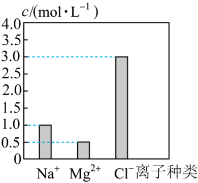

# Chemistry - 题目 48

**ID**: 22caa25dd9b34851940b70ffafce439d
**年级**: Grade 12
**难度**: Medium-Hard
**题型**: 非选择题

## 题目
某100mL溶液中含有的部分离子浓度如图所示，该溶液可能还含有 ${\rm{F}}{\rm{e}}{^{3+}}$ 、 ${\rm{B}}{\rm{a}}{^{2+}}$ 、 ${\rm{H}}{^{+}}$ 、 ${\rm{S}}{\rm{O}}{{}_{4}^{2-}}$ 、 ${\rm{C}}{\rm{O}}{{}_{3}^{2-}}$ 中的一种或几种。​​​​​​​‌某同学为确定该溶液中的离子组成，进行了实验探究，回答下列问题：(1)完成下列表格。实验操作与现象实验结论判断理由步骤一仔细观察图①肯定无②步骤二该溶液呈无色、透明、均一状态③肯定无④步骤三加足量盐酸酸化的 ${\rm{B}}{\rm{a}}{\rm{C}}{\rm{l}}{{}_{{{2}}}}$ 溶液，得到23.3g白色沉淀肯定有 ${\rm{S}}{\rm{O}}{{}_{4}^{2-}}$ 、 ${\rm{H}}{^{+}}$ ；肯定无 ${\rm{B}}{\rm{a}}{^{2+}}$⑤肯定有 ${\rm{H}}{^{+}}$ 的判定依据是(2)步骤三中称量沉淀前的实验操作有过滤、、干燥、灼烧、在干燥器中冷却。(3)原溶液中 ${\rm{H}}{^{+}}$ 的物质的量浓度为${\rm{m}}{\rm{o}}{\rm{l}}\cdot {\rm{L}}{^{-1}}$ 。(4)向原溶液中加入 ${\rm{N}}{\rm{a}}{\rm{H}}{\rm{C}}{\rm{O}}{{}_{{{3}}}}$ 溶液，发生反应的离子方程式为。(5)若向100mL该溶液中加入 $1.0{\rm{m}}{\rm{o}}{\rm{l}}\cdot {\rm{L}}{^{-1}}$ 的 ${\rm{B}}{\rm{a}}\left ({{\rm{O}}{\rm{H}}}\right ){{}_{{{2}}}}$ 溶液，当 ${\rm{M}}{\rm{g}}{^{2+}}$ 恰好沉淀完全时加入的 ${\rm{B}}{\rm{a}}\left ({{\rm{O}}{\rm{H}}}\right ){{}_{{{2}}}}$ 溶液的体积为L。

## 解答

1. (1)步骤一：由题图可知，溶液中含有 ${\rm{M}}{\rm{g}}{^{2+}}$ ，因为 ${\rm{C}}{\rm{O}}{{}_{3}^{2-}}$ 会与 ${\rm{M}}{\rm{g}}{^{2+}}$ 反应生成微溶于水的 ${\rm{M}}{\rm{g}}{\rm{C}}{\rm{O}}{{}_{{{3}}}}$ ，所以一定不含 ${\rm{C}}{\rm{O}}{{}_{3}^{2-}}$ ；步骤二：因为含 ${\rm{F}}{\rm{e}}{^{3+}}$ 的溶液显棕黄色，则无色、透明、均一状态的溶液中肯定不含 ${\rm{F}}{\rm{e}}{^{3+}}$ ；步骤三：加足量盐酸酸化的 ${\rm{B}}{\rm{a}}{\rm{C}}{\rm{l}}{{}_{{{2}}}}$ 溶液，得到23.3g白色沉淀，说明溶液中一定含有 ${\rm{S}}{\rm{O}}{{}_{4}^{2-}}$ ，一定不含 ${\rm{B}}{\rm{a}}{^{2+}}$ ，且 ${\rm{S}}{\rm{O}}{{}_{4}^{2-}}$ 的物质的量为 $\frac {23.3{\rm{g}}}{233{\rm{g}}\cdot {\rm{m}}{\rm{o}}{\rm{l}}{^{-1}}}=0.1{\rm{m}}{\rm{o}}{\rm{l}}$ ， ${\rm{S}}{\rm{O}}{{}_{4}^{2-}}$ 的浓度为 $1.0{\rm{m}}{\rm{o}}{\rm{l}}\cdot {\rm{L}}{^{-1}}$ ，溶液中，阳离子所带的正电荷总浓度为 $1.0{\rm{m}}{\rm{o}}{\rm{l}}\cdot {\rm{L}}{^{-1}}+2\times 0.5{\rm{m}}{\rm{o}}{\rm{l}}\cdot {\rm{L}}{^{-1}}=2.0{\rm{m}}{\rm{o}}{\rm{l}}\cdot {\rm{L}}{^{-1}}$ ，阴离子所带的负电荷总浓度为 $3.0{\rm{m}}{\rm{o}}{\rm{l}}\cdot {\rm{L}}{^{-1}}+2\times 1.0{\rm{m}}{\rm{o}}{\rm{l}}\cdot {\rm{L}}{^{-1}}=5{{.}}0{\rm{m}}{\rm{o}}{\rm{l}}\cdot {\rm{L}}{^{-1}}$ ，由电荷守恒可知，溶液中一定还含有 ${\rm{H}}{^{+}}$ ，且 ${\rm{H}}{^{+}}$ 的浓度为 ${{3}}{{.}}{{0}}{\rm{m}}{\rm{o}}{\rm{l}}\cdot {\rm{L}}{^{-1}}$ ；
2. (2)步骤三中称量沉淀前的实验操作有过滤、洗涤、干燥、灼烧、在干燥器中冷却；
3. (3)由以上分析知，原溶液中 ${\rm{H}}{^{+}}$ 的物质的量浓度为 ${{3}}{{.}}{{0}}{\rm{m}}{\rm{o}}{\rm{l}}\cdot {\rm{L}}{^{-1}}$ ；
4. (4)原溶液中含有H^{+}，则向原溶液中加入 ${\rm{N}}{\rm{a}}{\rm{H}}{\rm{C}}{\rm{O}}{{}_{{{3}}}}$ 溶液，发生反应的离子方程式为 ${\rm{H}}{\rm{C}}{\rm{O}}{{}_{3}}{^{-}}+{\rm{H}}{^{+}}{\rm{=}}{\rm{C}}{\rm{O}}{{}_{2}}\uparrow +{\rm{H}}{{}_{{{2}}}}{\rm{O}}$ ；
5. (5)若向100mL该溶液中加入 $1.0{\rm{m}}{\rm{o}}{\rm{l}}\cdot {\rm{L}}{^{-1}}$ 的 ${\rm{B}}{\rm{a}}\left ({{\rm{O}}{\rm{H}}}\right ){{}_{{{2}}}}$ 溶液， ${\rm{B}}{\rm{a}}\left ({{\rm{O}}{\rm{H}}}\right ){{}_{{{2}}}}$ 先与 ${\rm{H}}{^{+}}$ 反应，
6. 再与 ${\rm{M}}{\rm{g}}{^{2+}}$ 反应，由上述计算可知， ${\rm{H}}{^{+}}$ 的浓度为 ${{3}}{{.}}{{0}}{\rm{m}}{\rm{o}}{\rm{l}}\cdot {\rm{L}}{^{-1}}$ ，则 ${\rm{H}}{^{+}}$ 的物质的量为 ${{3}}{{.}}{{0}}{\rm{m}}{\rm{o}}{\rm{l}}\cdot {\rm{L}}{^{-1}}\times 0.1{\rm{L}}={{0}}{{.}}{{3}}{\rm{m}}{\rm{o}}{\rm{l}}$ ，消耗0. ${\rm 15mol}{\rm{B}}{\rm{a}}\left ({{\rm{O}}{\rm{H}}}\right ){{}_{{{2}}}}$ ， ${\rm{M}}{\rm{g}}{^{2+}}$ 的浓度为 $0.5{\rm{m}}{\rm{o}}{\rm{l}}\cdot {\rm{L}}{^{-1}}$ ，
7. 则 ${\rm{M}}{\rm{g}}{^{2+}}$ 的物质的量为 ${{0}}{{.}}{{5}}{\rm{m}}{\rm{o}}{\rm{l}}\cdot {\rm{L}}{^{-1}}\times 0.1{\rm{L}}={{0}}{{.}}{{0}}{{5}}{\rm{m}}{\rm{o}}{\rm{l}}$ ，消耗0. ${\rm 05mol}{\rm{B}}{\rm{a}}\left ({{\rm{O}}{\rm{H}}}\right ){{}_{{{2}}}}$ ，则消耗 ${\rm{B}}{\rm{a}}\left ({{\rm{O}}{\rm{H}}}\right ){{}_{{{2}}}}$ 的总物质的量为0.2mol，体积为： $\frac {0.2{\rm{m}}{\rm{o}}{\rm{l}}}{1.0{\rm{m}}{\rm{o}}{\rm{l}}\cdot {\rm{L}}{^{-1}}}=0.2{\rm{L}}$ 。

## 知识点

**中文**:
  - 离子反应的发生条件
  - 离子方程式的书写及正误判断
  - 离子推断

**English**:
  - Conditions for Ionic Reactions
  - Writing and Verifying Ionic Equations
  - Inference of Ions

---
