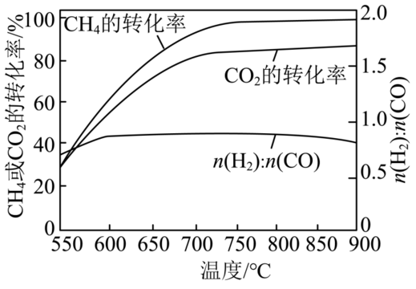

# Chemistry - 题目 68

**ID**: 3365db736b0349ffa9d3e4fce3fc1909
**年级**: Grade 12
**难度**: Medium-Hard
**题型**: Multiple-choice

## 题目
${\rm{C}}{\rm{H}}{{}_{4}}$ 和 ${\rm{C}}{\rm{O}}{{}_{2}}$ 联合重整能减少温室气体的排放。​​​​​​​‌其他条件相同时， $n\left ({{\rm{C}}{\rm{H}}{{}_{4}}}\right ):n\left ({{\rm{C}}{\rm{O}}{{}_{2}}}\right )$ 投料比为 $1:1.5$ ，发生以下两个反应：① ${\rm{C}}{\rm{H}}{{}_{4}}\left ({{\rm{g}}}\right )+{\rm{C}}{\rm{O}}{{}_{2}}\left ({{\rm{g}}}\right )\rightleftharpoons 2{\rm{H}}{{}_{2}}\left ({{\rm{g}}}\right )+2{\rm{C}}{\rm{O}}\left ({{\rm{g}}}\right )$    $ΔH=+247.1{\rm{k}}{\rm{J}}\cdot {\rm{m}}{\rm{o}}{\rm{l}}{^{-1}}$ ；② ${\rm{H}}{{}_{2}}\left ({{\rm{g}}}\right )+{\rm{C}}{\rm{O}}{{}_{2}}\left ({{\rm{g}}}\right )\rightleftharpoons {\rm{H}}{{}_{2}}{\rm{O}}\left ({{\rm{g}}}\right )+{\rm{C}}{\rm{O}}\left ({{\rm{g}}}\right )$    $ΔH=+41.2{\rm{k}}{\rm{J}}\cdot {\rm{m}}{\rm{o}}{\rm{l}}{^{-1}}$ 。${\rm{C}}{\rm{H}}{{}_{4}}$ 或 ${\rm{C}}{\rm{O}}{{}_{2}}$ 的平衡转化率与温度变化关系如图所示，下列说法错误的是（      ）

## 解答

1. A．反应①②同时发生，反应②会破坏反应①的平衡，所以两个反应应该同时达到平衡，故A正确；
2. B．由图可知，550～600℃条件下，甲烷的转化率大于二氧化碳的转化率，说明升温更有利于反应①，故B错误；
3. C．升高温度和增大压强，化学反应速率均增大，则加热、加压时，反应①②的反应速率均会增大，故C正确；
4. D．由方程式可知，反应①中氢气与一氧化碳的物质的量比始终为1.0，则氢气与一氧化碳的物质的量比始终低于1.0说明发生了反应②，故D正确；
5. 故选B。

## 知识点

**中文**:
  - 压强对于化学反应速率的影响
  - 温度对于化学反应速率的影响
  - 温度对化学平衡的影响

**English**:
  - Effect of Pressure
  - Effect of Temperature
  - Effect of Temperature

---
