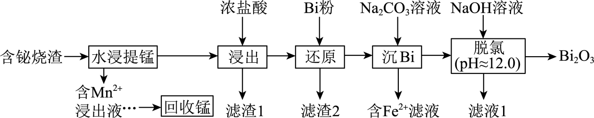
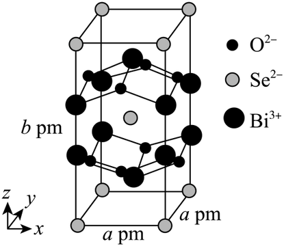

# Chemistry - 题目 158

**ID**: 34fe7b545ca7464bb1ea68785ff55b6e
**年级**: Grade 12
**难度**: Medium-Hard
**题型**: 非选择题

## 题目
铋及其化合物广泛应用于电子材料、医药等领域。​​​​​​​‌一种以含铋烧渣(主要成分为Bi_{2}O_{3}、MnSO_{4}，还含有少量MnS、Fe_{2}O_{3}、CuO及SiO_{2}等)制取Bi_{2}O_{3}，并回收锰的工艺流程如下：已知：①氧化性：Cu^{2+}＞Bi^{3+}；②Bi^{3+}易水解成BiOCl沉淀；常温下，BiOCl存在的pH范围约为2.0~11.0；③常温下， $K{{}_{{\rm{s}}{\rm{p}}}}\left [{\rm{F}}{\rm{e}}\left ({{\rm{O}}{\rm{H}}}\right ){{}_{2}}\right ]=4.9\times 10{^{-17}}$ ；lg7=0.85。(1)基态锰原子的价电子排布式为。(2)“水浸提锰”时，另加入少量稀硫酸可促进溶解，进一步提高锰的浸取率。(3)“滤渣2”的主要成分有、Bi。(4)常温下，“含Fe^{2+}滤液”中Fe^{2+}的浓度为0.01 mol·L^{-1}。为保证BiOCl产品的纯度，理论上，“沉铋”时应控制溶液的pH＜。(5)“脱氯”过程中发生主要反应的离子方程式为。(6)我国科学家在新型二维半导体芯片材料——硒氧化铋的研究中取得突破性进展。硒氧化铋的晶胞结构如图所示，晶胞棱边夹角均为90°，晶胞参数为a pm，a pm，b pm。①该晶胞沿z轴方向的投影图为(填标号)

## 解答

1. （1）Mn是25号元素，根据构造原理可得其价电子排布式为 $3{\rm{d}}{^{5}}4{\rm{s}}{^{2}}$ 。
2. （2）MnS可以溶解于稀酸，“水浸提锰”时，另加入少量稀硫酸可促进MnS溶解，进一步提高锰的浸取率。
3. （3）根据已知信息①， ${\rm{C}}{\rm{u}}{^{2+}}$ 氧化性大于 ${\rm{B}}{\rm{i}}{^{3+}}$ ，则“还原”步骤中，Bi与 ${\rm{C}}{\rm{u}}{^{2+}}$ 反应生成了Cu单质，则“滤渣2”主要成分有Cu和Bi。
4. （4）Fe^{2+}开始沉淀时， ${\rm c(OH^{-})=}\sqrt {\frac {K{{}_{{\rm{s}}{\rm{p}}}}\left [{\rm{F}}{\rm{e}}\left ({{\rm{O}}{\rm{H}}}\right ){{}_{2}}\right ]}{{\rm{c}}\left ({{\rm{F}}{\rm{e}}{^{{{2}}{{+}}}}}\right )}}=\sqrt {\frac {4.9\times 10{^{-17}}}{0.01}}{\rm{m}}{\rm{o}}{\rm{l}}{\rm{/}}{\rm{L}}{\rm{=}}7\times 10{^{-8}}{\rm{m}}{\rm{o}}{\rm{l}}{\rm{/}}{\rm{L}}{\rm ，c(H^{+})=}$  $\frac {{\rm{K}}{{}_{{\rm{W}}}}}{{\rm{c}}\left ({{\rm{O}}{\rm{H}}{^{{{-}}}}}\right )}=\frac {1\times 10{^{-14}}}{7\times 10{^{-8}}}{\rm{m}}{\rm{o}}{\rm{l}}{\rm{/}}{\rm{L}}{\rm{=}}\frac {1}{7}\times 10{^{-6}}{\rm{m}}{\rm{o}}{\rm{l}}{\rm{/}}{\rm{L}}{\rm ，pH=-lgc(H^{+})=-lg}$  $\frac {1}{7}\times 10{^{-6}}{\rm =6-lg}$  $\frac {1}{7}{\rm =6-lg1+lg7=6.85}$ ，为保证BiOCl产品的纯度，避免Fe^{2+}沉淀，理论上，“沉铋”时应控制溶液的pH＜6.85。
5. （5）“脱氯”过程中 ${\rm{B}}{\rm{i}}{\rm{O}}{\rm{C}}{\rm{l}}$ 和OH^{-}反应生成 ${\rm{B}}{\rm{i}}{{}_{2}}{\rm{O}}{{}_{3}}$ 和Cl^{-}，离子方程式为： $2{\rm{B}}{\rm{i}}{\rm{O}}{\rm{C}}{\rm{l}}+2{\rm{O}}{\rm{H}}{^{-}}={\rm{B}}{\rm{i}}{{}_{2}}{\rm{O}}{{}_{3}}+2{\rm{C}}{\rm{l}}{^{-}}+{\rm{H}}{{}_{2}}{\rm{O}}$ 。
6. （6）①由晶胞结构可知，该晶胞沿z轴方向的投影图为，故选B；
7. ②由晶胞结构可知，以面上的 ${\rm{O}}{^{2-}}$ 为研究对象，其距离最近的 ${\rm{B}}{\rm{i}}{^{3+}}$ 有4个，故该晶体中，每个 ${\rm{O}}{^{2-}}$ 周围紧邻的 ${\rm{B}}{\rm{i}}{^{3+}}$ 共有4个；
8. ③由晶胞结构可知，该晶胞中 ${\rm{B}}{\rm{i}}{^{3+}}$ 的个数为 $8\times \frac {1}{4}+2=4$ ， ${\rm{S}}{\rm{e}}{^{2-}}$ 的个数为 $8\times \frac {1}{8}+1=2$ ， ${\rm{O}}{^{2-}}$ 的个数为 $8\times \frac {1}{2}=4$ ，该晶体的密度为 $\frac {209\times 4+16\times 4+79\times 2}{N{{}_{{\rm{A}}}}\times a{^{2}}b\times 10{^{-30}}}{\rm{g}}\cdot {\rm{c}}{\rm{m}}{^{-3}}$ 。

## 知识点

**中文**:
  - 晶胞投影图
  - 离子方程式的书写及正误判断

**English**:
  - Unit Cell Projections
  - Writing and Verifying Ionic Equations

---
