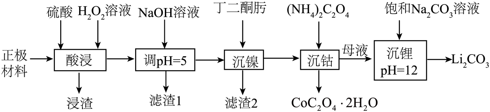
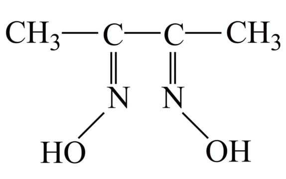

# Chemistry - 题目 74

**ID**: 597af33828354a25864122bcc3402775
**年级**: Grade 12
**难度**: Medium-Hard
**题型**: 非选择题

## 题目
某废弃锂离子电池正极材料(含 ${\rm{L}}{\rm{i}}{\rm{C}}{\rm{o}}{\rm{O}}{{}_{2}}$ 、 ${\rm{L}}{\rm{i}}{\rm{N}}{\rm{i}}{\rm{O}}{{}_{2}}$ 及少量Al、Fe等杂质)的湿法回收流程如图所示：已知：①常温下，溶液中金属离子完全转化为氢氧化物沉淀时的pH如下表：金属离子${\rm{A}}{\rm{l}}{^{3+}}$${\rm{F}}{\rm{e}}{^{2+}}$${\rm{F}}{\rm{e}}{^{3+}}$${\rm{C}}{\rm{o}}{^{2+}}$${\rm{C}}{\rm{o}}{^{3+}}$${\rm{N}}{\rm{i}}{^{2+}}$pH4.78.63.29.01.110.1② ${\rm{L}}{\rm{i}}{{}_{2}}{\rm{C}}{\rm{O}}{{}_{3}}$ 微溶于水，在冷水中的溶解度比在热水中的大。​​​​​​​‌回答下列问题：(1)基态Li原子的核外电子轨道表示式为。(2)“酸浸”时为加快浸取速率，可采取的措施有(写出两种)。(3)滤渣1的主要成分是(填化学式)。(4)“沉镍”流程中， ${\rm{N}}{\rm{i}}{^{2+}}$ 与丁二酮肟()生成鲜红色丁二酮肟镍()沉淀，丁二酮肟镍中 ${\rm{N}}{\rm{i}}{^{2+}}$ 与N原子形成平面正方形构型。①丁二酮肟中与 ${\rm{N}}{\rm{i}}{^{2+}}$ 形成配位键的原子是N而不是O的原因是。②丁二酮肟镍在水中的溶解度较小的原因可能是。(5)已知：常温下 $K{{}_{{\rm{s}}{\rm{p}}}}\left ({{\rm{C}}{\rm{o}}{\rm{C}}{{}_{2}}{\rm{O}}{{}_{4}}}\right )=2.5\times 10{^{-9}}$ ，则常温下在100g水中最多能溶解g  ${\rm{C}}{\rm{o}}{\rm{C}}{{}_{2}}{\rm{O}}{{}_{4}}$ (忽略溶液体积变化)。(6)“沉锂”流程中，母液用NaOH溶液调节 ${\rm{p}}{\rm{H}}=12$ 后，加入适量饱和 ${\rm{N}}{\rm{a}}{{}_{2}}{\rm{C}}{\rm{O}}{{}_{3}}$ 溶液，加热蒸发浓缩，，然后用乙醇洗涤 $2\sim 3$ 次，干燥，得到白色的 ${\rm{L}}{\rm{i}}{{}_{2}}{\rm{C}}{\rm{O}}{{}_{3}}$ 。

## 解答

1. （1）
2. 基态Li原子的核外电子排布式是 $1{\rm{s}}{^{2}}2{\rm{s}}{^{1}}$ ，电子轨道表示式为。
3. （2）根据影响反应速率的因素，粉碎正极材料、适当加热或搅拌等可加快“酸浸”时的速率；
4. （3）“酸浸”时因为有硫酸存在，铁和铝溶解， ${\rm{F}}{\rm{e}}{^{2+}}$ 被 ${\rm{H}}{{}_{2}}{\rm{O}}{{}_{2}}$ 氧化为 ${\rm{F}}{\rm{e}}{^{3+}}$ ，“调 ${\rm{p}}{\rm{H}}=5$ ”时， ${\rm{F}}{\rm{e}}{^{3+}}$ 和 ${\rm{A}}{\rm{l}}{^{3+}}$ 都会以氢氧化物形式沉淀，故滤渣1的主要成分是 ${\rm{A}}{\rm{l}}({\rm{O}}{\rm{H}}){{}_{3}}$ 、 ${\rm{F}}{\rm{e}}({\rm{O}}{\rm{H}}){{}_{3}}$ 。
5. （4）
6. “沉镍”流程中， ${\rm{N}}{\rm{i}}{^{2+}}$ 与丁二酮肟()生成鲜红色丁二酮肟镍()沉淀，丁二酮肟镍中 ${\rm{N}}{\rm{i}}{^{2+}}$ 与N原子形成平面正方形构型。
7. ①O的电负性比N大，N易提供孤电子对给 ${\rm{N}}{\rm{i}}{^{2+}}$ 成键，故丁二酮肟中与 ${\rm{N}}{\rm{i}}{^{2+}}$ 形成配位键的原子是N而不是O。
8. ②丁二酮肟镍为平面中心对称结构，且形成了分子内氢键，难与水分子间形成氢键，故丁二酮肟镍在水中的溶解度较小。
9. （5） ${\rm {K}_{\text{sp}}({\text{CoC}}_{2}{\text{O}}_{4})=c({\text{Co}}^{2+})\cdot c({\text{C}}_{2}{\text{O}}_{4}^{2-})=2.5×{10}^{-9}}$ ， ${\rm c({\text{Co}}^{2+})=5×{10}^{-5}\text{{\rm mol}}\cdot {\text{L}}^{-1}}$ ，因为浓度很小，溶液的密度近似看作 ${\rm{H}}{{}_{2}}{\rm{O}}$ 的，故常温下100g水最多能溶解 ${\rm 5×{10}^{-6}{\text{{\rm mol} CoC}}_{2}{\text{O}}_{4}}$ ，质量是 $5×{10}^{-6}\text{{\rm mol}}×147\text{g}\cdot {\text{{\rm mol}}}^{-1}=7.35×{10}^{-4}\text{g}$ 。
10. （6）母液用NaOH溶液调节 ${\rm{p}}{\rm{H}}=12$ 后，加入适量饱和 ${\rm{N}}{\rm{a}}{{}_{2}}{\rm{C}}{\rm{O}}{{}_{3}}$ 溶液，加热蒸发浓缩，根据 ${\rm{L}}{\rm{i}}{{}_{2}}{\rm{C}}{\rm{O}}{{}_{3}}$ 微溶于水，在冷水中的溶解度比在热水中的大，可知需要趁热过滤，以减少溶解。

## 知识点

**中文**:
  - 温度对于化学反应速率的影响
  - 物质分离和提纯的综合应用

**English**:
  - Effect of Temperature
  - Comprehensive Applications

---
