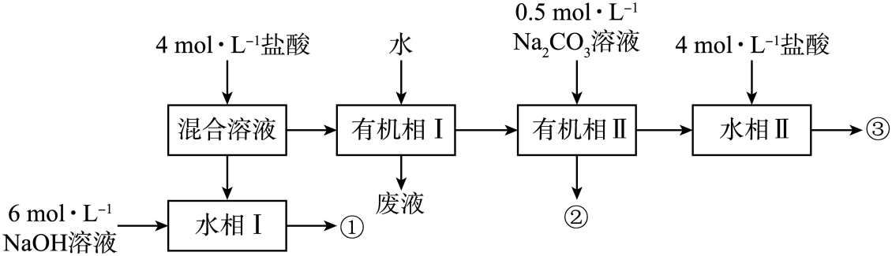

# Chemistry - 题目 146

**ID**: 5a80c238a3f74cc1a2039b852f440ee8
**年级**: Grade 12
**难度**: Medium-Hard
**题型**: Multiple-choice

## 题目
已知苯胺(液体)、苯甲酸(固体)微溶于水，苯胺盐酸盐易溶于水。​​​​​​​‌实验室初步分离甲苯、苯胺、苯甲酸混合溶液的流程如下。下列说法正确的是（      ）

## 解答

1. A．苯胺分子中含有的氨基能与盐酸反应，但不能与氢氧化钠溶液反应，故A错误；
2. B．由分析可知，得到苯胺粗品①的分离方法为分液，得到苯甲酸粗品③的分离方法为结晶或重结晶、过滤、洗涤，获取两者的操作方法不同，故B错误；
3. C．由分析可知，苯胺粗品、甲苯粗品、苯甲酸粗品依次由①、②、③获得，故C正确；
4. D．由分析可知，①、②为液相，③为固相，都不是两相混合体系，故D错误；
5. 故选C。

## 知识点

**中文**:
  - 有机物分离提纯的综合应用

**English**:
  - Separation and Purification of Organic Compounds

---
