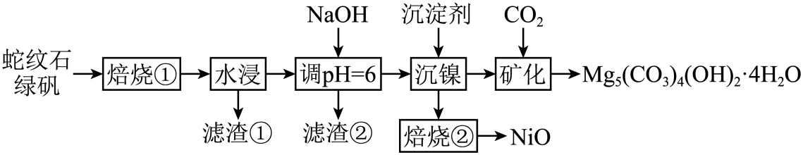
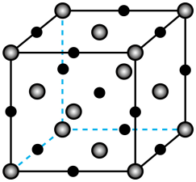

# Chemistry - 题目 71

**ID**: 68bbd6480a13464fa6ad158cd4b7a1fd
**年级**: Grade 12
**难度**: Medium-Hard
**题型**: 非选择题

## 题目
我国的蛇纹石资源十分丰富，它的主要成分是 ${\rm{M}}{\rm{g}}{{}_{{{3}}}}{\rm{S}}{\rm{i}}{{}_{{{2}}}}{\rm{O}}{{}_{{{5}}}}{\rm{(}}{\rm{O}}{\rm{H}}{\rm{)}}{{}_{{{4}}}}$ ，伴生有少量 ${\rm{N}}{\rm{i}}$ 、 ${\rm{F}}{\rm{e}}$ 、 ${\rm{A}}{\rm{l}}$ 等元素。​​​​​​​‌利用蛇纹石转化与绿矾分解的耦合回收 ${\rm{N}}{\rm{i}}{\rm{O}}$ 并矿化固定二氧化碳的实验流程如图所示。已知：${\rm{A}}{\rm{l}}{\rm{(}}{\rm{O}}{\rm{H}}{\rm{)}}{{}_{{{3}}}}$${\rm{F}}{\rm{e}}{\rm{(}}{\rm{O}}{\rm{H}}{\rm{)}}{{}_{{{3}}}}$${\rm{M}}{\rm{g}}{\rm{(}}{\rm{O}}{\rm{H}}{\rm{)}}{{}_{{{2}}}}$${\rm{N}}{\rm{i}}{\rm{(}}{\rm{O}}{\rm{H}}{\rm{)}}{{}_{{{2}}}}$${\rm{K}}{{}_{{\rm{s}}{\rm{p}}}}$${{1}}{{.}}{{3}}\times {{1}}{{0}}{^{{{-}}{{3}}{{3}}}}$${{2}}{{.}}{{8}}\times {{1}}{{0}}{^{{{-}}{{3}}{{9}}}}$${{5}}{{.}}{{6}}\times {{1}}{{0}}{^{{{-}}{{1}}{{2}}}}$${{5}}{{.}}{{5}}\times {{1}}{{0}}{^{{{-}}{{1}}{{6}}}}$回答下列问题：(1)绿矾( ${\rm{F}}{\rm{e}}{\rm{S}}{\rm{O}}{{}_{{{4}}}}\cdot {{7}}{\rm{H}}{{}_{{{2}}}}{\rm{O}}$ )在高温下分解，得到红棕色固体和气体产物，反应的化学方程式为。(2)经“焙烧①”“水浸”，过滤分离后，滤液中金属离子的浓度( ${\rm{m}}{\rm{o}}{\rm{l}}\cdot {\rm{L}}{^{{{-}}{{1}}}}$ )分别为： ${\rm{N}}{\rm{i}}{^{{{2}}{{+}}}}{{0}}{{.}}{{0}}{{0}}{{5}}$ 、 ${\rm{F}}{\rm{e}}{^{{{3}}{{+}}}}{{0}}{{.}}{{1}}{{5}}{{0}}$ 、 ${\rm{M}}{\rm{g}}{^{{{2}}{{+}}}}{{0}}{{.}}{{4}}{{3}}{{0}}$ 、 ${\rm{A}}{\rm{l}}{^{{{3}}{{+}}}}{{0}}{{.}}{{0}}{{1}}{{0}}$ 。滤渣①的主要成分是、。(3)加入 ${\rm{N}}{\rm{a}}{\rm{O}}{\rm{H}}$  “调 ${\rm{p}}{\rm{H}}{\rm{=}}{{6}}$ ”，过滤后，滤渣②是、，滤液中 ${\rm{A}}{\rm{l}}{^{{{3}}{{+}}}}$ 的浓度为${\rm{m}}{\rm{o}}{\rm{l}}\cdot {\rm{L}}{^{{{-}}{{1}}}}$ 。(4)“焙烧②”后得到 ${\rm{N}}{\rm{i}}{\rm{O}}$ 。 ${\rm{N}}{\rm{i}}{\rm{O}}$ 晶胞如图所示，晶胞中含有 ${\rm{N}}{\rm{i}}{^{{{2}}{{+}}}}$ 的个数为。(5)调节“沉镍”后的溶液为碱性，“矿化”反应的离子方程式为。(6) ${{1}}{{.}}{{0}}{\rm{k}}{\rm{g}}$ 蛇纹石“矿化”固定 ${\rm{C}}{\rm{O}}{{}_{{{2}}}}$ ，得到 ${{0}}{{.}}{{4}}{{6}}{{6}}{\rm{k}}{\rm{g}}{\rm{\;}}{\rm{M}}{\rm{g}}{{}_{{{5}}}}\left ({{\rm{C}}{\rm{O}}{{}_{{{3}}}}}\right ){{}_{{{4}}}}{\rm{(}}{\rm{O}}{\rm{H}}{\rm{)}}{{}_{{{2}}}}\cdot {{4}}{\rm{H}}{{}_{{{2}}}}{\rm{O}}$ ，相当于固定 ${\rm{C}}{\rm{O}}{{}_{{{2}}}}$L(标准状况)。

## 解答

1. （1）绿矾( ${\rm{F}}{\rm{e}}{\rm{S}}{\rm{O}}{{}_{{{4}}}}\cdot {{7}}{\rm{H}}{{}_{{{2}}}}{\rm{O}}$ )在高温下分解，得到红棕色固体 ${\rm{F}}{\rm{e}}{{}_{2}}{\rm{O}}{{}_{3}}$ 和气体产物三氧化硫、二氧化硫，反应的化学方程式为 ${{2}}{\rm{F}}{\rm{e}}{\rm{S}}{\rm{O}}{{}_{{{4}}}}\cdot {{7}}{\rm{H}}{{}_{{{2}}}}{\rm{O}}\hspace{-0.5em}\begin{array}{}{\underline{{\underline{~~高温~~}}}}\atop{}\end{array}\hspace{-0.5em}{\rm{F}}{\rm{e}}{{}_{{{2}}}}{\rm{O}}{{}_{{{3}}}}{{+}}{\rm{S}}{\rm{O}}{{}_{{{2}}}}\uparrow {{+}}{\rm{S}}{\rm{O}}{{}_{{{3}}}}\uparrow {{+}}{{1}}{{4}}{\rm{H}}{{}_{{{2}}}}{\rm{O}}\uparrow $ ，故答案为： ${{2}}{\rm{F}}{\rm{e}}{\rm{S}}{\rm{O}}{{}_{{{4}}}}\cdot {{7}}{\rm{H}}{{}_{{{2}}}}{\rm{O}}\hspace{-0.5em}\begin{array}{}{\underline{{\underline{~~高温~~}}}}\atop{}\end{array}\hspace{-0.5em}{\rm{F}}{\rm{e}}{{}_{{{2}}}}{\rm{O}}{{}_{{{3}}}}{{+}}{\rm{S}}{\rm{O}}{{}_{{{2}}}}\uparrow {{+}}{\rm{S}}{\rm{O}}{{}_{{{3}}}}\uparrow {{+}}{{1}}{{4}}{\rm{H}}{{}_{{{2}}}}{\rm{O}}\uparrow $ ；
2. （2） ${\rm{M}}{\rm{g}}{{}_{{{3}}}}{\rm{S}}{\rm{i}}{{}_{{{2}}}}{\rm{O}}{{}_{{{5}}}}{\rm{(}}{\rm{O}}{\rm{H}}{\rm{)}}{{}_{{{4}}}}$ 经“焙烧①”，生成氧化镁、二氧化硅、水； ${\rm{F}}{\rm{e}}{\rm{S}}{\rm{O}}{{}_{{{4}}}}\cdot {{7}}{\rm{H}}{{}_{{{2}}}}{\rm{O}}$ 分解生成 ${\rm{F}}{\rm{e}}{{}_{2}}{\rm{O}}{{}_{3}}$ 、二氧化硫、三氧化硫， “水浸”，过滤分离后，滤渣①的主要成分是为 ${\rm{F}}{\rm{e}}{{}_{2}}{\rm{O}}{{}_{3}}$ 、 ${\rm{S}}{\rm{i}}{\rm{O}}{{}_{{{2}}}}$ ，故答案为： ${\rm{F}}{\rm{e}}{{}_{2}}{\rm{O}}{{}_{3}}$ ； ${\rm{S}}{\rm{i}}{\rm{O}}{{}_{{{2}}}}$ ；
3. （3）加入 ${\rm{N}}{\rm{a}}{\rm{O}}{\rm{H}}$  “调 ${\rm{p}}{\rm{H}}{\rm{=}}{{6}}$ ”， $c({\rm{H}}{^{{{+}}}})=10{^{-6}}{\rm{m}}{\rm{o}}{\rm{l}}{\rm{/}}{\rm{L}}$ ， $c({\rm{O}}{\rm{H}}{^{{{-}}}})=10{^{-8}}{\rm{m}}{\rm{o}}{\rm{l}}{\rm{/}}{\rm{L}}$ ， $c({\rm{F}}{\rm{e}}{^{{{3}}{{+}}}})=\frac {K{{}_{{\rm{s}}{\rm{p}}}}[{\rm{F}}{\rm{e}}{\rm{(}}{\rm{O}}{\rm{H}}{\rm{)}}{{}_{{{3}}}}]}{c{^{3}}({\rm{O}}{\rm{H}}{^{-}})}=\frac {2.8\times 10{^{-39}}}{(1\times 10{^{-8}}){^{3}}}=2.8\times 10{^{-15}}{\rm{m}}{\rm{o}}{\rm{l}}{\rm{/}}{\rm{L}}{\rm{<}}{{1}}\times 10{^{-5}}{\rm{m}}{\rm{o}}{\rm{l}}{\rm{/}}{\rm{L}}$ ， $c({\rm{A}}{\rm{l}}{^{{{3}}{{+}}}})=\frac {K{{}_{{\rm{s}}{\rm{p}}}}[{\rm{A}}{\rm{l}}{\rm{(}}{\rm{O}}{\rm{H}}{\rm{)}}{{}_{{{3}}}}]}{c{^{3}}({\rm{O}}{\rm{H}}{^{-}})}=\frac {1.3\times 10{^{-33}}}{(1\times 10{^{-8}}){^{3}}}=1.3\times 10{^{-9}}{\rm{m}}{\rm{o}}{\rm{l}}{\rm{/}}{\rm{L}}{\rm{<}}{{1}}\times 10{^{-5}}{\rm{m}}{\rm{o}}{\rm{l}}{\rm{/}}{\rm{L}}$ ，溶液中没有铁离子、氯离子，两者均以氢氧化物沉淀下来，过滤后，滤渣②是为 ${\rm{F}}{\rm{e}}{\rm{(}}{\rm{O}}{\rm{H}}{\rm{)}}{{}_{{{3}}}}$ 、 ${\rm{A}}{\rm{l}}{\rm{(}}{\rm{O}}{\rm{H}}{\rm{)}}{{}_{{{3}}}}$ ；滤液中 ${\rm{A}}{\rm{l}}{^{{{3}}{{+}}}}$ 的浓度为 $c({\rm{A}}{\rm{l}}{^{{{3}}{{+}}}})=\frac {K{{}_{{\rm{s}}{\rm{p}}}}[{\rm{A}}{\rm{l}}{\rm{(}}{\rm{O}}{\rm{H}}{\rm{)}}{{}_{{{3}}}}]}{c{^{3}}({\rm{O}}{\rm{H}}{^{-}})}=\frac {1.3\times 10{^{-33}}}{(1\times 10{^{-8}}){^{3}}}=1.3\times 10{^{-9}}{\rm{m}}{\rm{o}}{\rm{l}}{\rm{/}}{\rm{L}}$ ，故答案为： ${\rm{F}}{\rm{e}}{\rm{(}}{\rm{O}}{\rm{H}}{\rm{)}}{{}_{{{3}}}}$ ； ${\rm{A}}{\rm{l}}{\rm{(}}{\rm{O}}{\rm{H}}{\rm{)}}{{}_{{{3}}}}$ ； $1.3\times 10{^{-9}}$ ；
4. （4）因为离子半径 ${\rm{N}}{\rm{i}}{^{{{2}}{{+}}}}>{\rm{O}}{^{{{2}}{{-}}}}$ ， ${\rm{N}}{\rm{i}}{\rm{O}}$ 晶胞图中 ${\rm{N}}{\rm{i}}{^{{{2}}{{+}}}}$ 位于8个顶点，6个面心，1个晶胞中 ${\rm{N}}{\rm{i}}{^{{{2}}{{+}}}}$ 的个数为 $8\times \frac {1}{8}+6\times \frac {1}{2}=4$ ，故答案为：4；
5. （5）调节“沉镍”后的溶液为碱性，通入二氧化碳“矿化”发生反应 ${{5}}{\rm{M}}{\rm{g}}{^{{{2}}{{+}}}}{{+}}{{1}}{{0}}{\rm{O}}{\rm{H}}{^{{{-}}}}{{+}}{{4}}{\rm{C}}{\rm{O}}{{}_{{{2}}}}{\rm{=}}{\rm{M}}{\rm{g}}{{}_{{{5}}}}\left ({{\rm{C}}{\rm{O}}{{}_{{{3}}}}}\right ){{}_{{{4}}}}{\rm{(}}{\rm{O}}{\rm{H}}{\rm{)}}{{}_{{{2}}}}\cdot {{4}}{\rm{H}}{{}_{{{2}}}}{\rm{O}}\downarrow $  ，故答案为： ${{5}}{\rm{M}}{\rm{g}}{^{{{2}}{{+}}}}{{+}}{{1}}{{0}}{\rm{O}}{\rm{H}}{^{{{-}}}}{{+}}{{4}}{\rm{C}}{\rm{O}}{{}_{{{2}}}}{\rm{=}}{\rm{M}}{\rm{g}}{{}_{{{5}}}}\left ({{\rm{C}}{\rm{O}}{{}_{{{3}}}}}\right ){{}_{{{4}}}}{\rm{(}}{\rm{O}}{\rm{H}}{\rm{)}}{{}_{{{2}}}}\cdot {{4}}{\rm{H}}{{}_{{{2}}}}{\rm{O}}\downarrow $ ；
6. （6） ${{0}}{{.}}{{4}}{{6}}{{6}}{\rm{k}}{\rm{g}}{\rm{\;}}{\rm{M}}{\rm{g}}{{}_{{{5}}}}\left ({{\rm{C}}{\rm{O}}{{}_{{{3}}}}}\right ){{}_{{{4}}}}{\rm{(}}{\rm{O}}{\rm{H}}{\rm{)}}{{}_{{{2}}}}\cdot {{4}}{\rm{H}}{{}_{{{2}}}}{\rm{O}}$ 物质的量为 $\frac {{{0}}{{.}}{{4}}{{6}}{{6}}\times {{1}}{{0}}{^{{{3}}}}{\rm{g}}}{{{4}}{{6}}{{6}}{\rm{g}}{\rm{/}}{\rm{m}}{\rm{o}}{\rm{l}}}=1{\rm{m}}{\rm{o}}{\rm{l}}$ ，根据C原子守恒 ${\rm{M}}{\rm{g}}{{}_{{{5}}}}\left ({{\rm{C}}{\rm{O}}{{}_{{{3}}}}}\right ){{}_{{{4}}}}{\rm{(}}{\rm{O}}{\rm{H}}{\rm{)}}{{}_{{{2}}}}\cdot {{4}}{\rm{H}}{{}_{{{2}}}}{\rm{O}}\sim {{4}}{\rm{C}}\sim {{4}}{\rm{C}}{\rm{O}}{{}_{2}}$ ，固定 ${\rm{C}}{\rm{O}}{{}_{{{2}}}}$ 为 $4{\rm{m}}{\rm{o}}{\rm{l}}$ ，标准状况下的体积为 $4{\rm{m}}{\rm{o}}{\rm{l}}\times 22.4{\rm{L}}{\rm{/}}{\rm{m}}{\rm{o}}{\rm{l}}{\rm{=}}{{8}}{{9}}{{.}}{{6}}{\rm{L}}$ ，故答案为：89.6。

## 知识点

**中文**:
  - 根据晶胞结构确定粒子数目和化学式
  - 陌生氧化还原反应方程式的书写

**English**:
  - Determining Particle Number and Formula
  - Writing Equations for Unfamiliar Redox Reactions

---
