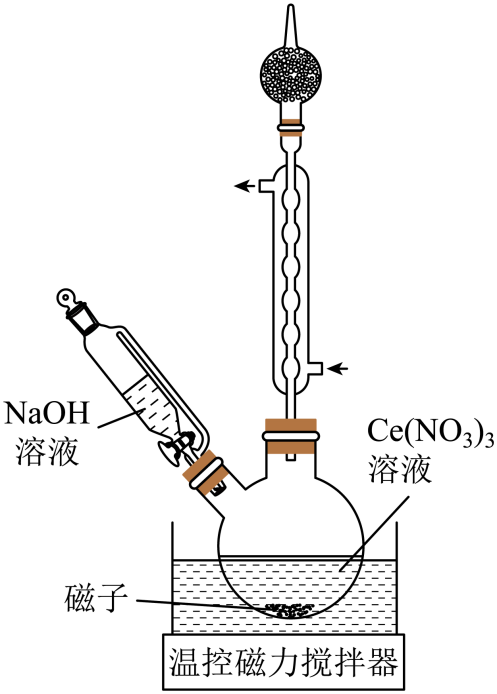

# Chemistry - 题目 352

**ID**: 72cd1b75c9804df0ba31e161bc470cb9
**年级**: Grade 12
**难度**: Medium-Hard
**题型**: 非选择题

## 题目
CeO_{2}是一种稀土氧化物，在催化剂、电化学、光学等方面都有重要应用。​​​​​​​‌CeO_{2}是淡黄色固体粉末，难溶于水，熔点为2600℃。请回答下列问题：(一)制备CeO_{2}I.取一定量化学计量比的Ce(NO_{3})_{3}·6H_{2}O和NaOH分别溶解在5mL和35mL的去离子水中，分别磁力搅拌30min后，再将两种液体混合，继续磁力搅拌30min，形成白色絮状沉淀[Ce(OH)_{3}]。将混合溶液加热(并通入O_{2})，在一定温度下反应一段时间。通过离心方法将Ce(OH)_{4}沉淀分离出来。II.用水和无水乙醇分别洗涤Ce(OH)_{4}沉淀3次。III.将洗涤后的样品转入干燥炉中，在60°C下干燥24h，得到淡黄色粉末CeO_{2}。(1)盛放NaOH溶液的仪器名称为，无水乙醇的作用是。(2)写出由Ce(OH)_{3}和O_{2}反应制备Ce(OH)_{4}的化学方程式：。(二)某样品中CeO_{2}[M(CeO_{2})=172.1]纯度的测定称取mg样品置于锥形瓶中，加入50mL水及20mL浓硫酸，分批加入H_{2}O_{2}溶液，每次5mL，摇匀，低温加热，直至样品完全溶解。加热除尽锥形瓶中的H_{2}O_{2}，冷却后稀释至250mL，加入5mL10g·L^{-1}AgNO_{3}溶液催化，再加入过量的过硫酸铵[(NH_{4})_{2}S_{2}O_{8}]溶液，低温加热，将Ce^{3+}氧化成Ce^{4+}，当锥形瓶中无气泡冒出，再煮沸2min。待冷却后，加入5滴邻二氮菲-亚铁指示液，用(NH_{4})_{2}Fe(SO_{4})_{2}标准溶液滴定至终点，消耗cmol·L^{-1}的(NH_{4})_{2}Fe(SO_{4})_{2}标准溶液VmL。已知邻二氮菲与Fe^{2+}可形成红色配合物，这种离子可示表为[Fe(phen)_{3}]^{2+}。(3)实验中分批加入H_{2}O_{2}溶液时，采取低温加热的原因是。(4)加热煮沸过程中，(NH_{4})_{2}S_{2}O_{8}在溶液中反应生成NH_{4}HSO_{4}和O_{2}，反应的化学方程式为；若滴定时锥形瓶中过量的(NH_{4})_{2}S_{2}O_{8}未除尽，则测得的CeO_{2}纯度(填“偏高”、“偏低”或“无影响”)；判断滴定终点的方法是。(5)样品中CeO_{2}的质量分数w=(用含有c、V、m的代数式表示)。(6)CeO_{2}是汽车尾气净化催化剂的关键成分，它能在还原气氛中供氧，在氧化气氛中耗氧。在尾气消除过程中发生着CeO_{2}→ CeO_{2(1-x)}+xO_{2}↑(0≤x≤0.25)的循环。请写出CeO_{2}消除CO尾气的化学方程式：。

## 解答

1. （1）由仪器构造可知该仪器为恒压漏斗；乙醇与水混溶且乙醇易挥发，用乙醇可以除去沉淀表面多余的水分，使沉淀快速干燥，故答案为：恒压漏斗；除去沉淀表面多余的水分，使沉淀快速干燥；
2. （2）Ce(OH)_{3}与O_{2}反应生成4Ce(OH)_{4}，反应方程式为：4Ce(OH)_{3}+ O_{2}+2H_{2}O= 4Ce(OH)_{4}，故答案为：4Ce(OH)_{3}+ O_{2}+2H_{2}O= 4Ce(OH)_{4}；
3. （3）温度过低时反应速率太慢，温度过高时H_{2}O_{2}不稳定受热易分解，都不利于反应进行，因此采用低温加热，故答案为：温度低，反应速率慢，温度高，H_{2}O_{2}会分解；
4. （4）加热煮沸过程中，(NH_{4})_{2}S_{2}O_{8}在溶液中反应生成NH_{4}HSO_{4}和O_{2}，反应方程式为：2(NH_{4})_{2}S_{2}O_{8}+2H_{2}O4NH_{4}HSO_{4}+O_{2}↑，若滴定时锥形瓶中过量的(NH_{4})_{2}S_{2}O_{8}未除尽，则(NH_{4})_{2}Fe(SO_{4})_{2}标准溶液用量偏高，则还原Ce^{4+}的用量偏高，最终测得的CeO_{2}纯度偏高；判断滴定终点的方法是滴加最后一滴(或半滴)(NH_{4})_{2}Fe(SO_{4})_{2}标准溶液时，溶液颜色变为红色，且半分钟内不褪色，故答案为：2(NH_{4})_{2}S_{2}O_{8}+2H_{2}O4NH_{4}HSO_{4}+O_{2}↑；偏高；滴加最后一滴(或半滴)(NH_{4})_{2}Fe(SO_{4})_{2}标准溶液时，溶液颜色变为红色，且半分钟内不褪色；
5. （5）根据得失电子守恒知：，故样品中的质量分数=，故答案为：；
6. （6）能在还原气氛中供氧，CO为还原气体，结合氧生成二氧化碳，根据信息知，化学方程式为：2xCO+CeO_{2}=CeO_{2(1- x)}+2xCO_{2}，故答案为：2xCO+CeO_{2}=CeO_{2(1- x)}+2xCO_{2}；

## 知识点

**中文**:
  - 酸碱中和滴定的拓展应用
  - 陌生氧化还原反应方程式的书写

**English**:
  - Extended Applications of Titration
  - Writing Equations for Unfamiliar Redox Reactions

---
